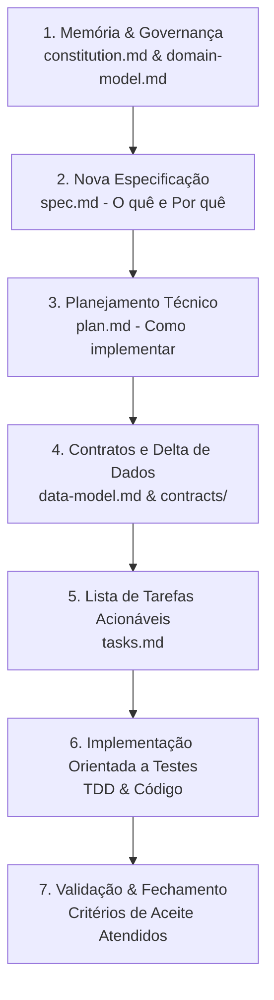

# Metodologia SDD — Spec-Driven Development

Este diretório contém a estrutura de artefatos da metodologia **Spec-Driven Development (SDD)** (Desenvolvimento Orientado a Especificação). O objetivo do SDD é garantir que **nenhuma linha de código de produção seja escrita sem uma especificação prévia, validada e rastreável**.

---

## 📁 Estrutura de Pastas e Convenção

```text
.specify/
├── README.md                           # Guia e fluxo da metodologia SDD
├── memory/                             # Memória persistente e contexto global do projeto
│   ├── constitution.md                 # Princípios, padrões arquiteturais e regras inegociáveis
│   └── domain-model.md                 # Modelo conceitual (DER) + glossário/linguagem ubíqua
└── specs/                              # Pacotes incrementais de especificação (por funcionalidade)
    └── _template/                      # Modelo base para criar novas especificações (ex: 001-nome-da-funcionalidade)
        ├── spec.md                     # O quê e por quê (requisitos, regras e critérios de aceite)
        ├── plan.md                     # Como (arquitetura, plano técnico e decisões)
        ├── data-model.md               # Delta do modelo de dados (o que é criado/alterado)
        ├── contracts/                  # Contratos de API e interfaces (OpenAPI, Schemas)
        │   ├── README.md
        │   └── api-contract.yaml
        └── tasks.md                    # Checklist acionável de implementação e validação
```

---

## 🔄 Fluxo de Trabalho SDD (Passo a Passo)



### 1. Memória do Projeto (`memory/`)
- **`constitution.md`**: Define as regras do jogo. Padrões de código, arquitetura, segurança (LGPD), pirâmide de testes e governança.
- **`domain-model.md`**: Alinha o vocabulário (Linguagem Ubíqua) e o modelo conceitual de entidades (DER conceitual) entre todos os membros e partes interessadas.

### 2. Ciclo de Vida de uma Spec (`specs/XXX-nome-da-funcionalidade/`)
Cada funcionalidade recebe uma pasta numerada sequencialmente (`001-...`, `002-...`):
1. **`spec.md` (`o quê`)**: Requisitos funcionais, regras de negócio, histórias de usuário e critérios de aceite em formato BDD (Dado/Quando/Então).
2. **`plan.md` (`como`)**: Escolhas técnicas, padrões arquiteturais, diagramas de sequência, segurança e estratégia de testes.
3. **`data-model.md` (`delta`)**: Especifica exatamente o que é criado, alterado ou excluído na camada de dados (tabelas, campos, índices e migrações).
4. **`contracts/` (`interfaces`)**: Contratos formais (OpenAPI/Swagger, JSON Schema, Protobuf) garantindo alinhamento prévio entre frontend, backend e mobile.
5. **`tasks.md` (`execução`)**: Tarefas granulares marcáveis (`[ ]` / `[x]`), rastreadas até a conclusão e validação do artefato.

---

## 📋 Como Criar uma Nova Funcionalidade

1. Copie a pasta [`.specify/specs/_template/`](specs/_template/) para uma nova pasta em `.specify/specs/` seguindo a convenção `NNN-nome-da-funcionalidade` (exemplo: `002-autenticacao-usuarios`).
2. Preencha o `spec.md` com o problema de negócio, regras e critérios de aceite.
3. Elabore o `plan.md` com a solução técnica e o `data-model.md` com as alterações no banco de dados.
4. Escreva ou atualize os contratos em `contracts/`.
5. Detalhe as tarefas em `tasks.md`.
6. Valide a especificação com a equipe/orientador antes de iniciar a codificação.
