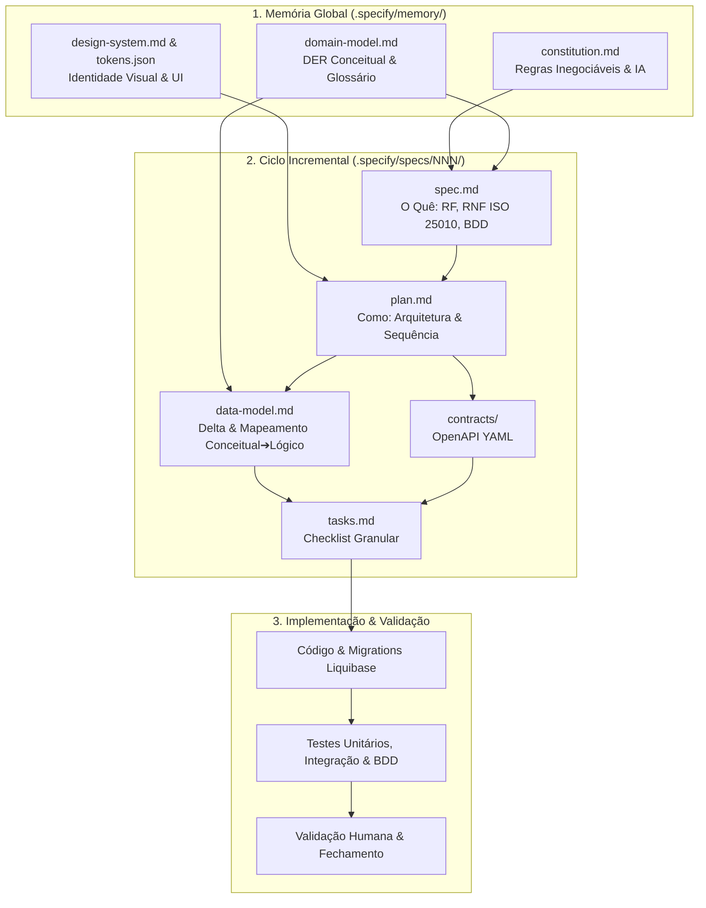

# Metodologia SDD — Spec-Driven Development (AMDE Digital)

Este diretório contém a estrutura de artefatos da metodologia **Spec-Driven Development (SDD)** (Desenvolvimento Orientado a Especificação) aplicada ao projeto **AMDE Digital — Controle de Prontuário**.

O objetivo fundamental do SDD é garantir que **nenhuma linha de código de produção seja escrita ou alterada sem uma especificação prévia, validada, consistente e rastreável**.

---

## 📁 Estrutura de Diretórios e Governança

```text
.specify/
├── README.md                           # Guia metodológico e roadmap de especificações
├── memory/                             # Memória persistente e contexto global do projeto
│   ├── constitution.md                 # Princípios inegociáveis, stack, governança e regras da IA
│   ├── domain-model.md                 # Modelo Conceitual (DER Mermaid), cardinalidades e glossário
│   └── design-system.md                # Diretrizes de UI/UX, acessibilidade (WCAG) e tokens
├── design/
│   └── tokens.json                     # Design Tokens formais (cores, tipografia, espaçamentos)
└── specs/                              # Pacotes incrementais de especificação por funcionalidade
    ├── _template/                      # Modelo base obrigatório para novas especificações
    │   ├── spec.md                     # O quê e por quê (RFs, RNFs ISO 25010, RNs e BDD)
    │   ├── plan.md                     # Como (arquitetura técnica, UI plan e metas derivadas)
    │   ├── data-model.md               # Delta do modelo de dados (Mapeamento Conceitual ➔ Lógico)
    │   ├── contracts/                  # Contratos formais OpenAPI/Swagger
    │   │   ├── README.md
    │   │   └── api-contract.yaml
    │   └── tasks.md                    # Checklist acionável de execução por fases
    ├── 001-autenticacao-e-usuarios/     # RF01, RF02, UC01-UC07, RN01-RN04
    ├── 002-gestao-de-pacientes/        # RF03, UC08-UC09, RN04
    ├── 003-prontuarios-e-anexos/       # RF04, UC10-UC13, RN05-RN10
    ├── 004-agendamentos-e-consultas/   # RF05, UC14-UC19, RN11-RN15
    ├── 005-auditoria-e-seguranca/      # RF06, UC20, RN16
    └── 006-dashboard-gerencial/        # RF07, UC21
```

---

## 🔄 Fluxo de Trabalho SDD



---

## 🗺️ Roadmap de Especificações do AMDE Digital

A reconstrução do projeto via SDD está dividida em 6 pacotes de especificação independentes e rastreáveis à monografia:

| Pacote / Spec | Requisitos e Casos de Uso | Escopo Resumido |
|---|---|---|
| **`001-autenticacao-e-usuarios`** | RF01, RF02 / UC01 a UC07 / RN01 a RN04 | Login JWT com BCrypt, CRUD de usuários, especialização em Médico/Funcionário e controle RBAC. |
| **`002-gestao-de-pacientes`** | RF03 / UC08, UC09 / RN04 | Cadastro clínico de pacientes (grau de suporte TEA 1, 2 e 3), filtros e visualização do histórico. |
| **`003-prontuarios-e-anexos`** | RF04 / UC10 a UC13 / RN05 a RN10 | Upload de laudos/exames (PDF < 10MB, UUID físico), categorização, download e substituição/versionamento. |
| **`004-agendamentos-e-consultas`** | RF05 / UC14 a UC19 / RN11 a RN15 | Agendamento clínico com validação de conflito de horário, tipos de sessão e controle de presença. |
| **`005-auditoria-e-seguranca`** | RF06 / UC20 / RN16 | Trilha de auditoria assíncrona para operações sensíveis em conformidade com LGPD e CFM nº 1.821/2007. |
| **`006-dashboard-gerencial`** | RF07 / UC21 | Painel visual com métricas de consultas, distribuição por especialidade e pacientes ativos. |

---

## 📋 Como Criar e Concluir uma Nova Spec

1. Copie o diretório [`specs/_template/`](specs/_template/) para `specs/NNN-nome-da-funcionalidade`.
2. Preencha `spec.md` com o problema, atores, histórias, RFs, RNs, BDDs e preencha a tabela de RNFs com métricas e a coluna *"Como verificar"*.
3. Execute a verificação cruzada de consistência (Seção 5.2 da Constituição):
   - Modelo Conceitual x Entidades
   - Entidades x Regras de Negócio
   - Telas x Entidades
   - Cenários BDD x Requisitos
4. Elabore `plan.md` e preencha a tabela de *Mapeamento Conceitual ➔ Materialização Lógica* em `data-model.md`.
5. Gere os contratos em `contracts/api-contract.yaml` e as tarefas em `tasks.md`.
6. Submeta para aprovação da equipe antes de qualquer codificação.
