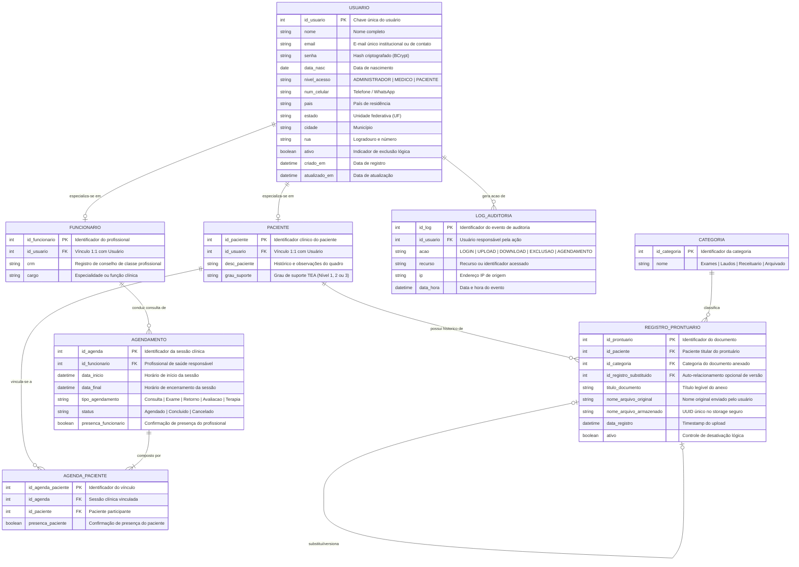

# Modelo de Domínio e Glossário: AMDE Digital

> **Projeto:** AMDE Digital — Controle de Prontuário  
> **Status:** Consolidado (Linha de Base da Monografia)  
> **Versão:** 1.0.0  
> **Data:** 2026-11-01  
> **Finalidade:** Servir como fonte única da verdade para o Modelo Conceitual (DER), Linguagem Ubíqua e Invariantes de Domínio para toda a equipe e ferramentas de IA.

---

## 1. Visão Geral do Domínio

A **Associação Amigos dos Deficientes (AMDE)** é uma Organização da Sociedade Civil (OSC) sem fins lucrativos de Sorocaba/SP, dedicada desde 2010 ao atendimento multidisciplinar e reabilitação de crianças e adolescentes com **Transtorno do Espectro Autista (TEA)** por meio do seu *Centro de Excelência em Autismo*. 

A equipe reúne profissionais de Serviço Social, Fonoaudiologia, Terapia Ocupacional, Educação Física, Pedagogia, Psicologia, Fisioterapia, Psiquiatria e Enfermagem. 

O sistema **AMDE Digital** substitui o controle manual e os registros físicos em papel por uma plataforma integrada de:
1. **Gestão de Usuários e Controle de Acesso:** Baseado em perfis (`ADMINISTRADOR`, `FUNCIONARIO`/`MEDICO` e `PACIENTE`).
2. **Prontuário Eletrônico do Paciente (PEP):** Em conformidade com a Resolução CFM nº 1.821/2007 e LGPD (Lei nº 13.709/2018), com upload e visualização de documentos digitais (laudos, exames, receitas) categorizados e auditados.
3. **Gestão de Agendamentos e Presença:** Organização de horários clínicos dos profissionais, vinculação de pacientes a consultas e controle individual de comparecimento.
4. **Auditoria e Rastreabilidade:** Trilha estrita de logs para leitura e manipulação de informações clínicas confidenciais.

---

## 2. Modelo Conceitual de Dados (DER em Mermaid)

---

## 3. Legenda das Cardinalidades em Português

Para uso nas reuniões com os gestores e profissionais da AMDE:

| Símbolo | Notação Técnica | Leitura em Linguagem Natural | Exemplo Prático no Domínio da AMDE |
|---|---|---|---|
| `\|\|` | `1..1` | **Exatamente um** | Todo `PACIENTE` está vinculado a **exatamente um** `USUARIO`. |
| `\|o` ou `o\|` | `0..1` | **Zero ou um** (opcional) | Um `USUARIO` pode ser especializado em **zero ou um** `FUNCIONARIO`. Um documento pode substituir **zero ou um** prontuário anterior. |
| `\|{` | `1..n` | **Um ou mais** (obrigatório múltiplo) | Todo `AGENDAMENTO` deve possuir **um ou mais** registros na associativa `AGENDA_PACIENTE`. |
| `o{` | `0..n` | **Zero ou mais** (opcional múltiplo) | Um `PACIENTE` pode ter **zero ou mais** documentos de `REGISTRO_PRONTUARIO`. |

---

## 4. Divisão de Escopo do Modelo

| Elemento / Aspecto | Onde é Definido | Por quê |
|---|---|---|
| **Entidades, Atributos Principais e Vínculos Estruturais** | `domain-model.md` (Diagrama acima) | Garante visão única e compartilhada de toda a arquitetura de dados entre frontend, backend e direção. |
| **Validação de Sobreposição de Horários de Agendamento** | `spec.md` (RN13) e Código do Serviço | Regra dinâmica e contextual dependente de consulta temporal em banco de dados (`data_inicio < data_final`). |
| **Limites de Tamanho e Extensão de Arquivo (PDF < 10MB)** | `spec.md` (RN05) e Contratos | Validação de requisição HTTP e segurança de infraestrutura. |
| **Formato e Armazenamento Físico de Arquivos em Storage** | `plan.md` e Constituição | Detalhes de infraestrutura de buckets S3 e estrutura `uploads/prontuarios/paciente-{id}/{uuid}.pdf`. |
| **Regras de Mascaramento de CPF / Dados Pessoais** | `constitution.md` e `design-system.md` | Requisito não funcional transversal de conformidade à LGPD. |

---

## 5. Questões em Aberto e Validações Pendentes com a Instituição

- [ ] **Múltiplos Pacientes no mesmo Agendamento:** A estrutura atual suporta agendamentos coletivos (oficinas ou terapias em grupo) via `AGENDA_PACIENTE`. Confirmar se o fluxo da interface deve permitir seleção múltipla de pacientes para sessões em grupo de TEA.
- [ ] **Tempo de Retenção de Prontuários (LGPD / CFM):** A Resolução CFM nº 1.821/2007 prevê prazo de guarda de 20 anos para prontuários eletrônicos. Confirmar se a AMDE exige política automática de arquivamento após inativação.
- [ ] **Tipos Adicionais de Agendamento:** Confirmar se além de Consulta, Exame, Retorno, Avaliação e Terapia haverá novos tipos institucionais (ex.: "Visita Domiciliar", "Reunião de Equipe").

---

## 6. Glossário do Projeto (Linguagem Ubíqua)

| Termo do Negócio | Nome no Código | Definição no Contexto AMDE | Termos Desaconselhados |
|---|---|---|---|
| **Usuário** | `Usuario` / `User` | Conta básica de acesso à plataforma com credenciais autenticáveis. | Cliente, Login, Pessoa genérica |
| **Funcionário / Profissional** | `Funcionario` / `Employee` | Profissional de saúde ou colaborador administrativo da AMDE vinculado a um usuário. | Prestador, Operador |
| **Paciente** | `Paciente` / `Patient` | Criança ou adolescente assistido pela AMDE com diagnóstico de TEA. | Aluno, Beneficiário, Cliente |
| **Grau de Suporte** | `grau_suporte` | Nível de suporte para Transtorno do Espectro Autista (Nível 1 - leve, Nível 2 - moderado, Nível 3 - substancial). | Gravidade, Tipo de autismo |
| **Prontuário Digital / PEP** | `RegistroProntuario` | Registro digital estruturado de documento clínico anexado em PDF (laudo, exame, receituário). | Ficha de papel, Arquivo avulso |
| **Categoria de Prontuário** | `Categoria` | Classificação do arquivo digital (Exames, Laudos, Receituário, Arquivado). | Pasta, Tipo genérico |
| **Agendamento** | `Agendamento` / `Appointment` | Compromisso clínico com data/hora de início e fim conduzido por um profissional. | Consulta simples, Sessão solta |
| **Presença** | `presenca_funcionario` / `presenca_paciente` | Confirmação de comparecimento registrada individualmente para o profissional e paciente. | Falta, Check-in informal |
| **Log de Auditoria** | `LogAuditoria` / `AuditLog` | Registro rastreável de operações sensíveis em conformidade com a LGPD e CFM. | Histórico comum, Log de erro |

---

## 7. Invariantes Globais do Domínio

1. **Unicidade de Identidade Digital:** Todo usuário possui e-mail exclusivo (`email UNIQUE`).
2. **Especialização Exclusiva:** Todo paciente e todo funcionário derivam de uma única entidade `usuario`.
3. **Formato Obrigatório de Prontuário:** Todo arquivo anexado ao prontuário é estritamente do tipo PDF com tamanho inferior a 10MB (RN05).
4. **Armazenamento Não Colidente:** O nome do arquivo físico no disco ou S3 é sempre um identificador universal único (`UUID`), preservando o nome original apenas como metadado no banco (RN07).
5. **Consistência Temporal de Agendamento:** Nenhum agendamento pode possuir data de término anterior ou igual à data de início (`data_inicio < data_final`) (RN12).
6. **Não Sobreposição de Agenda do Profissional:** Um funcionário não pode possuir mais de um agendamento conflitante no mesmo intervalo de tempo (RN13).
7. **Rastreabilidade Universal:** Operações em prontuários e agendamentos disparam obrigatoriamente gravação em log de auditoria com vínculo do usuário atuante (RN16).
