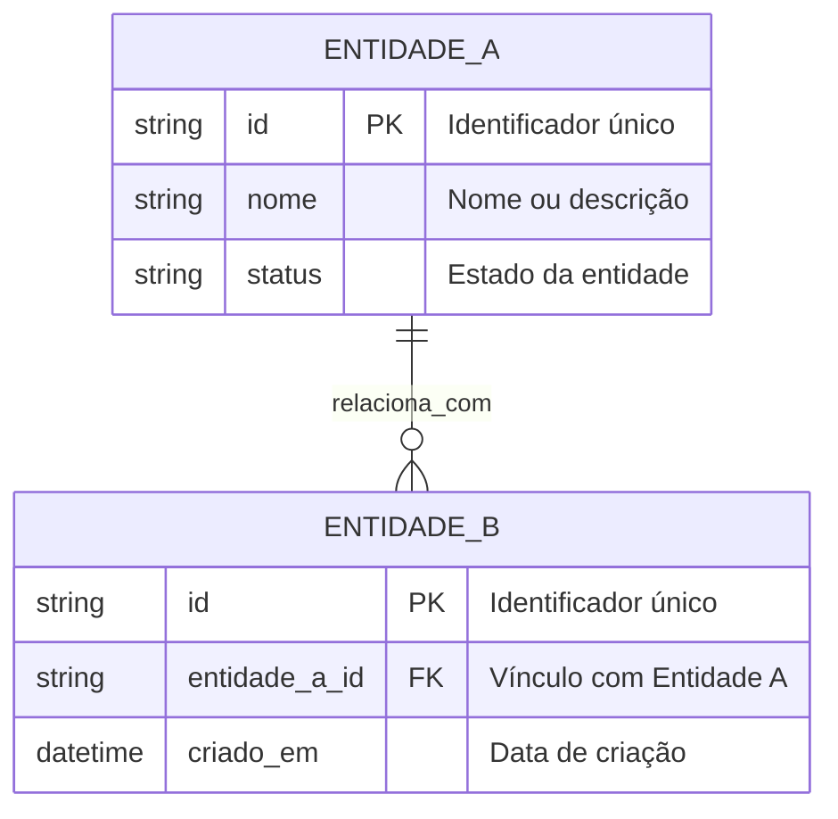

# Modelo de Domínio e Glossário do Projeto

> **Status:** Rascunho / Em Definição  
> **Versão:** 0.1.0  
> **Data:** AAAA-MM-DD  
> **Finalidade:** Servir como fonte única da verdade para o Modelo Conceitual (DER) e Glossário (Linguagem Ubíqua) do projeto.

---

## 1. Visão Geral do Domínio

[Descreva aqui o contexto geral de negócio do projeto, o problema que a solução se propõe a resolver e o escopo macro.]

---

## 2. Glossário do Projeto (Linguagem Ubíqua)

> Registre os termos oficiais adotados no domínio do sistema, evitando termos ambíguos ou sinônimos conflitantes.

| Termo do Negócio | Nome no Código (Inglês) | Significado / Definição no Projeto | Termos Desaconselhados |
|---|---|---|---|
| *[Ex: Entidade Principal]* | *[EntityName]* | *[Definição clara do papel desta entidade]* | *[Sinônimo vago ou confuso]* |
| *[Ex: Operação]* | *[OperationAction]* | *[Ação realizada no sistema]* | *[Termo inadequado]* |

---

## 3. Modelo Conceitual de Dados (DER Conceitual)

[Elabore o diagrama conceitual das entidades principais e seus relacionamentos utilizando a notação Mermaid:]

---

## 4. Invariantes Globais e Regras Fundamentais

- **[Regra 1]:** [Restrição ou regra fundamental do negócio que se aplica globalmente]
- **[Regra 2]:** [Condição obrigatória de integridade dos dados]
