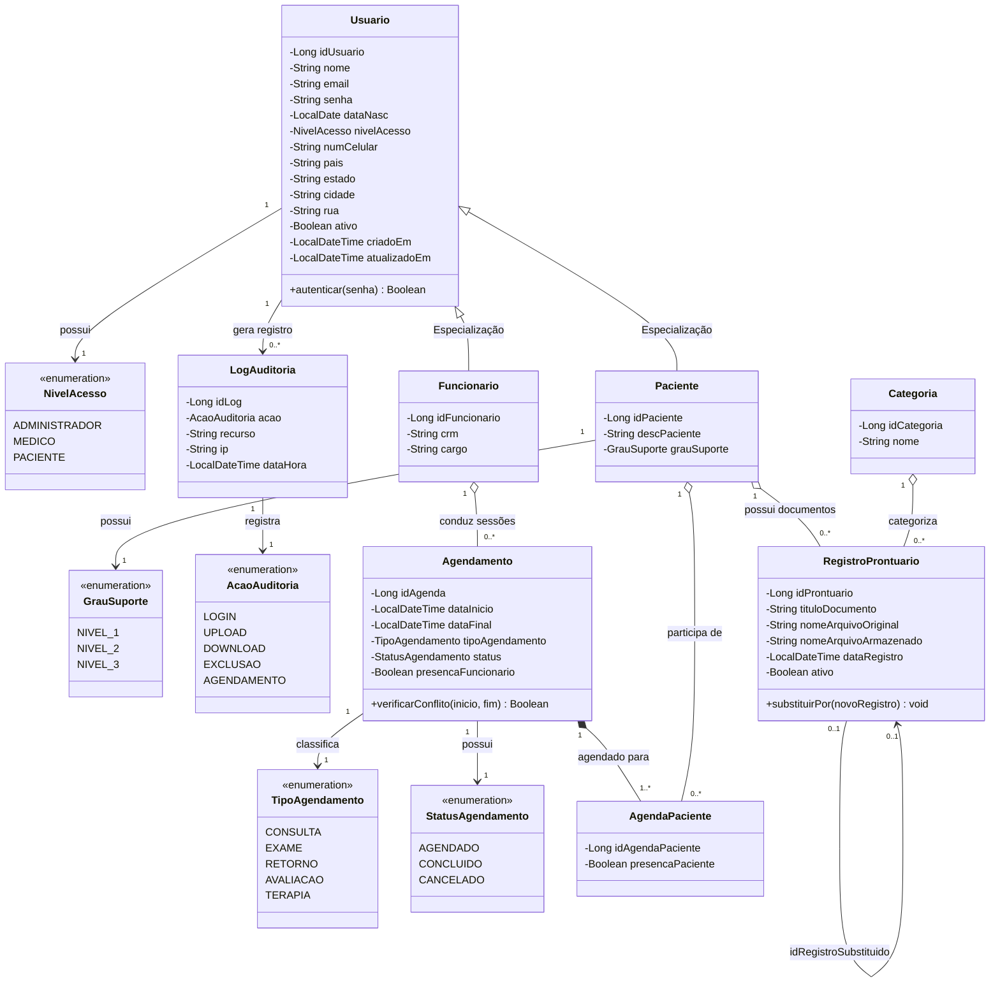

# Diagrama de Classes — AMDE Digital

> **Referência Acadêmica:** Capítulo 4.3.3 da Monografia (Figura 04)  
> **Camada de Domínio / Backend:** Java 17 com Spring Data JPA

---

### Figura – Diagrama de Classes da Camada de Domínio

    <b>Fonte:</b> Autores (Monografia AMDE Digital / Fatec Sorocaba).

 
