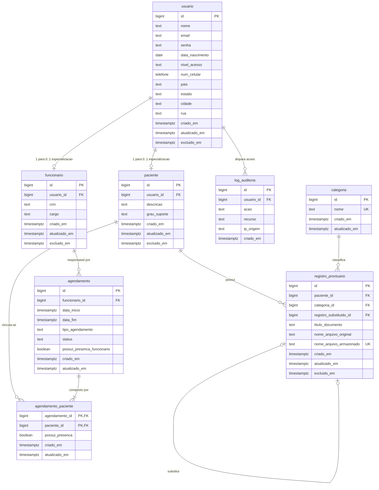

# Diagrama de Entidade-Relacionamento (DER) — AMDE Digital

> **Referência Acadêmica:** Capítulo 4.3 da Monografia  
> **Modelo Conceitual Global SDD:** [`memory/domain-model.md`](../../memory/domain-model.md)  
> **SGBD:** PostgreSQL 18 (Relacional ACID — Schema `amde_digital`)

---

### Figura – Modelo de Entidade-Relacionamento do AMDE Digital

<b>Fonte:</b> Autores (Monografia AMDE Digital / Fatec Sorocaba, adequado ao padrão PostgreSQL 18).

---

### Descrição dos Relacionamentos

1. **`usuario` ➔ `funcionario` / `paciente` ($1:0..1$):** Especialização de perfil via chave estrangeira única `usuario_id`. Cada conta de usuário pode ser associada a no máximo um registro de funcionário ou de paciente.
2. **`paciente` ➔ `registro_prontuario` ($1:N$):** Um paciente assistido possui zero ou múltiplos documentos clínicos arquivados no PEP (`paciente_id`).
3. **`categoria` ➔ `registro_prontuario` ($1:N$):** Toda ficha pertence a uma categoria pré-definida (`Exames`, `Laudos`, `Receituario`, `Arquivado`) via `categoria_id`.
4. **`registro_prontuario` ➔ `registro_prontuario` ($0..1:0..1$):** Auto-relacionamento via `registro_substituido_id` que permite versionar a substituição de documentos obsoletos.
5. **`funcionario` ➔ `agendamento` ($1:N$):** Cada compromisso na agenda clínica é conduzido por um profissional responsável (`funcionario_id`).
6. **`agendamento` ➔ `agendamento_paciente` ➔ `paciente` ($N:N$):** Tabela associativa com chave primária composta `(agendamento_id, paciente_id)` que viabiliza o vínculo de pacientes às consultas e registra o comparecimento individual (`possui_presenca`).
7. **`usuario` ➔ `log_auditoria` ($1:N$):** Trilha de auditoria imutável (*append-only*) vinculada ao usuário atuante (`usuario_id`).

