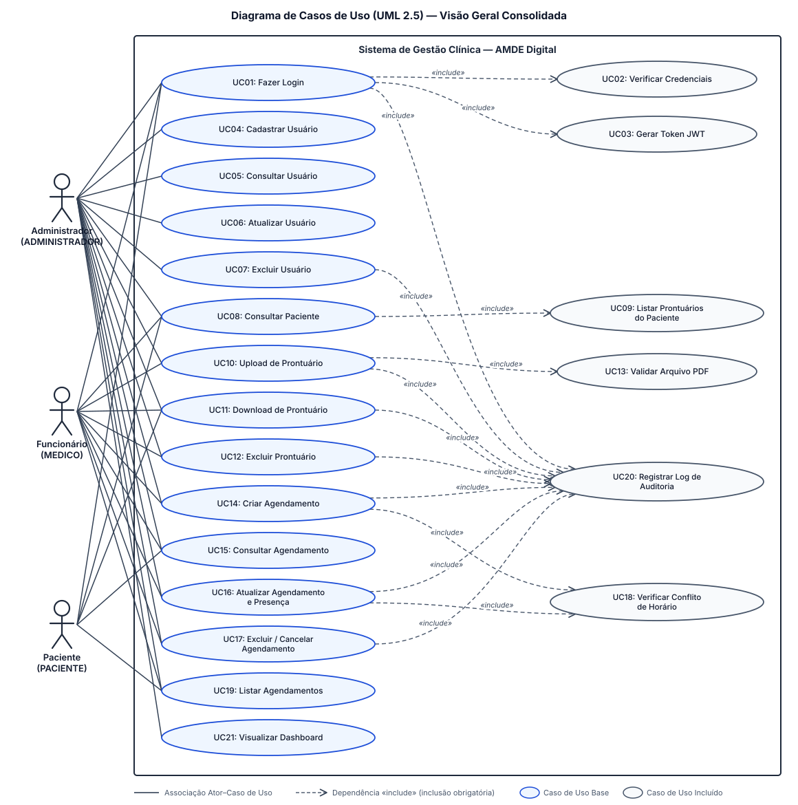
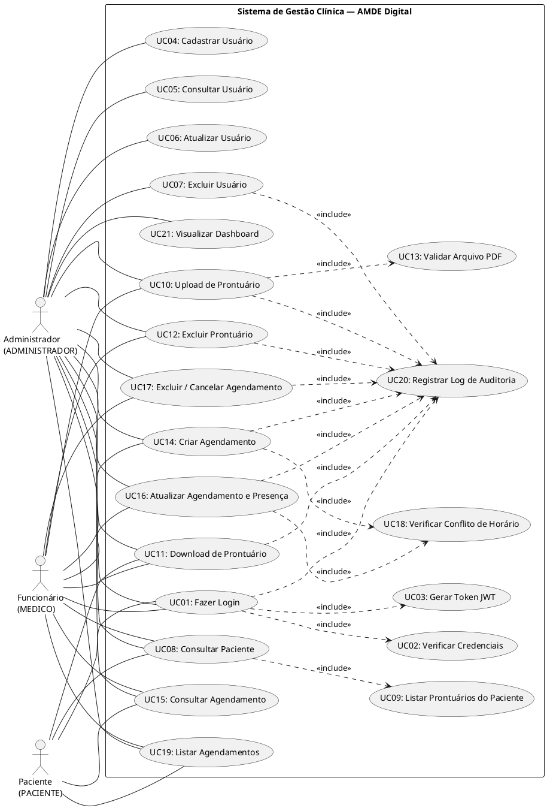
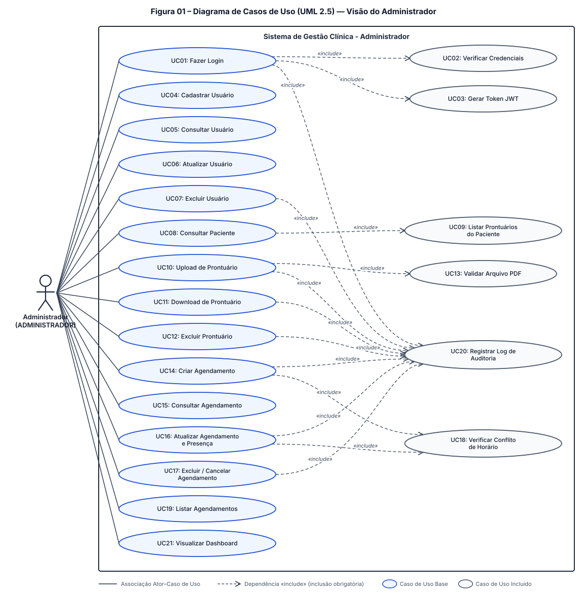
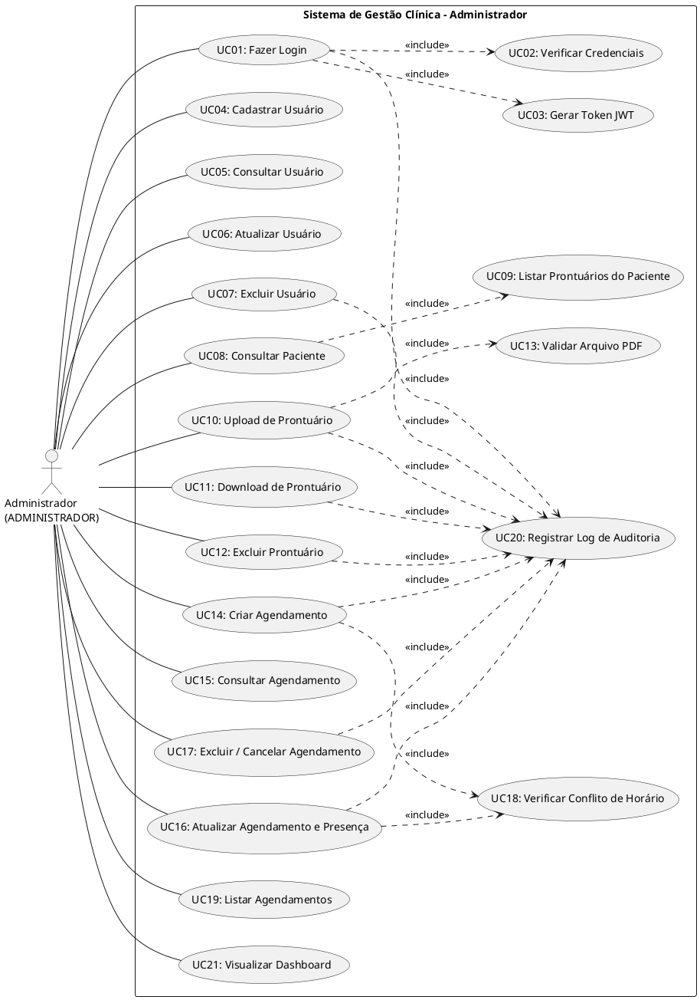
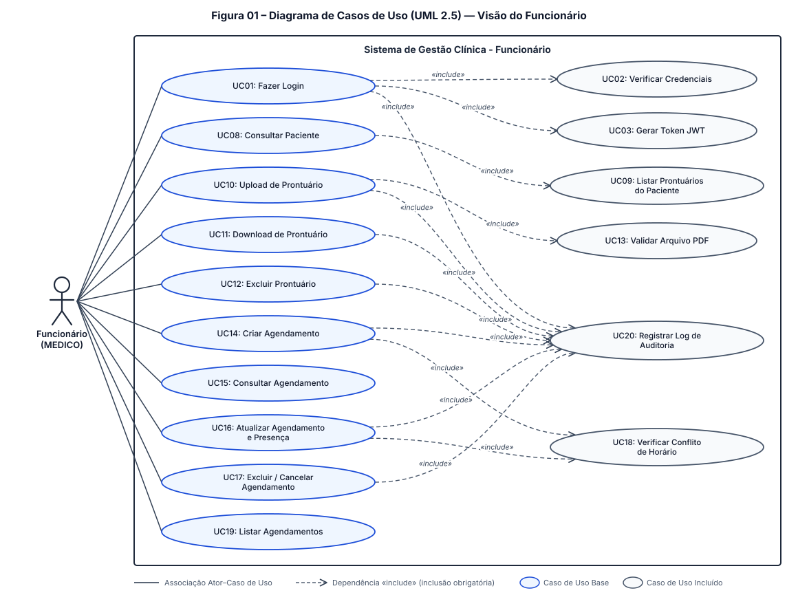
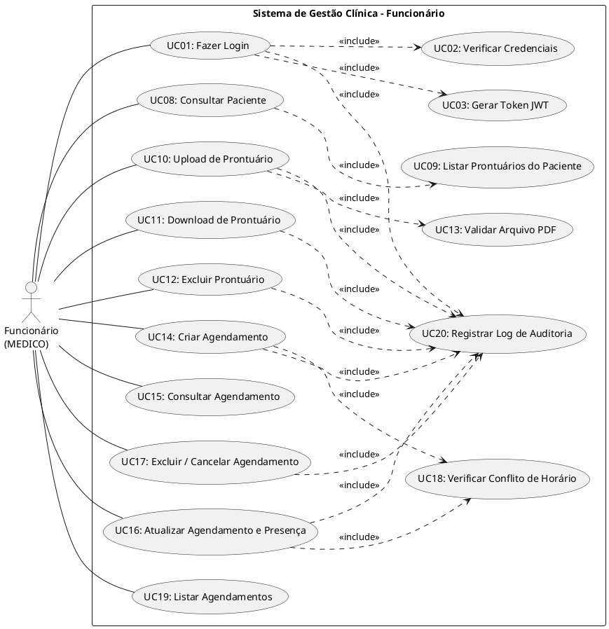
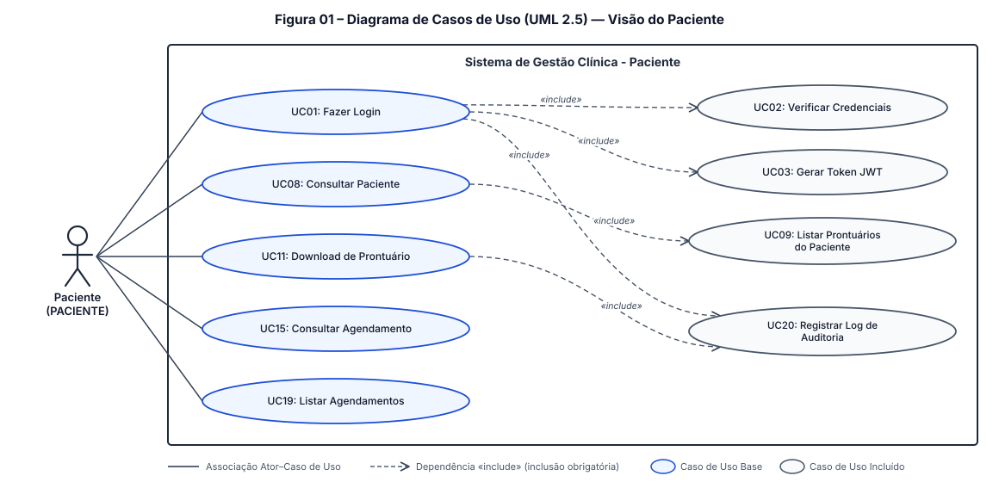
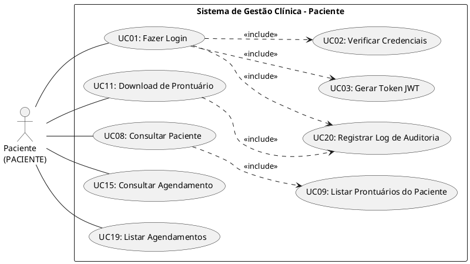

# Especificação de Casos de Uso — AMDE Digital

> **Projeto:** AMDE Digital — Controle de Prontuário  
> **Versão:** 2.0.0 *(Alinhada à Constituição v2.0.0 e ao Modelo de Domínio v2.0.0)*  
> **Data:** 2026-11-17  
> **Base Documental:** Monografia AMDE Digital (Cap. 3.4 — Figura 01 e Quadros 1 a 10, págs. 18–28) / Fatec Sorocaba  
> **Artefatos Relacionados:** [especificacao-requisitos.md](especificacao-requisitos.md) | [constitution.md](../../memory/constitution.md) | [domain-model.md](../../memory/domain-model.md) | [dicionario-de-dados.md](../data-model/dicionario-de-dados.md) | [Roadmap SDD](../../README.md)

---

## 1. Atores e Perfis de Acesso (`NivelAcesso`)

Em conformidade com a Linguagem Ubíqua definida em [`constitution.md`](../../memory/constitution.md) e [`domain-model.md`](../../memory/domain-model.md), os atores humanos do sistema correspondem aos valores do enum `NivelAcesso` persistidos na tabela `usuario`:

| Ator / Papel | Perfil (`nivel_acesso`) | Descrição e Escopo de Atuação |
|---|---|---|
| **Administrador** | `ADMINISTRADOR` | Gestor administrativo da AMDE com acesso irrestrito à gestão de usuários (`UC04`–`UC07`), consulta de pacientes e prontuários (`UC08`–`UC09`), upload/download/exclusão de documentos (`UC10`–`UC13`), gestão de agendamentos de todos os profissionais (`UC14`–`UC19`) e painel gerencial (`UC21`). |
| **Funcionário / Profissional de Saúde** | `MEDICO` | Médico ou especialista da equipe multidisciplinar (psicólogo, fonoaudiólogo, terapeuta ocupacional, fisioterapeuta, assistente social, pedagogo, educador físico, enfermeiro) — materializado na tabela `funcionario` e autorizado sob a role `MEDICO`. Realiza login (`UC01`), consulta pacientes e históricos (`UC08`–`UC09`), gerencia documentos de prontuário (`UC10`–`UC13`) e gerencia agendamentos e confirmações de presença (`UC14`–`UC19`), visualizando apenas os agendamentos vinculados a si na listagem (`RN15`). |
| **Paciente** | `PACIENTE` | Criança ou adolescente com TEA assistido pela AMDE (ou seu responsável legal), materializado na tabela `paciente`. Realiza login (`UC01`), consulta seus próprios dados e lista de prontuários (`UC08`–`UC09`), realiza download de seus documentos clínicos (`UC11`) e consulta/lista exclusivamente os seus próprios agendamentos (`UC15`, `UC19`, conforme `RN15`). |
| **Sistema** | — *(Interno)* | Processos de verificação, geração de credenciais, validação documental, checagem de agenda e auditoria assíncrona (`UC02`, `UC03`, `UC13`, `UC18`, `UC20`), disparados por inclusão (`<<include>>`) pelos casos de uso principais. |

---

## 2. Diagramas de Casos de Uso (Padrão UML 2.5)

Os diagramas abaixo seguem estritamente a notação **UML 2.5 de Casos de Uso** (atores em boneco palito externos à fronteira do sistema, retângulo de fronteira do sistema, casos de uso em elipses, linhas contínuas de associação e dependências tracejadas com estereótipo `«include»`), consolidando a Figura 01 da Monografia (págs. 18–20) harmonizada com a Constituição v2.0.0 (`UC20` transversal e `UC19` acessível aos três perfis conforme `RN15`).

### 2.1 Visão Geral Consolidada (UML 2.5)

Código PlantUML (Padrão UML 2.5)

### 2.2 Visão — Administrador (Figura 01 — Monografia pág. 19)

Código PlantUML (Padrão UML 2.5)

### 2.3 Visão — Funcionário / Profissional de Saúde (Figura 01 — Monografia pág. 18)

Código PlantUML (Padrão UML 2.5)

### 2.4 Visão — Paciente (Figura 01 — Monografia pág. 20)

Código PlantUML (Padrão UML 2.5)

---

## 3. Matriz de Rastreabilidade Geral (`UC01` a `UC21`)

| ID | Caso de Uso | Requisito Funcional | Regras de Negócio | Pacote SDD | Atores / Origem |
|---|---|---|---|---|---|
| **UC01** | Fazer Login | RF-01 | RN01, RN16 | `001-autenticacao-e-usuarios` | Paciente, Funcionário, Administrador |
| **UC02** | Verificar Credenciais (`<<include>>` de `UC01`) | RF-01 | RN01 | `001-autenticacao-e-usuarios` | Sistema (Autenticação) |
| **UC03** | Gerar Token JWT (`<<include>>` de `UC01`) | RF-01 | — | `001-autenticacao-e-usuarios` | Sistema (Autenticação) |
| **UC04** | Cadastrar Usuário | RF-02 | RN01, RN02, RN03, RN04 | `001-autenticacao-e-usuarios` | Administrador |
| **UC05** | Consultar Usuário | RF-02 | RN03, RN04 | `001-autenticacao-e-usuarios` | Administrador |
| **UC06** | Atualizar Usuário | RF-02 | RN01, RN02, RN03, RN04 | `001-autenticacao-e-usuarios` | Administrador |
| **UC07** | Excluir Usuário (Inativação Lógica) | RF-02 | RN03, RN16 | `001-autenticacao-e-usuarios` | Administrador |
| **UC08** | Consultar Paciente | RF-03 | RN04 | `002-gestao-de-pacientes` | Paciente, Funcionário, Administrador |
| **UC09** | Listar Prontuários do Paciente (`<<include>>` de `UC08`) | RF-03 | RN08 | `002-gestao-de-pacientes` | Paciente, Funcionário, Administrador |
| **UC10** | Upload de Prontuário | RF-04 | RN05, RN06, RN07, RN08, RN16 | `003-prontuarios-e-anexos` | Funcionário, Administrador |
| **UC11** | Download de Prontuário | RF-04 | RN06, RN09, RN16 | `003-prontuarios-e-anexos` | Paciente, Funcionário, Administrador |
| **UC12** | Excluir Prontuário | RF-04 | RN06, RN10, RN16 | `003-prontuarios-e-anexos` | Funcionário, Administrador |
| **UC13** | Validar Arquivo PDF (`<<include>>` de `UC10`) | RF-04 | RN05 | `003-prontuarios-e-anexos` | Sistema (Validação) |
| **UC14** | Criar Agendamento | RF-05 | RN11, RN12, RN13, RN14, RN16 | `004-agendamentos-e-consultas` | Funcionário, Administrador |
| **UC15** | Consultar Agendamento | RF-05 | RN14, RN15 | `004-agendamentos-e-consultas` | Paciente, Funcionário, Administrador |
| **UC16** | Atualizar Agendamento e Presença | RF-05 | RN12, RN13, RN14, RN16 | `004-agendamentos-e-consultas` | Funcionário, Administrador |
| **UC17** | Excluir / Cancelar Agendamento | RF-05 | RN14, RN16 | `004-agendamentos-e-consultas` | Funcionário, Administrador |
| **UC18** | Verificar Conflito de Horário (`<<include>>` de `UC14`, `UC16`) | RF-05 | RN12, RN13 | `004-agendamentos-e-consultas` | Sistema (Agenda) |
| **UC19** | Listar Agendamentos | RF-05 | RN15 | `004-agendamentos-e-consultas` | Paciente, Funcionário, Administrador |
| **UC20** | Registrar Log de Auditoria (Trilha de Auditoria) | RF-06 | RN16 | `005-auditoria-e-seguranca` | Sistema (`AuditoriaService` — disparado por `UC01`, `UC07`, `UC10`, `UC11`, `UC12`, `UC14`, `UC16`, `UC17`) |
| **UC21** | Visualizar Dashboard | RF-07 | — | `006-dashboard-gerencial` | Administrador |

---

## 4. Especificação Detalhada dos Casos de Uso (`UC01` a `UC21`)

---

### 4.1 Pacote `001-autenticacao-e-usuarios` (`RF-01`, `RF-02`)

#### UC01 — Fazer Login

| Atributo | Descrição |
|---|---|
| **ID e Nome** | `UC01` — Fazer Login |
| **Requisito Funcional** | `RF-01` — Autenticação e Controle de Acesso |
| **Regras de Negócio** | `RN01`, `RN16` |
| **Pacote SDD** | `001-autenticacao-e-usuarios` |
| **Atores** | Paciente (`PACIENTE`), Funcionário (`MEDICO`), Administrador (`ADMINISTRADOR`) |
| **Pré-Condições** | O usuário deve possuir cadastro prévio ativo (`excluido_em IS NULL`) no sistema. |
| **Pós-Condições** | O sistema autentica o usuário, concede acesso compatível com seu `nivel_acesso`, retorna o token JWT stateless e registra o evento `LOGIN` em `log_auditoria`. |

**Fluxo Principal:**

| Passo | Ator / Origem | Ação / Resposta do Sistema |
|---|---|---|
| 1 | Ator | Informa e-mail e senha na tela de login e envia requisição `POST /api/auth/login`. |
| 2 | Sistema | *(Include `UC02`)* Verifica as credenciais informadas (busca usuário ativo por `lower(email)` e compara a senha com o hash BCrypt). |
| 3 | Sistema | *(Include `UC03`)* Gera o token JWT assinado contendo a identidade do usuário e seu `nivel_acesso`. |
| 4 | Sistema | *(Include `UC20`)* Dispara gravação assíncrona em `log_auditoria` com `acao = 'LOGIN'`, `usuario_id`, `recurso` e `ip_origem`. |
| 5 | Sistema | Retorna `200 OK` com o token de autenticação JWT e os metadados básicos de sessão do perfil. |

**Fluxos Alternativos e de Exceção:**

| Origem | Condição | Ação / Resposta do Sistema |
|---|---|---|
| Passo 2 | E-mail inexistente, conta inativada logicamente (`excluido_em IS NOT NULL`) ou senha incorreta. | Retorna `401 Unauthorized` com mensagem genérica de falha de autenticação, sem expor qual campo falhou nem dados sensíveis. |
| Passo 1 | E-mail em formato inválido ou campos obrigatórios vazios. | A interface bloqueia a submissão (`onBlur`/envio) e o back-end retorna `400 Bad Request`. |

---

#### UC02 — Verificar Credenciais

| Atributo | Descrição |
|---|---|
| **ID e Nome** | `UC02` — Verificar Credenciais *(caso de uso incluído por `UC01`)* |
| **Requisito Funcional** | `RF-01` — Autenticação e Controle de Acesso |
| **Regras de Negócio** | `RN01` |
| **Pacote SDD** | `001-autenticacao-e-usuarios` |
| **Atores** | Sistema (Autenticação) — acionado via `<<include>>` por `UC01` |
| **Pré-Condições** | Credenciais (e-mail e senha em texto plano sobre HTTPS) recebidas pelo endpoint de autenticação. |
| **Pós-Condições** | Identidade e elegibilidade da conta confirmadas para emissão do token JWT. |

**Fluxo Principal:**

| Passo | Ator / Origem | Ação / Resposta do Sistema |
|---|---|---|
| 1 | Sistema (`UC01`) | Normaliza o e-mail (`trim` / `lower`) e consulta registro ativo em `usuario` (`excluido_em IS NULL`). |
| 2 | Sistema | Compara a senha informada com o hash armazenado na coluna `senha` utilizando exclusivamente `BCryptPasswordEncoder` (`RN01`). |
| 3 | Sistema | Confirma a validade das credenciais e devolve a entidade autenticada para `UC01`. |

**Fluxos Alternativos e de Exceção:**

| Origem | Condição | Ação / Resposta do Sistema |
|---|---|---|
| Passo 1 | Nenhum usuário ativo localizado para o e-mail informado. | Interrompe o fluxo e sinaliza falha de autenticação (`401 Unauthorized`) ao `UC01`. |
| Passo 2 | Hash BCrypt não confere com a senha enviada. | Interrompe o fluxo e sinaliza falha de autenticação (`401 Unauthorized`) ao `UC01`. |

---

#### UC03 — Gerar Token JWT

| Atributo | Descrição |
|---|---|
| **ID e Nome** | `UC03` — Gerar Token JWT *(caso de uso incluído por `UC01`)* |
| **Requisito Funcional** | `RF-01` — Autenticação e Controle de Acesso |
| **Regras de Negócio** | — *(Derivado de `RNF-01` e Constituição Seção 2)* |
| **Pacote SDD** | `001-autenticacao-e-usuarios` |
| **Atores** | Sistema (Autenticação) — acionado via `<<include>>` por `UC01` |
| **Pré-Condições** | Credenciais do usuário verificadas com sucesso por `UC02`. |
| **Pós-Condições** | Token JWT válido emitido com prazo de expiração configurado e claims de autorização. |

**Fluxo Principal:**

| Passo | Ator / Origem | Ação / Resposta do Sistema |
|---|---|---|
| 1 | Sistema (`UC01`) | Extrai `id`, `email` e `nivel_acesso` (`ADMINISTRADOR`, `MEDICO` ou `PACIENTE`) do usuário autenticado. |
| 2 | Sistema | Monta as *claims* do token sem incluir dados sensíveis clínicos ou hash de senha. |
| 3 | Sistema | Assina digitalmente o token JWT (`io.jsonwebtoken`) com chave secreta configurada e define o tempo de expiração. |
| 4 | Sistema | Devolve o token JWT gerado ao fluxo do `UC01`. |

**Fluxos Alternativos e de Exceção:**

| Origem | Condição | Ação / Resposta do Sistema |
|---|---|---|
| Passo 3 | Falha interna de assinatura ou ausência de chave secreta configurada no ambiente. | Registra erro técnico seguro sem expor segredos e retorna `500 Internal Server Error`. |

---

#### UC04 — Cadastrar Usuário

| Atributo | Descrição |
|---|---|
| **ID e Nome** | `UC04` — Cadastrar Usuário |
| **Requisito Funcional** | `RF-02` — Gestão de Usuários |
| **Regras de Negócio** | `RN01`, `RN02`, `RN03`, `RN04` |
| **Pacote SDD** | `001-autenticacao-e-usuarios` |
| **Atores** | Administrador (`ADMINISTRADOR`) |
| **Pré-Condições** | O Administrador deve estar autenticado com perfil `ADMINISTRADOR` válido (`RN03`). |
| **Pós-Condições** | Novo registro criado em `usuario` com senha criptografada via BCrypt e respectiva especialização 1:1 (`paciente` ou `funcionario`, conforme `nivel_acesso`). |

**Fluxo Principal:**

| Passo | Ator / Origem | Ação / Resposta do Sistema |
|---|---|---|
| 1 | Administrador | Preenche o formulário de cadastro (nome, e-mail, senha, `nivel_acesso`, contato, endereço e dados específicos do perfil) e envia requisição `POST /api/usuarios/registro`. |
| 2 | Sistema | Valida que o solicitante possui perfil `ADMINISTRADOR` (`RN03`). |
| 3 | Sistema | Verifica se já existe usuário ativo (`excluido_em IS NULL`) com o mesmo e-mail ignorando maiúsculas/minúsculas (`uq_usuario_email_ativo`, `RN02`). |
| 4 | Sistema | Normaliza campos de contato (remove máscara de `num_celular`, armazenando apenas 10 ou 11 dígitos) e valida os limites dos campos (`nome`, `email`, `estado`, `data_nascimento`). |
| 5 | Sistema | Criptografa a senha com algoritmo BCrypt (`RN01`). |
| 6 | Sistema | Persiste a entidade `Usuario` e cria a especialização 1:1 correspondente (`RN04`): se `PACIENTE`, cria `Paciente` com `grau_suporte` (`NIVEL_1`, `NIVEL_2`, `NIVEL_3`) e `descricao` opcional; se `MEDICO`, cria `Funcionario` com `cargo` obrigatório e `crm` opcional. |
| 7 | Sistema | Retorna `201 Created` com `UsuarioDTO` (sem retornar o campo `senha`). |

**Fluxos Alternativos e de Exceção:**

| Origem | Condição | Ação / Resposta do Sistema |
|---|---|---|
| Passo 2 | Usuário autenticado não possui perfil `ADMINISTRADOR`. | Rejeita a operação com `403 Forbidden` (`RN03`). |
| Passo 3 | E-mail já cadastrado entre usuários ativos. | Retorna `409 Conflict` com mensagem informando duplicidade de e-mail (`RN02`). |
| Passo 4 | Dados inválidos (ex.: `grau_suporte` ausente para paciente, `cargo` ausente para funcionário, telefone fora do padrão `10-11` dígitos). | Retorna `400 Bad Request` detalhando os campos com erro. |

---

#### UC05 — Consultar Usuário

| Atributo | Descrição |
|---|---|
| **ID e Nome** | `UC05` — Consultar Usuário |
| **Requisito Funcional** | `RF-02` — Gestão de Usuários |
| **Regras de Negócio** | `RN03`, `RN04` |
| **Pacote SDD** | `001-autenticacao-e-usuarios` |
| **Atores** | Administrador (`ADMINISTRADOR`) |
| **Pré-Condições** | O Administrador deve estar autenticado com perfil `ADMINISTRADOR` válido (`RN03`). |
| **Pós-Condições** | O sistema retorna os dados do(s) usuário(s) ativo(s) solicitado(s) em DTO seguro, com contadores agregados por perfil na listagem. |

**Fluxo Principal:**

| Passo | Ator / Origem | Ação / Resposta do Sistema |
|---|---|---|
| 1 | Administrador | Acessa a tela de Usuários ou envia requisição `GET /api/usuarios` (com filtros opcionais de busca por nome/e-mail, `nivel_acesso`, ordenação `ASC`/`DESC` e paginação) ou `GET /api/usuarios/{id}`. |
| 2 | Sistema | Valida autorização exclusiva de `ADMINISTRADOR` (`RN03`). |
| 3 | Sistema | Consulta os registros ativos (`excluido_em IS NULL`) no banco, incluindo os dados da especialização (`Paciente` ou `Funcionario`) e totalizadores por perfil (`Total`, `Administradores`, `Médicos`, `Pacientes`). |
| 4 | Sistema | Converte os resultados para `UsuarioDTO` (omitindo sempre `senha`) e aplica mascaramento protetor em listagens para dados de contato (`num_celular`), conforme Constituição Seção 4.4. |
| 5 | Sistema | Retorna `200 OK` com a lista paginada ou detalhes do usuário solicitado. |

**Fluxos Alternativos e de Exceção:**

| Origem | Condição | Ação / Resposta do Sistema |
|---|---|---|
| Passo 2 | Usuário autenticado não possui perfil `ADMINISTRADOR`. | Retorna `403 Forbidden` (`RN03`). |
| Passo 3 | ID específico informado não existe ou pertence a usuário inativado (`excluido_em IS NOT NULL`). | Retorna `404 Not Found`. |
| Passo 3 | Busca/filtro em listagem não encontra correspondências. | Retorna `200 OK` com lista vazia e a interface exibe o estado *Vazio* orientativo. |

---

#### UC06 — Atualizar Usuário

| Atributo | Descrição |
|---|---|
| **ID e Nome** | `UC06` — Atualizar Usuário |
| **Requisito Funcional** | `RF-02` — Gestão de Usuários |
| **Regras de Negócio** | `RN01`, `RN02`, `RN03`, `RN04` |
| **Pacote SDD** | `001-autenticacao-e-usuarios` |
| **Atores** | Administrador (`ADMINISTRADOR`) |
| **Pré-Condições** | O Administrador deve estar autenticado e o usuário-alvo deve existir e estar ativo (`excluido_em IS NULL`). |
| **Pós-Condições** | Dados do usuário e da especialização associada (`paciente` ou `funcionario`) atualizados no banco, com `atualizado_em` mantido por trigger (`tg_usuario_atualizado_em`). |

**Fluxo Principal:**

| Passo | Ator / Origem | Ação / Resposta do Sistema |
|---|---|---|
| 1 | Administrador | Seleciona o usuário, altera os campos desejados (cadastrais, endereço, nova senha opcional ou dados de `Paciente`/`Funcionario`) e envia `PUT /api/usuarios/{id}`. |
| 2 | Sistema | Valida autorização exclusiva de `ADMINISTRADOR` (`RN03`). |
| 3 | Sistema | Localiza o usuário ativo (`excluido_em IS NULL`) pelo `id`. |
| 4 | Sistema | Caso o e-mail tenha sido alterado, verifica se o novo e-mail já pertence a outro usuário ativo (`RN02`). |
| 5 | Sistema | Caso uma nova senha tenha sido informada, gera novo hash com BCrypt (`RN01`); remove máscara de `num_celular` e atualiza os campos modificados em `usuario` e na tabela especializada (`paciente` ou `funcionario`, `RN04`). |
| 6 | Sistema | Salva as alterações e retorna `200 OK` com `UsuarioDTO` atualizado. |

**Fluxos Alternativos e de Exceção:**

| Origem | Condição | Ação / Resposta do Sistema |
|---|---|---|
| Passo 2 | Usuário autenticado não possui perfil `ADMINISTRADOR`. | Retorna `403 Forbidden` (`RN03`). |
| Passo 3 | Usuário não encontrado ou inativo. | Retorna `404 Not Found`. |
| Passo 4 | Novo e-mail já utilizado por outro usuário ativo. | Retorna `409 Conflict` (`RN02`). |
| Passo 5 | Violação de formato/tamanho dos campos enviados. | Retorna `400 Bad Request` sem persistir alterações parciais. |

---

#### UC07 — Excluir Usuário

| Atributo | Descrição |
|---|---|
| **ID e Nome** | `UC07` — Excluir Usuário *(Inativação Lógica)* |
| **Requisito Funcional** | `RF-02` — Gestão de Usuários |
| **Regras de Negócio** | `RN03`, `RN16` |
| **Pacote SDD** | `001-autenticacao-e-usuarios` |
| **Atores** | Administrador (`ADMINISTRADOR`) |
| **Pré-Condições** | O Administrador deve estar autenticado e o usuário-alvo deve existir e estar ativo (`excluido_em IS NULL`). |
| **Pós-Condições** | Usuário (e sua especialização `paciente` ou `funcionario` vinculada) inativado logicamente via preenchimento de `excluido_em = now()`, preservando integridade referencial de prontuários, agendamentos e logs de auditoria, e registro gravado em `log_auditoria`. |

**Fluxo Principal:**

| Passo | Ator / Origem | Ação / Resposta do Sistema |
|---|---|---|
| 1 | Administrador | Aciona a ação de exclusão de usuário na interface e confirma a operação no modal de diálogo com *backdrop* (Constituição Seção 4.2), disparando `DELETE /api/usuarios/{id}`. |
| 2 | Sistema | Valida autorização exclusiva de `ADMINISTRADOR` (`RN03`). |
| 3 | Sistema | Busca o usuário ativo (`excluido_em IS NULL`) pelo `id` e sua eventual especialização em `paciente` ou `funcionario`. |
| 4 | Sistema | Executa **exclusão lógica (*soft delete*)** conforme Constituição Seção 3.3 (preenche `excluido_em = now()` em `usuario` e no registro vinculado de `paciente`/`funcionario`, sem realizar `DELETE` físico para preservar vínculos históricos em `agendamento`, `registro_prontuario` e `log_auditoria`). |
| 5 | Sistema | *(Include `UC20`)* Registra evento de auditoria (`acao = 'EXCLUSAO'`) em `log_auditoria` (`RN16`). |
| 6 | Sistema | Retorna `204 No Content` (ou `200 OK` confirmando a inativação). |

**Fluxos Alternativos e de Exceção:**

| Origem | Condição | Ação / Resposta do Sistema |
|---|---|---|
| Passo 1 | Administrador cancela a ação no modal de confirmação ou pressiona `Esc`. | Nenhuma requisição é enviada e o usuário permanece ativo. |
| Passo 2 | Usuário autenticado não possui perfil `ADMINISTRADOR`. | Retorna `403 Forbidden` (`RN03`). |
| Passo 3 | Usuário não encontrado ou já inativado anteriormente. | Retorna `404 Not Found`. |
| Passo 3 | Administrador tenta inativar a própria conta autenticada em sessão (se aplicável). | Bloqueia a autoexclusão e retorna `400 Bad Request` / `409 Conflict` orientando uso de outro administrador. |

---

### 4.2 Pacote `002-gestao-de-pacientes` (`RF-03`)

#### UC08 — Consultar Paciente

| Atributo | Descrição |
|---|---|
| **ID e Nome** | `UC08` — Consultar Paciente |
| **Requisito Funcional** | `RF-03` — Consulta de Pacientes e Prontuários |
| **Regras de Negócio** | `RN04` |
| **Pacote SDD** | `002-gestao-de-pacientes` |
| **Atores** | Paciente (`PACIENTE`), Funcionário (`MEDICO`), Administrador (`ADMINISTRADOR`) |
| **Pré-Condições** | O usuário deve estar autenticado; caso o ator seja `PACIENTE`, só poderá consultar o seu próprio registro clínico. |
| **Pós-Condições** | O sistema apresenta os pacientes ativos filtrados/ordenados na listagem ou exibe a ficha clínica completa (dados cadastrais, `grau_suporte`, `descricao` e histórico documental agrupado). |

**Fluxo Principal:**

| Passo | Ator / Origem | Ação / Resposta do Sistema |
|---|---|---|
| 1 | Ator | Acessa a seção de Pacientes (ou envia `GET /api/pacientes` / `GET /api/pacientes/{id}`), podendo informar termo de busca por nome ou e-mail, filtro de `grau_suporte` (`NIVEL_1`, `NIVEL_2`, `NIVEL_3`) e ordenação `ASC`/`DESC`. |
| 2 | Sistema | Verifica o `nivel_acesso` do usuário autenticado: para `ADMINISTRADOR` e `MEDICO`, consulta os pacientes ativos (`excluido_em IS NULL`); para `PACIENTE`, restringe a consulta ao próprio `paciente` vinculado ao seu `usuario_id`. |
| 3 | Sistema | Na listagem, retorna os dados paginados aplicando máscara protetora em campos de contato (`num_celular`, Constituição Seção 4.4). |
| 4 | Ator | Seleciona um paciente para abrir a visualização detalhada / modal de Prontuário Digital (Figura 09 da Monografia). |
| 5 | Sistema | *(Include `UC09`)* Carrega os detalhes clínicos (`grau_suporte`, anotações clínicas em `descricao`) e a lista categorizada de documentos do prontuário do paciente. |

**Fluxos Alternativos e de Exceção:**

| Origem | Condição | Ação / Resposta do Sistema |
|---|---|---|
| Passo 4–5 | `ADMINISTRADOR` ou `MEDICO` edita as anotações clínicas (`descricao`) ou `grau_suporte` no modal e aciona *"Salvar Notas"*. | Sistema atualiza o registro em `paciente`, registra `atualizado_em` via trigger e confirma com `200 OK`. |
| Passo 2 | Ator `PACIENTE` tenta consultar `id` de outro paciente. | Rejeita com `403 Forbidden`. |
| Passo 2 | Paciente informado não existe ou foi inativado logicamente (`excluido_em IS NOT NULL`). | Retorna `404 Not Found`. |

---

#### UC09 — Listar Prontuários do Paciente

| Atributo | Descrição |
|---|---|
| **ID e Nome** | `UC09` — Listar Prontuários do Paciente *(caso de uso incluído por `UC08`)* |
| **Requisito Funcional** | `RF-03` — Consulta de Pacientes e Prontuários |
| **Regras de Negócio** | `RN08` |
| **Pacote SDD** | `002-gestao-de-pacientes` |
| **Atores** | Paciente (`PACIENTE`), Funcionário (`MEDICO`), Administrador (`ADMINISTRADOR`) — acionado via `<<include>>` por `UC08` |
| **Pré-Condições** | Usuário autenticado e autorizado a visualizar o paciente titular do prontuário. |
| **Pós-Condições** | O sistema retorna os metadados dos documentos ativos (`excluido_em IS NULL`) de `registro_prontuario` agrupados por categoria. |

**Fluxo Principal:**

| Passo | Ator / Origem | Ação / Resposta do Sistema |
|---|---|---|
| 1 | Sistema (`UC08`) | Solicita a lista de registros de prontuário pertencentes ao `paciente_id`. |
| 2 | Sistema | Consulta os registros ativos (`excluido_em IS NULL`) em `registro_prontuario` realizando junção com `categoria` (`Exames`, `Laudos`, `Receituario`, `Arquivado`). |
| 3 | Sistema | Identifica vínculos de versionamento (`registro_substituido_id`, `RN08`) e agrupa os documentos por categoria (exibindo contagem por aba/acordeão, conforme Figura 09 da Monografia). |
| 4 | Sistema | Retorna os metadados (`id`, `titulo_documento`, `nome_arquivo_original`, `categoria`, `registro_substituido_id`, `criado_em`) ordenados cronologicamente. |

**Fluxos Alternativos e de Exceção:**

| Origem | Condição | Ação / Resposta do Sistema |
|---|---|---|
| Passo 2 | Paciente ainda não possui documentos cadastrados em determinada categoria ou em todo o prontuário. | Retorna lista vazia na categoria correspondente e a interface exibe *"Nenhum documento"*. |

---

### 4.3 Pacote `003-prontuarios-e-anexos` (`RF-04`)

#### UC10 — Upload de Prontuário

| Atributo | Descrição |
|---|---|
| **ID e Nome** | `UC10` — Upload de Prontuário |
| **Requisito Funcional** | `RF-04` — Gestão de Prontuários Digitais |
| **Regras de Negócio** | `RN05`, `RN06`, `RN07`, `RN08`, `RN16` |
| **Pacote SDD** | `003-prontuarios-e-anexos` |
| **Atores** | Funcionário (`MEDICO`), Administrador (`ADMINISTRADOR`) |
| **Pré-Condições** | O ator deve estar autenticado com perfil `MEDICO` ou `ADMINISTRADOR` (`RN06`), e o paciente-alvo e a categoria selecionada devem existir e estar ativos. |
| **Pós-Condições** | Arquivo PDF salvo no storage sob caminho `uploads/prontuarios/paciente-{id}/{uuid}.pdf`, metadados persistidos em `registro_prontuario` (com eventual vínculo de substituição) e log `UPLOAD` registrado em `log_auditoria`. |

**Fluxo Principal:**

| Passo | Ator / Origem | Ação / Resposta do Sistema |
|---|---|---|
| 1 | Funcionário / Administrador | No Prontuário Digital do paciente, seleciona a categoria (`Exames`, `Laudos`, `Receituario`, `Arquivado`), informa o título do documento (e opcionalmente o ID do documento substituído), seleciona o arquivo PDF e envia requisição `POST /api/prontuarios/upload`. |
| 2 | Sistema | Verifica permissão RBAC (`MEDICO` ou `ADMINISTRADOR`, `RN06`) e existência do paciente ativo e da categoria (`RN08`). |
| 3 | Sistema | *(Include `UC13`)* Valida que o arquivo enviado é estritamente do formato PDF e possui tamanho inferior a 10MB (`RN05`). |
| 4 | Sistema | Gera um identificador `UUID` único para o nome físico (`nome_arquivo_armazenado`) e preserva `nome_arquivo_original` (`RN07`). |
| 5 | Sistema | Armazena o arquivo físico no diretório/bucket `uploads/prontuarios/paciente-{id}/{uuid}.pdf`. |
| 6 | Sistema | Cria a entidade `RegistroProntuario` (preenchendo `registro_substituido_id` caso seja substituição/nova versão conforme `RN08`) e persiste no banco de dados. |
| 7 | Sistema | *(Include `UC20`)* Registra log assíncrono em `log_auditoria` com `acao = 'UPLOAD'` e referência ao recurso criado (`RN16`). |
| 8 | Sistema | Retorna `201 Created` com os metadados do registro de prontuário salvo. |

**Fluxos Alternativos e de Exceção:**

| Origem | Condição | Ação / Resposta do Sistema |
|---|---|---|
| Passo 2 | Usuário com perfil `PACIENTE` tenta realizar upload. | Rejeita a operação com `403 Forbidden` (`RN06`). |
| Passo 2 | `paciente_id`, `categoria_id` ou `registro_substituido_id` inexistente (ou substituição de registro de outro paciente). | Retorna `404 Not Found` ou `400 Bad Request` sem gravar arquivo no storage. |
| Passo 3 | Arquivo ausente, corrompido, extensão/conteúdo não PDF ou tamanho `>= 10MB`. | Retorna `400 Bad Request` conforme `UC13` (`RN05`). |
| Passo 6 | Falha de persistência no banco após gravação física do arquivo. | Executa limpeza compensatória do arquivo físico recém-gravado e retorna `500 Internal Server Error`. |

---

#### UC11 — Download de Prontuário

| Atributo | Descrição |
|---|---|
| **ID e Nome** | `UC11` — Download de Prontuário |
| **Requisito Funcional** | `RF-04` — Gestão de Prontuários Digitais |
| **Regras de Negócio** | `RN06`, `RN09`, `RN16` |
| **Pacote SDD** | `003-prontuarios-e-anexos` |
| **Atores** | Paciente (`PACIENTE` — apenas próprio prontuário), Funcionário (`MEDICO`), Administrador (`ADMINISTRADOR`) |
| **Pré-Condições** | O usuário deve estar autenticado e o registro do prontuário deve existir e estar ativo (`excluido_em IS NULL`). |
| **Pós-Condições** | O sistema registra log `DOWNLOAD` na trilha de auditoria e retorna o binário PDF ao solicitante. |

**Fluxo Principal:**

| Passo | Ator / Origem | Ação / Resposta do Sistema |
|---|---|---|
| 1 | Ator | Solicita o download do documento clicando no anexo ou enviando requisição `GET /api/prontuarios/{id}/download`. |
| 2 | Sistema | Busca o registro ativo (`excluido_em IS NULL`) em `registro_prontuario` pelo `id`. |
| 3 | Sistema | Valida autorização (`RN06`): se ator for `PACIENTE`, garante que o documento pertence ao seu próprio `paciente_id`; `MEDICO` e `ADMINISTRADOR` têm acesso liberado. |
| 4 | Sistema | Resolve o caminho físico `uploads/prontuarios/paciente-{pacienteId}/{nome_arquivo_armazenado}` e carrega o recurso do storage (local ou S3). |
| 5 | Sistema | *(Include `UC20`)* Registra log assíncrono em `log_auditoria` com `acao = 'DOWNLOAD'`, `usuario_id`, identificador do recurso e `ip_origem` (`RN16`). |
| 6 | Sistema | Retorna `200 OK` com `Content-Type: application/pdf` e `Content-Disposition` contendo o `nome_arquivo_original`. |

**Fluxos Alternativos e de Exceção:**

| Origem | Condição | Ação / Resposta do Sistema |
|---|---|---|
| Passo 2 | Prontuário não encontrado no banco ou já excluído/inativado. | Retorna `404 Not Found` (`RN09`). |
| Passo 3 | Usuário `PACIENTE` tenta baixar documento pertencente a outro paciente. | Retorna `403 Forbidden` (`RN06`). |
| Passo 4 | Metadado existe no banco, mas o arquivo físico não existe ou está ilegível no storage. | Retorna `500 Internal Server Error` (`RN09`) sem expor caminhos internos da infraestrutura ao cliente. |

---

#### UC12 — Excluir Prontuário

| Atributo | Descrição |
|---|---|
| **ID e Nome** | `UC12` — Excluir Prontuário |
| **Requisito Funcional** | `RF-04` — Gestão de Prontuários Digitais |
| **Regras de Negócio** | `RN06`, `RN10`, `RN16` |
| **Pacote SDD** | `003-prontuarios-e-anexos` |
| **Atores** | Funcionário (`MEDICO`), Administrador (`ADMINISTRADOR`) |
| **Pré-Condições** | O ator deve estar autenticado com perfil `MEDICO` ou `ADMINISTRADOR` (`RN06`) e o registro de prontuário deve existir e estar ativo. |
| **Pós-Condições** | Evento `EXCLUSAO` registrado previamente em `log_auditoria`, arquivo físico removido do storage e metadado inativado/excluído no banco conforme `RN10` e Constituição Seção 3.3. |

**Fluxo Principal:**

| Passo | Ator / Origem | Ação / Resposta do Sistema |
|---|---|---|
| 1 | Funcionário / Administrador | Seleciona a opção de exclusão do documento e confirma no modal de diálogo com *backdrop* (Constituição Seção 4.2), enviando requisição `DELETE /api/prontuarios/{id}`. |
| 2 | Sistema | Verifica permissão RBAC (`MEDICO` ou `ADMINISTRADOR`, `RN06`). |
| 3 | Sistema | Busca o registro ativo do prontuário em `registro_prontuario` pelo `id`. |
| 4 | Sistema | *(Include `UC20`)* Registra **previamente** o evento em `log_auditoria` com `acao = 'EXCLUSAO'`, identificando usuário, recurso e `ip_origem` (Constituição Seção 3.3 e `RN10` / `RN16`). |
| 5 | Sistema | Remove o arquivo físico do storage (`uploads/prontuarios/paciente-{id}/{uuid}.pdf` via `Files.deleteIfExists` ou exclusão no bucket S3). |
| 6 | Sistema | Executa a inativação lógica (`excluido_em = now()`) ou exclusão controlada do metadado em `registro_prontuario` (conforme política definida em `RN10` e Constituição Seção 3.3). |
| 7 | Sistema | Retorna `204 No Content` (ou `200 OK`) confirmando a exclusão do prontuário. |

> **Nota de Alinhamento (Constituição v2.0.0 Seção 3.3 vs. Monografia):** A Constituição diferencia o **arquivamento lógico** de documentos — que apenas preenche `excluido_em` em `registro_prontuario` e/ou reclassifica na categoria `Arquivado` mantendo o PDF — da **operação de exclusão (`UC12` / `RN10`)**, que remove o arquivo físico após o registro prévio em `log_auditoria` antes de inativar/excluir o metadado no banco.

**Fluxos Alternativos e de Exceção:**

| Origem | Condição | Ação / Resposta do Sistema |
|---|---|---|
| Passo 1 | Ator cancela a confirmação no modal ou pressiona `Esc`. | Nenhuma alteração é feita no arquivo ou no banco. |
| Passo 2 | Usuário com perfil `PACIENTE` tenta excluir um documento. | Retorna `403 Forbidden` (`RN06`). |
| Passo 3 | Registro de prontuário não encontrado no banco. | Retorna `404 Not Found`. |

---

#### UC13 — Validar Arquivo PDF

| Atributo | Descrição |
|---|---|
| **ID e Nome** | `UC13` — Validar Arquivo PDF *(caso de uso incluído por `UC10`)* |
| **Requisito Funcional** | `RF-04` — Gestão de Prontuários Digitais |
| **Regras de Negócio** | `RN05` |
| **Pacote SDD** | `003-prontuarios-e-anexos` |
| **Atores** | Sistema (Validação) — acionado via `<<include>>` por `UC10` |
| **Pré-Condições** | Arquivo submetido em requisição multipart no fluxo de upload (`UC10`). |
| **Pós-Condições** | Conformidade de formato PDF e limite de tamanho `< 10MB` atestada antes da gravação em storage. |

**Fluxo Principal:**

| Passo | Ator / Origem | Ação / Resposta do Sistema |
|---|---|---|
| 1 | Sistema (`UC10`) | Verifica se o arquivo não está vazio e se a extensão original termina em `.pdf` (case-insensitive). |
| 2 | Sistema | Verifica o `Content-Type` (`application/pdf`) e os bytes de cabeçalho (*magic bytes* `%PDF-`) para impedir arquivos renomeados maliciosamente. |
| 3 | Sistema | Valida que o tamanho total do arquivo é estritamente menor que 10MB (`< 10.485.760` bytes, `RN05`). |
| 4 | Sistema | Aprova o arquivo e devolve o controle para o `UC10`. |

**Fluxos Alternativos e de Exceção:**

| Origem | Condição | Ação / Resposta do Sistema |
|---|---|---|
| Passo 1–2 | Arquivo vazio, sem extensão `.pdf` ou assinatura binária inválida. | Rejeita o upload com `400 Bad Request` informando que apenas arquivos PDF válidos são aceitos (`RN05`). |
| Passo 3 | Arquivo com tamanho igual ou superior a 10MB. | Rejeita o upload com `400 Bad Request` (ou `413 Payload Too Large` mapeado para erro de validação) informando o limite máximo de 10MB (`RN05`). |

---

### 4.4 Pacote `004-agendamentos-e-consultas` (`RF-05`)

#### UC14 — Criar Agendamento

| Atributo | Descrição |
|---|---|
| **ID e Nome** | `UC14` — Criar Agendamento |
| **Requisito Funcional** | `RF-05` — Gestão de Agendamentos e Presença |
| **Regras de Negócio** | `RN11`, `RN12`, `RN13`, `RN14`, `RN16` |
| **Pacote SDD** | `004-agendamentos-e-consultas` |
| **Atores** | Funcionário (`MEDICO`), Administrador (`ADMINISTRADOR`) |
| **Pré-Condições** | O ator deve estar autenticado com perfil `MEDICO` ou `ADMINISTRADOR`; o funcionário responsável e o(s) paciente(s) vinculado(s) devem existir e estar ativos (`RN11`). |
| **Pós-Condições** | Novo registro criado em `agendamento` com `status = 'AGENDADO'` e `possui_presenca_funcionario = false`, vínculo(s) criados em `agendamento_paciente` com `possui_presenca = false`, e log `AGENDAMENTO` gravado em `log_auditoria`. |

**Fluxo Principal:**

| Passo | Ator / Origem | Ação / Resposta do Sistema |
|---|---|---|
| 1 | Funcionário / Administrador | Preenche profissional (`funcionario_id`), paciente(s) participante(s), `data_inicio`, `data_fim` e `tipo_agendamento` (`CONSULTA`, `EXAME`, `RETORNO`, `AVALIACAO`, `TERAPIA`), enviando requisição `POST /api/agendamentos`. |
| 2 | Sistema | Verifica permissão RBAC (`MEDICO` ou `ADMINISTRADOR`). |
| 3 | Sistema | Valida a consistência temporal das datas: `data_fim > data_inicio` (`RN12`). |
| 4 | Sistema | Verifica a existência e estado ativo (`excluido_em IS NULL`) do `funcionario` e de cada `paciente` informado (`RN11`). |
| 5 | Sistema | *(Include `UC18`)* Verifica se não há conflito/sobreposição de horário na agenda do profissional selecionado (`RN13`). |
| 6 | Sistema | Cria o registro em `agendamento` com `status = 'AGENDADO'` e `possui_presenca_funcionario = false`, além dos registros em `agendamento_paciente` com `possui_presenca = false` (`RN14`). |
| 7 | Sistema | *(Include `UC20`)* Registra log assíncrono em `log_auditoria` com `acao = 'AGENDAMENTO'` (`RN16`). |
| 8 | Sistema | Retorna `201 Created` com `AgendamentoDTO`. |

**Fluxos Alternativos e de Exceção:**

| Origem | Condição | Ação / Resposta do Sistema |
|---|---|---|
| Passo 2 | Usuário com perfil `PACIENTE` tenta criar agendamento. | Retorna `403 Forbidden`. |
| Passo 3 | `data_inicio` maior ou igual a `data_fim`, ou ausência de ao menos um paciente vinculado. | Retorna `400 Bad Request` (`RN12`). |
| Passo 4 | Funcionário ou paciente inexistente ou inativo (`excluido_em IS NOT NULL`). | Retorna `404 Not Found` (`RN11`). |
| Passo 5 | Profissional já possui agendamento não cancelado no mesmo intervalo (`UC18`). | Retorna `409 Conflict` informando choque de horário (`RN13`). |

---

#### UC15 — Consultar Agendamento

| Atributo | Descrição |
|---|---|
| **ID e Nome** | `UC15` — Consultar Agendamento |
| **Requisito Funcional** | `RF-05` — Gestão de Agendamentos e Presença |
| **Regras de Negócio** | `RN14`, `RN15` |
| **Pacote SDD** | `004-agendamentos-e-consultas` |
| **Atores** | Paciente (`PACIENTE`), Funcionário (`MEDICO`), Administrador (`ADMINISTRADOR`) |
| **Pré-Condições** | O usuário deve estar autenticado e o agendamento deve existir no sistema. |
| **Pós-Condições** | O sistema retorna os detalhes completos da sessão clínica, profissional, pacientes vinculados e respectivos estados de presença. |

**Fluxo Principal:**

| Passo | Ator / Origem | Ação / Resposta do Sistema |
|---|---|---|
| 1 | Ator | Seleciona um agendamento na lista/calendário ou envia requisição `GET /api/agendamentos/{id}`. |
| 2 | Sistema | Busca o registro em `agendamento` com seus relacionamentos (`funcionario`, `agendamento_paciente` e `paciente`). |
| 3 | Sistema | Valida a visibilidade conforme o `nivel_acesso` (`RN15`): `ADMINISTRADOR` acessa qualquer agendamento; `MEDICO` acessa apenas agendamentos sob sua responsabilidade (`funcionario_id`); `PACIENTE` acessa apenas agendamentos em que figure como participante em `agendamento_paciente`. |
| 4 | Sistema | Retorna `200 OK` com os detalhes completos (`data_inicio`, `data_fim`, `tipo_agendamento`, `status`, `possui_presenca_funcionario` e lista de pacientes com `possui_presenca`). |

**Fluxos Alternativos e de Exceção:**

| Origem | Condição | Ação / Resposta do Sistema |
|---|---|---|
| Passo 2 | Agendamento não encontrado pelo `id`. | Retorna `404 Not Found`. |
| Passo 3 | `PACIENTE` ou `MEDICO` tenta consultar agendamento ao qual não está vinculado. | Retorna `403 Forbidden` (`RN15`). |

---

#### UC16 — Atualizar Agendamento e Presença

| Atributo | Descrição |
|---|---|
| **ID e Nome** | `UC16` — Atualizar Agendamento e Presença |
| **Requisito Funcional** | `RF-05` — Gestão de Agendamentos e Presença |
| **Regras de Negócio** | `RN12`, `RN13`, `RN14`, `RN16` |
| **Pacote SDD** | `004-agendamentos-e-consultas` |
| **Atores** | Funcionário (`MEDICO`), Administrador (`ADMINISTRADOR`) |
| **Pré-Condições** | O ator deve estar autenticado com perfil `MEDICO` ou `ADMINISTRADOR`, e o agendamento deve existir no sistema. |
| **Pós-Condições** | Dados do agendamento (horários, tipo, status, presença do profissional) e/ou presença individual dos pacientes (`agendamento_paciente.possui_presenca`) atualizados no banco, com log `AGENDAMENTO` registrado em `log_auditoria`. |

**Fluxo Principal:**

| Passo | Ator / Origem | Ação / Resposta do Sistema |
|---|---|---|
| 1 | Funcionário / Administrador | Edita informações da sessão (`data_inicio`, `data_fim`, `tipo_agendamento`, `status` entre `AGENDADO`/`CONCLUIDO`/`CANCELADO`, `possui_presenca_funcionario` e/ou `possui_presenca` de cada paciente em `agendamento_paciente`) e envia `PUT /api/agendamentos/{id}` (ou `PATCH` equivalente de presença). |
| 2 | Sistema | Valida permissão RBAC (`MEDICO` ou `ADMINISTRADOR`). Caso seja `MEDICO`, verifica se a sessão pertence ao profissional (quando aplicável à regra de agenda). |
| 3 | Sistema | Busca o agendamento pelo `id` e valida consistência temporal (`data_fim > data_inicio`, `RN12`). |
| 4 | Sistema | Caso haja alteração de `funcionario_id`, `data_inicio` ou `data_fim` (e o status não seja `CANCELADO`), *(Include `UC18`)* verifica conflito de horário desconsiderando o próprio `id` do agendamento em edição (`RN13`). |
| 5 | Sistema | Atualiza os dados de `agendamento` e os vínculos/presenças em `agendamento_paciente` (`RN14`). |
| 6 | Sistema | *(Include `UC20`)* Registra log assíncrono em `log_auditoria` com `acao = 'AGENDAMENTO'` (`RN16`). |
| 7 | Sistema | Retorna `200 OK` com `AgendamentoDTO` atualizado. |

**Fluxos Alternativos e de Exceção:**

| Origem | Condição | Ação / Resposta do Sistema |
|---|---|---|
| Passo 2 | Usuário `PACIENTE` tenta alterar agendamento ou marcar presença. | Retorna `403 Forbidden`. |
| Passo 3 | Agendamento não encontrado. | Retorna `404 Not Found`. |
| Passo 3 | `data_fim <= data_inicio`. | Retorna `400 Bad Request` (`RN12`). |
| Passo 4 | Novo intervalo gera conflito na agenda do profissional (`UC18`). | Retorna `409 Conflict` (`RN13`). |

---

#### UC17 — Excluir / Cancelar Agendamento

| Atributo | Descrição |
|---|---|
| **ID e Nome** | `UC17` — Excluir / Cancelar Agendamento *(denominado "UC17: Excluir Agendamento" na Figura 01 da Monografia)* |
| **Requisito Funcional** | `RF-05` — Gestão de Agendamentos e Presença |
| **Regras de Negócio** | `RN14`, `RN16` |
| **Pacote SDD** | `004-agendamentos-e-consultas` |
| **Atores** | Funcionário (`MEDICO`), Administrador (`ADMINISTRADOR`) |
| **Pré-Condições** | O ator deve estar autenticado com perfil `MEDICO` ou `ADMINISTRADOR`, e o agendamento deve existir e não estar cancelado. |
| **Pós-Condições** | Agendamento alterado para `status = 'CANCELADO'` (sem exclusão física e sem uso de `excluido_em`, preservando o histórico clínico e liberando o horário na agenda) e evento registrado em `log_auditoria`. |

**Fluxo Principal:**

| Passo | Ator / Origem | Ação / Resposta do Sistema |
|---|---|---|
| 1 | Funcionário / Administrador | Solicita o cancelamento/exclusão de um agendamento na tabela e confirma a ação no modal de diálogo com *backdrop* (Constituição Seção 4.2), disparando `DELETE /api/agendamentos/{id}` (ou endpoint de cancelamento). |
| 2 | Sistema | Valida permissão RBAC (`MEDICO` ou `ADMINISTRADOR`). |
| 3 | Sistema | Busca o registro em `agendamento` pelo `id`. |
| 4 | Sistema | Altera o campo `status` do agendamento para `'CANCELADO'` (conforme Constituição Seção 3.3 e Dicionário de Dados Seção 6), preservando o registro histórico e liberando automaticamente a faixa horária no índice parcial `ix_agendamento_funcionario_periodo WHERE status <> 'CANCELADO'`. |
| 5 | Sistema | *(Include `UC20`)* Registra log assíncrono em `log_auditoria` (`acao = 'AGENDAMENTO'` ou `'EXCLUSAO'`, `RN16`). |
| 6 | Sistema | Retorna `204 No Content` (ou `200 OK` com o agendamento atualizado para `CANCELADO`). |

**Fluxos Alternativos e de Exceção:**

| Origem | Condição | Ação / Resposta do Sistema |
|---|---|---|
| Passo 1 | Ator cancela a confirmação no modal. | Nenhuma alteração é persistida. |
| Passo 2 | Usuário `PACIENTE` tenta cancelar/excluir agendamento por esta operação administrativa. | Retorna `403 Forbidden`. |
| Passo 3 | Agendamento não encontrado. | Retorna `404 Not Found`. |
| Passo 4 | Agendamento já se encontra com `status = 'CANCELADO'` ou `status = 'CONCLUIDO'`. | Retorna `409 Conflict` (ou `400 Bad Request`) informando que a transição de estado não é permitida. |

---

#### UC18 — Verificar Conflito de Horário

| Atributo | Descrição |
|---|---|
| **ID e Nome** | `UC18` — Verificar Conflito de Horário *(caso de uso incluído por `UC14` e `UC16`)* |
| **Requisito Funcional** | `RF-05` — Gestão de Agendamentos e Presença |
| **Regras de Negócio** | `RN12`, `RN13` |
| **Pacote SDD** | `004-agendamentos-e-consultas` |
| **Atores** | Sistema (Agenda) — acionado via `<<include>>` por `UC14` e `UC16` |
| **Pré-Condições** | `funcionario_id`, `data_inicio` e `data_fim` (`data_fim > data_inicio`) informados. |
| **Pós-Condições** | Disponibilidade da agenda do profissional confirmada para o intervalo solicitado, ou bloqueio por sobreposição sinalizado. |

**Fluxo Principal:**

| Passo | Ator / Origem | Ação / Resposta do Sistema |
|---|---|---|
| 1 | Sistema (`UC14` / `UC16`) | Recebe `funcionario_id`, `data_inicio`, `data_fim` e, em caso de atualização, o `agendamento_id` corrente a ignorar. |
| 2 | Sistema | Executa consulta no repositório verificando se existe algum registro em `agendamento` do mesmo `funcionario_id` com `status <> 'CANCELADO'` que satisfaça a condição de interseção temporal: `data_inicio < novo_fim AND data_fim > novo_inicio`. |
| 3 | Sistema | Caso nenhum conflito seja encontrado, confirma disponibilidade para prosseguimento do fluxo chamador. |

**Fluxos Alternativos e de Exceção:**

| Origem | Condição | Ação / Resposta do Sistema |
|---|---|---|
| Passo 2 | Existe ao menos um agendamento ativo/concluído com sobreposição total ou parcial de horário para o mesmo profissional. | Interrompe o fluxo chamador e sinaliza erro de conflito (`409 Conflict`, `RN13`). |

---

#### UC19 — Listar Agendamentos

| Atributo | Descrição |
|---|---|
| **ID e Nome** | `UC19` — Listar Agendamentos *(Quadro 10 da Monografia)* |
| **Requisito Funcional** | `RF-05` — Gestão de Agendamentos e Presença |
| **Regras de Negócio** | `RN15` |
| **Pacote SDD** | `004-agendamentos-e-consultas` |
| **Atores** | Paciente (`PACIENTE`), Funcionário (`MEDICO`), Administrador (`ADMINISTRADOR`) |
| **Pré-Condições** | O usuário deve estar autenticado com token JWT válido. |
| **Pós-Condições** | O sistema retorna a lista paginada de agendamentos filtrada automaticamente pelas permissões do perfil autenticado. |

**Fluxo Principal:**

| Passo | Ator / Origem | Ação / Resposta do Sistema |
|---|---|---|
| 1 | Ator | Acessa a tela de Agendamentos ou envia requisição `GET /api/agendamentos` (podendo informar termo de busca por paciente/médico, ordenação `ASC`/`DESC` e paginação). |
| 2 | Sistema | Identifica o `nivel_acesso` e o `usuario_id` contidos no contexto de segurança JWT. |
| 3 | Sistema | Aplica automaticamente o filtro de visibilidade (`RN15`): • `PACIENTE`: retorna apenas agendamentos vinculados ao seu `paciente_id`; • `MEDICO` (Funcionário): retorna apenas agendamentos sob sua responsabilidade (`funcionario_id`); • `ADMINISTRADOR`: retorna todos os agendamentos da instituição. |
| 4 | Sistema | Converte os registros encontrados para `AgendamentoDTO` (com horário, paciente(s), profissional, especialidade/`cargo`, `tipo_agendamento` e `status`, conforme Figura 11 da Monografia) e retorna `200 OK`. |

**Fluxos Alternativos e de Exceção:**

| Origem | Condição | Ação / Resposta do Sistema |
|---|---|---|
| Passo 3 | Nenhum agendamento encontrado para o filtro ou perfil no período consultado. | Retorna `200 OK` com lista vazia e a interface exibe o estado *Vazio* orientativo. |

---

### 4.5 Pacote `005-auditoria-e-seguranca` (`RF-06`)

#### UC20 — Registrar Log de Auditoria

| Atributo | Descrição |
|---|---|
| **ID e Nome** | `UC20` — Registrar Log de Auditoria *(Trilha de Auditoria)* |
| **Requisito Funcional** | `RF-06` — Registro de Log de Auditoria |
| **Regras de Negócio** | `RN16` |
| **Pacote SDD** | `005-auditoria-e-seguranca` |
| **Atores** | Sistema (`AuditoriaService`) — disparado via `<<include>>` por `UC01`, `UC07`, `UC10`, `UC11`, `UC12`, `UC14`, `UC16`, `UC17` |
| **Pré-Condições** | Ocorrência de operação sensível no sistema com usuário autenticado identificável (`usuario_id`) e tipo de ação pertencente ao domínio de auditoria. |
| **Pós-Condições** | Registro imutável (*append-only*) gravado em `log_auditoria` para conformidade com a LGPD (Lei nº 13.709/2018) e Resolução CFM nº 1.821/2007. |

**Fluxo Principal:**

| Passo | Ator / Origem | Ação / Resposta do Sistema |
|---|---|---|
| 1 | Sistema *(Caso de Uso Chamador)* | Ao executar operação sensível (`UC01`, `UC07`, `UC10`, `UC11`, `UC12`, `UC14`, `UC16` ou `UC17`), aciona o `AuditoriaService` de forma assíncrona informando `usuario_id`, `acao` (`LOGIN`, `UPLOAD`, `DOWNLOAD`, `EXCLUSAO` ou `AGENDAMENTO`), `recurso` e `ip_origem` da requisição HTTP. |
| 2 | Sistema | Sanitiza o campo `recurso` garantindo que registre apenas o identificador lógico ou caminho do recurso afetado, **sem jamais expor** dados clínicos sensíveis, senhas ou conteúdo de prontuário (Constituição Seção 3.4). |
| 3 | Sistema | Instancia `LogAuditoria` (entidade `@Immutable`, sem `atualizado_em` nem `excluido_em`) e persiste na tabela `log_auditoria` com `criado_em = now()`. |

**Fluxos Alternativos e de Exceção:**

| Origem | Condição | Ação / Resposta do Sistema |
|---|---|---|
| Passo 1 | Evento disparado por rotina interna ou teste sem requisição HTTP web (ausência de IP). | Registra `ip_origem = NULL`, conforme previsto no Dicionário de Dados (Seção 8). |
| Passo 1–3 | Operação crítica de exclusão de prontuário (`UC12` / `RN10`). | Conforme Constituição Seção 3.3 e `RN10`, o registro em `log_auditoria` ocorre **previamente** à remoção física do arquivo e inativação/exclusão do metadado; caso o registro de auditoria falhe antes da exclusão, a operação destrutiva é abortada. |

---

### 4.6 Pacote `006-dashboard-gerencial` (`RF-07`)

#### UC21 — Visualizar Dashboard

| Atributo | Descrição |
|---|---|
| **ID e Nome** | `UC21` — Visualizar Dashboard |
| **Requisito Funcional** | `RF-07` — Dashboard Gerencial |
| **Regras de Negócio** | — *(Exclusividade gerencial do Administrador e agregação sobre dados ativos)* |
| **Pacote SDD** | `006-dashboard-gerencial` |
| **Atores** | Administrador (`ADMINISTRADOR`) |
| **Pré-Condições** | O Administrador deve estar autenticado com perfil `ADMINISTRADOR`. |
| **Pós-Condições** | Painel analítico exibido com os 4 indicadores principais e os 2 gráficos de distribuição conforme os filtros selecionados. |

**Fluxo Principal:**

| Passo | Ator / Origem | Ação / Resposta do Sistema |
|---|---|---|
| 1 | Administrador | Acessa a opção *Visão Geral / Dashboard* (tela inicial pós-login administrativo, Figura 07 da Monografia) ou aplica filtros de **Período** (ex.: últimos 30 dias) e **Profissional** (todos ou um funcionário específico), enviando requisição à API do dashboard. |
| 2 | Sistema | Valida que o usuário autenticado possui perfil `ADMINISTRADOR`. |
| 3 | Sistema | Calcula os 4 cartões de métricas agregadas sobre registros válidos (respeitando filtros e `excluido_em IS NULL`): • **Total de Consultas** (agendamentos no período selecionado); • **Consultas Hoje** (agendamentos do dia corrente); • **Total de Pacientes** (pacientes ativos atendidos/cadastrados); • **Profissionais Ativos** (funcionários ativos cadastrados). |
| 4 | Sistema | Agrega as séries analíticas para os 2 gráficos: • **Consultas ao Longo do Tempo:** evolução diária de agendamentos no período; • **Consultas por Especialidade:** distribuição percentual por área de atuação (`funcionario.cargo`). |
| 5 | Sistema | Retorna `200 OK` com o payload de métricas e o front-end renderiza os cards e gráficos (exibindo estado *Loading* com Skeleton durante o carregamento). |

**Fluxos Alternativos e de Exceção:**

| Origem | Condição | Ação / Resposta do Sistema |
|---|---|---|
| Passo 2 | Usuário com perfil `MEDICO` ou `PACIENTE` tenta acessar o endpoint gerencial do Dashboard. | Rejeita com `403 Forbidden`. |
| Passo 3–4 | Período selecionado não possui agendamentos registrados. | Retorna contadores zerados e séries vazias, exibindo estado informativo na interface sem falhas de renderização. |
