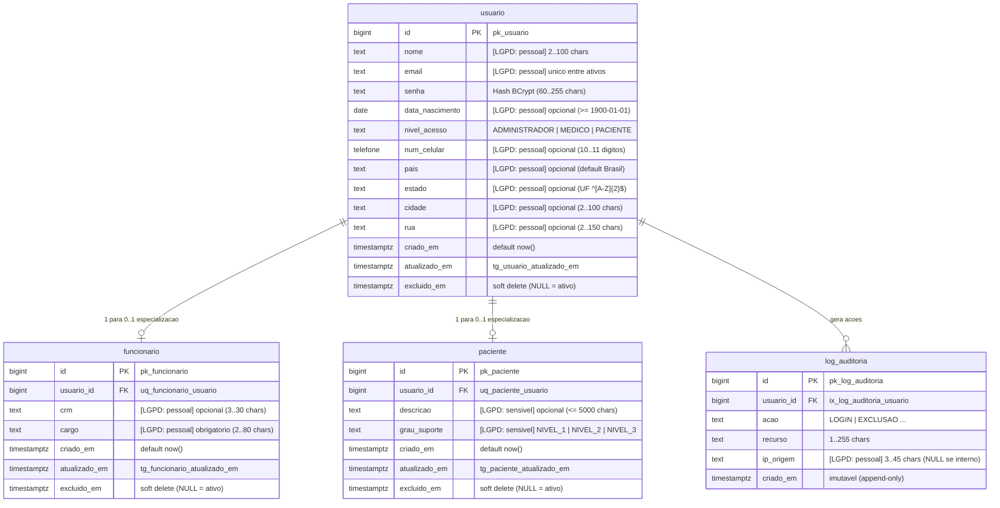

# Delta do Modelo de Dados: Autenticação, Controle de Acesso e Gestão de Usuários

> **ID da Spec:** `SPEC-001`  
> **Status:** Aplicado via Migration Inicial (`001_esquema_inicial.sql`)  
> **Referência Funcional:** [spec.md](spec.md)  
> **Modelo Conceitual Global:** [domain-model.md](../../memory/domain-model.md)  
> **Foco:** **Mapeamento Conceitual ➔ Lógico no Schema `amde_digital` (PostgreSQL 18) e Alinhamento JPA/Hibernate 6**

---

## 1. Mapeamento Conceitual ➔ Materialização Lógica

> Esta seção evidencia a derivação do Modelo Conceitual (`domain-model.md`) e dos requisitos da `SPEC-001` para o Modelo Lógico PostgreSQL 18 já materializado em [`001_esquema_inicial.sql`](../../../backend/src/main/resources/db/changelog/migrations/001_esquema_inicial.sql).

| Elemento Conceitual (DER / Spec) | Materialização Lógica (Tabela / Coluna / Constraint) | Alocação da Regra (Banco vs. Aplicação) | Justificativa / Rastreabilidade |
|---|---|---|---|
| `USUARIO` (entidade base de identidade) | Tabela `amde_digital.usuario`, PK `id bigint generated always as identity` (`pk_usuario`), trigger `tg_usuario_atualizado_em` | Banco de Dados | Derivada de `domain-model.md` para atender `RF-01` e `RF-02` |
| Identidade digital ativa única (`RN02`, `RN25`) | Índice único parcial `uq_usuario_email_ativo` sobre `(lower(email)) WHERE excluido_em IS NULL` | Banco de Dados + Aplicação | Garante unicidade sem distinção de caixa apenas entre ativos; a aplicação traduz conflitos para `409 Conflict` |
| Campos de `Usuario`: obrigatórios vs. opcionais (`RN22`) | `nome`, `email`, `senha`, `nivel_acesso` (`NOT NULL`); `data_nascimento`, `num_celular` (`telefone`), `pais` (`DEFAULT 'Brasil'`), `estado`, `cidade`, `rua`, `excluido_em` (`NULL`) + constraints `ck_usuario_*` | Banco de Dados + Aplicação | Banco garante limites (`nome` 2..100, `email` 5..254, `pais` 2..60, `estado` UF `^[A-Z]{2}$`, `cidade` 2..100, `rua` 2..150, `data_nascimento >= 1900-01-01 e <= current_date`) e domínio `telefone`; aplicação normaliza entrada |
| Perfil de acesso fixo (`RN17`, `RN24`) | `nivel_acesso text not null` + `ck_usuario_nivel_acesso` (`'ADMINISTRADOR'`, `'MEDICO'`, `'PACIENTE'`) | Banco de Dados + Aplicação | Banco restringe os valores oficiais; aplicação impede alteração de perfil após o cadastro (`RN24`) |
| `FUNCIONARIO` (especialização 1:0..1 de `MEDICO`, `RN04`, `RN23`) | Tabela `amde_digital.funcionario`, PK `id` (`pk_funcionario`), `usuario_id bigint not null`, `uq_funcionario_usuario`, `fk_funcionario_usuario`, `cargo text not null` (`2..80`), `crm text` (`NULL`, `3..30`) | Banco de Dados + Aplicação | FK única garante vínculo 1:1; aplicação cria em conjunto apenas quando `nivel_acesso = 'MEDICO'` (`RN23`) |
| `PACIENTE` (especialização 1:0..1 de `PACIENTE`, `RN04`, `RN23`) | Tabela `amde_digital.paciente`, PK `id` (`pk_paciente`), `usuario_id bigint not null`, `uq_paciente_usuario`, `fk_paciente_usuario`, `grau_suporte text not null` (`'NIVEL_1'`, `'NIVEL_2'`, `'NIVEL_3'`), `descricao text` (`NULL`, `<= 5000`) | Banco de Dados + Aplicação | FK única garante vínculo 1:1; aplicação cria em conjunto apenas quando `nivel_acesso = 'PACIENTE'` (`RN23`) |
| Busca paginada e filtros (`UC05`, `RNF-02.1`) | Índices parciais `ix_usuario_nome_trgm` (`GIN public.gin_trgm_ops WHERE excluido_em IS NULL`) e `ix_usuario_nivel_acesso` (`WHERE excluido_em IS NULL`) | Banco de Dados + Aplicação | Acelera busca textual por nome/e-mail e filtragem por perfil para manter p95 < 500 ms |
| Proteção de senha com BCrypt (`RN01`, `RN21`) | Coluna `senha text not null` + `ck_usuario_senha` (`char_length(trim(senha)) between 60 and 255`) | Aplicação + Banco de Dados | Validação de 8 chars e `<= 72 bytes UTF-8` e geração do hash BCrypt ocorrem na aplicação; banco impede persistência de hash inválido |
| Sessão JWT 8h, revogação imediata no soft delete e mascaramento (`RN18`, `RN20`, `RN28`) | Consulta de `excluido_em IS NULL` por requisição autenticada; mascaramento de `num_celular` no `UsuarioMapper` | Aplicação (Filter / Service / Mapper) | Regras de autenticação stateless, contexto de sessão e visualização condicional |
| Bloqueios de exclusão (`RN26`, `RN27`) | Verificação de autoexclusão e consulta em `amde_digital.agendamento` (`status = 'AGENDADO'`) e `agendamento_paciente` antes de definir `excluido_em` | Aplicação (Service / Repository) | Regras contextuais envolvendo usuário autenticado e estado de agendamentos (`SPEC-004`) |
| Auditoria de `LOGIN` e `EXCLUSAO` (`RN16`) | Inserção assíncrona na tabela `amde_digital.log_auditoria` via `AuditoriaService` (`SPEC-005`) | Aplicação + Banco de Dados | Tabela imutável (*append-only*) com vínculo obrigatório para `usuario_id` |

---

## 2. Origem das Decisões do Modelo

- **Definido explicitamente na Spec (`SPEC-001`):**
  - Existência de exatamente três perfis oficiais (`ADMINISTRADOR`, `MEDICO`, `PACIENTE`) imutáveis após o cadastro (`RN17`, `RN24`).
  - Unicidade de e-mail entre usuários ativos, liberando o e-mail após soft delete (`RN02`, `RN25`).
  - Obrigatoriedade de `nome`, `email`, `senha`, `nivel_acesso`, `cargo` (para `MEDICO`) e `grau_suporte` (para `PACIENTE`), e opcionalidade justificada dos demais campos (`data_nascimento`, `num_celular`, endereço, `crm` e `descricao`).
  - Classificação LGPD: dados cadastrais e profissionais marcados com `[LGPD: pessoal]`; dados clínicos de `Paciente` (`grau_suporte`, `descricao`) marcados com `[LGPD: sensível]`.
- **Derivado das convenções da Constituição e do Banco (`constitution.md` / `AGENTS.md` / `001_esquema_inicial.sql`):**
  - Schema exclusivo `amde_digital`, extensões `unaccent` e `pg_trgm` em `public`, segregação de roles (`amde_digital_owner` para DDL e `amde_digital_app` para DML).
  - PK `id bigint generated always as identity`, timestamps com fuso `timestamptz` (`criado_em`, `atualizado_em`, `excluido_em`), domínio `amde_digital.telefone` (`^[0-9]{10,11}$`), colunas textuais em `text` com `CHECK`, função `definir_atualizado_em()` e triggers `tg_<tabela>_atualizado_em`.
  - Mapeamento JPA explícito em `AGENTS.md`: `@Table(name = "...", schema = "amde_digital")`, `@Column(columnDefinition = "text")` para `text` e `telefone`, `OffsetDateTime` para `timestamptz`, `@Enumerated(EnumType.STRING)` e `@SQLRestriction("excluido_em IS NULL")`.
- **Suposições da IA com Justificativa:**
  - `ck_usuario_senha` exige entre 60 e 255 caracteres no banco porque todo hash BCrypt padrão possui 60 caracteres; isso garante em nível de banco que nenhuma senha em texto curto ou vazio seja gravada sem hash.

---

## 3. Resumo e Diagrama do Delta

### 3.1. Resumo das Alterações
| Tipo de Operação | Objeto / Tabela | Modificação Detalhada |
|---|---|---|
| `Nenhuma alteração DDL` | `amde_digital.usuario`, `amde_digital.funcionario`, `amde_digital.paciente`, `amde_digital.log_auditoria` | Todas as tabelas, domínios (`telefone`), constraints (`pk_`, `fk_`, `uq_`, `ck_`), índices (`ix_`, `uq_usuario_email_ativo`), triggers `tg_` e comentários `[LGPD: ...]` necessários para a `SPEC-001` **já estão criados** na migration inicial [`001_esquema_inicial.sql`](../../../backend/src/main/resources/db/changelog/migrations/001_esquema_inicial.sql). |

### 3.2. Diagrama das Entidades Envolvidas (Mermaid)



---

## 4. Dicionário de Dados e Mapeamento JPA (`AGENTS.md`)

### Tabela: `amde_digital.usuario`

> **Política de Ciclo de Vida:** Soft delete via `excluido_em` (`NULL` = ativo; `NOT NULL` = inativado logicamente). Entidade JPA anotada com `@Table(name = "usuario", schema = "amde_digital")` e `@SQLRestriction("excluido_em IS NULL")` para consultas padrão.

| Coluna | Tipo SQL (PG 18) | Nulo? | Mapeamento JPA / Java | Restrições / Chaves | Descrição / Classificação LGPD e Justificativa |
|---|---|---|---|---|---|
| `id` | `bigint generated always as identity` | Não | `@Id @GeneratedValue(strategy = GenerationType.IDENTITY) Long id` | `pk_usuario` | Identificador único do usuário. |
| `nome` | `text` | Não | `@Column(name = "nome", nullable = false, columnDefinition = "text") String nome` | `ck_usuario_nome` (`2..100`), `ix_usuario_nome_trgm` | `[LGPD: pessoal]` Nome completo do titular. |
| `email` | `text` | Não | `@Column(name = "email", nullable = false, columnDefinition = "text") String email` | `ck_usuario_email` (`5..254`), `uq_usuario_email_ativo` | `[LGPD: pessoal]` Credencial única entre contas ativas. |
| `senha` | `text` | Não | `@Column(name = "senha", nullable = false, columnDefinition = "text") String senha` | `ck_usuario_senha` (`60..255`) | Hash criptográfico BCrypt; nunca retornado em DTOs. |
| `data_nascimento` | `date` | Sim | `@Column(name = "data_nascimento") LocalDate dataNascimento` | `ck_usuario_data_nascimento` (`>= 1900-01-01` e `<= current_date`) | `[LGPD: pessoal]` **Anulável** porque contas administrativas iniciais podem ser criadas antes da complementação cadastral. |
| `nivel_acesso` | `text` | Não | `@Enumerated(EnumType.STRING) @Column(name = "nivel_acesso", nullable = false, columnDefinition = "text") NivelAcesso nivelAcesso` | `ck_usuario_nivel_acesso`, `ix_usuario_nivel_acesso` | Perfil imutável: `ADMINISTRADOR`, `MEDICO` ou `PACIENTE`. |
| `num_celular` | `telefone` | Sim | `@Column(name = "num_celular", columnDefinition = "text") String numCelular` | Domínio `telefone` (`^[0-9]{10,11}$`) | `[LGPD: pessoal]` **Anulável** porque nem todo usuário possui telefone próprio no ato do pré-cadastro. |
| `pais` | `text` | Sim | `@Column(name = "pais", columnDefinition = "text") String pais` | Padrão `'Brasil'`, `ck_usuario_pais` (`2..60`) | `[LGPD: pessoal]` **Anulável** por ser dado complementar de endereço. |
| `estado` | `text` | Sim | `@Column(name = "estado", columnDefinition = "text") String estado` | `ck_usuario_estado` (`^[A-Z]{2}$`) | `[LGPD: pessoal]` **Anulável** por ser dado complementar de endereço (UF). |
| `cidade` | `text` | Sim | `@Column(name = "cidade", columnDefinition = "text") String cidade` | `ck_usuario_cidade` (`2..100`) | `[LGPD: pessoal]` **Anulável** por ser dado complementar de endereço. |
| `rua` | `text` | Sim | `@Column(name = "rua", columnDefinition = "text") String rua` | `ck_usuario_rua` (`2..150`) | `[LGPD: pessoal]` **Anulável** por ser dado complementar de endereço. |
| `criado_em` | `timestamptz` | Não | `@Column(name = "criado_em", nullable = false, insertable = false, updatable = false) OffsetDateTime criadoEm` | Default `now()` | Timestamp com fuso de criação. |
| `atualizado_em` | `timestamptz` | Não | `@Column(name = "atualizado_em", nullable = false, insertable = false, updatable = false) OffsetDateTime atualizadoEm` | Trigger `tg_usuario_atualizado_em` | Timestamp com fuso da última atualização. |
| `excluido_em` | `timestamptz` | Sim | `@Column(name = "excluido_em") OffsetDateTime excluidoEm` | — | Data/hora de inativação lógica; **anulável** pois `NULL` indica ativo. |

### Tabela: `amde_digital.funcionario`

> **Política de Ciclo de Vida:** Soft delete via `excluido_em` sincronizado com `usuario`. Entidade JPA anotada com `@Table(name = "funcionario", schema = "amde_digital")` e `@SQLRestriction("excluido_em IS NULL")`.

| Coluna | Tipo SQL (PG 18) | Nulo? | Mapeamento JPA / Java | Restrições / Chaves | Descrição / Classificação LGPD e Justificativa |
|---|---|---|---|---|---|
| `id` | `bigint generated always as identity` | Não | `@Id @GeneratedValue(strategy = GenerationType.IDENTITY) Long id` | `pk_funcionario` | Identificador único do profissional. |
| `usuario_id` | `bigint` | Não | `@OneToOne(fetch = FetchType.LAZY) @JoinColumn(name = "usuario_id", nullable = false) Usuario usuario` | `fk_funcionario_usuario`, `uq_funcionario_usuario` | Vínculo 1:1 com `usuario` (`MEDICO`). |
| `crm` | `text` | Sim | `@Column(name = "crm", columnDefinition = "text") String crm` | `ck_funcionario_crm` (`3..30`) | `[LGPD: pessoal]` **Anulável** porque colaboradores ou funções pedagógicas de apoio podem não possuir registro em conselho médico. |
| `cargo` | `text` | Não | `@Column(name = "cargo", nullable = false, columnDefinition = "text") String cargo` | `ck_funcionario_cargo` (`2..80`), `ix_funcionario_cargo` | `[LGPD: pessoal]` Especialidade clínica ou função exercida. |
| `criado_em` | `timestamptz` | Não | `OffsetDateTime criadoEm` | Default `now()` | Timestamp com fuso de criação. |
| `atualizado_em` | `timestamptz` | Não | `OffsetDateTime atualizadoEm` | Trigger `tg_funcionario_atualizado_em` | Timestamp com fuso de alteração. |
| `excluido_em` | `timestamptz` | Sim | `OffsetDateTime excluidoEm` | — | Data/hora de inativação lógica (`NULL` = ativo). |

### Tabela: `amde_digital.paciente`

> **Política de Ciclo de Vida:** Soft delete via `excluido_em` sincronizado com `usuario`. Entidade JPA anotada com `@Table(name = "paciente", schema = "amde_digital")` e `@SQLRestriction("excluido_em IS NULL")`.

| Coluna | Tipo SQL (PG 18) | Nulo? | Mapeamento JPA / Java | Restrições / Chaves | Descrição / Classificação LGPD e Justificativa |
|---|---|---|---|---|---|
| `id` | `bigint generated always as identity` | Não | `@Id @GeneratedValue(strategy = GenerationType.IDENTITY) Long id` | `pk_paciente` | Identificador único do paciente. |
| `usuario_id` | `bigint` | Não | `@OneToOne(fetch = FetchType.LAZY) @JoinColumn(name = "usuario_id", nullable = false) Usuario usuario` | `fk_paciente_usuario`, `uq_paciente_usuario` | Vínculo 1:1 com `usuario` (`PACIENTE`). |
| `descricao` | `text` | Sim | `@Column(name = "descricao", columnDefinition = "text") String descricao` | `ck_paciente_descricao` (`<= 5000`) | `[LGPD: sensível]` **Anulável** porque o cadastro inicial pela recepção pode preceder a avaliação clínica pelo especialista. |
| `grau_suporte` | `text` | Não | `@Enumerated(EnumType.STRING) @Column(name = "grau_suporte", nullable = false, columnDefinition = "text") GrauSuporte grauSuporte` | `ck_paciente_grau_suporte` (`NIVEL_1`, `NIVEL_2`, `NIVEL_3`), `ix_paciente_grau_suporte` | `[LGPD: sensível]` Grau de suporte TEA obrigatório para direcionamento clínico. |
| `criado_em` | `timestamptz` | Não | `OffsetDateTime criadoEm` | Default `now()` | Timestamp com fuso de criação. |
| `atualizado_em` | `timestamptz` | Não | `OffsetDateTime atualizadoEm` | Trigger `tg_paciente_atualizado_em` | Timestamp com fuso de alteração. |
| `excluido_em` | `timestamptz` | Sim | `OffsetDateTime excluidoEm` | — | Data/hora de inativação lógica (`NULL` = ativo). |

---

## 5. Validação Automática do Esquema

Antes de iniciar ou concluir a implementação da `SPEC-001`:
1. Executar `sqlfluff lint --dialect postgres backend/src/main/resources/db/changelog/migrations/ data/verificacao.sql` garantindo zero erros.
2. Subir o banco local (`docker compose up -d postgres`), aplicar a migration com Liquibase pela role `amde_digital_owner` e executar `psql -h localhost -U postgres -d amde_digital -f data/verificacao.sql` garantindo **zero linhas retornadas** nas 9 verificações estruturais.
3. Conferir o inventário `[LGPD: ...]` gerado pela consulta final de `data/verificacao.sql`.

---

## 6. Dados Sintéticos para Testes e Validação (Seeds)

> **Atenção:** Seeds ficam em arquivos separados das migrations estruturais (`data/seeds/001_usuarios_seed_sintetico.sql`) e utilizam **exclusivamente massas sintéticas** (nunca dados reais da AMDE). O hash BCrypt abaixo é meramente ilustrativo para ambiente de desenvolvimento local.

```sql
-- Arquivo sugerido: data/seeds/001_usuarios_seed_sintetico.sql
-- Massa de dados sintética para desenvolvimento e testes da SPEC-001 (LGPD compliant)
set search_path = amde_digital, public;

insert into usuario (
    nome, email, senha, data_nascimento, nivel_acesso, num_celular, pais, estado, cidade, rua
)
values (
    'Administrador Sintetico',
    'admin.teste@amde.example.org',
    '$2a$10$N9qo8uLOickgx2ZMRZoMyeIjZAgcfl7p92ldGxad68LJZdL17lhWy',
    date '1990-05-10',
    'ADMINISTRADOR',
    '15999990001',
    'Brasil',
    'SP',
    'Sorocaba',
    'Rua Exemplo, 100'
)
on conflict do nothing;

with novo_medico as (
    insert into usuario (
        nome, email, senha, data_nascimento, nivel_acesso, num_celular, pais, estado, cidade, rua
    )
    values (
        'Profissional Sintetico',
        'medico.teste@amde.example.org',
        '$2a$10$N9qo8uLOickgx2ZMRZoMyeIjZAgcfl7p92ldGxad68LJZdL17lhWy',
        date '1988-08-20',
        'MEDICO',
        '15999990002',
        'Brasil',
        'SP',
        'Sorocaba',
        'Avenida Teste, 200'
    )
    on conflict do nothing
    returning id
)
insert into funcionario (usuario_id, crm, cargo)
select id, 'CRM/SP 000001', 'Psicologia'
from novo_medico;

with novo_paciente as (
    insert into usuario (
        nome, email, senha, data_nascimento, nivel_acesso, num_celular, pais, estado, cidade, rua
    )
    values (
        'Paciente Sintetico',
        'paciente.teste@amde.example.org',
        '$2a$10$N9qo8uLOickgx2ZMRZoMyeIjZAgcfl7p92ldGxad68LJZdL17lhWy',
        date '2016-03-15',
        'PACIENTE',
        null,
        'Brasil',
        'SP',
        'Sorocaba',
        'Rua Modelo, 300'
    )
    on conflict do nothing
    returning id
)
insert into paciente (usuario_id, grau_suporte, descricao)
select id, 'NIVEL_2', 'Registro sintetico exclusivo para testes funcionais.'
from novo_paciente;
```
