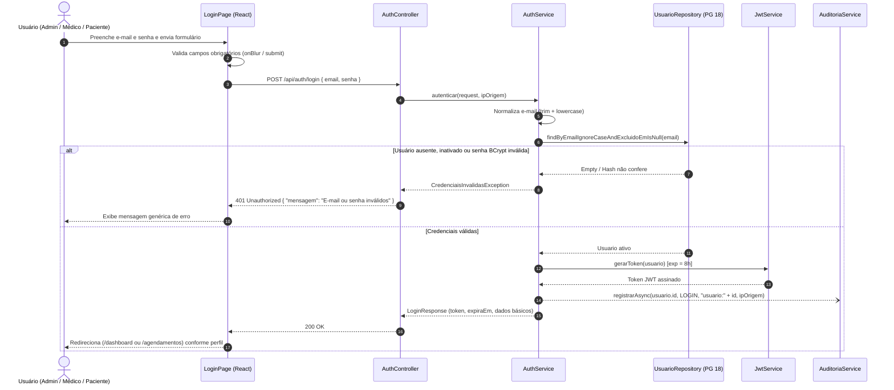
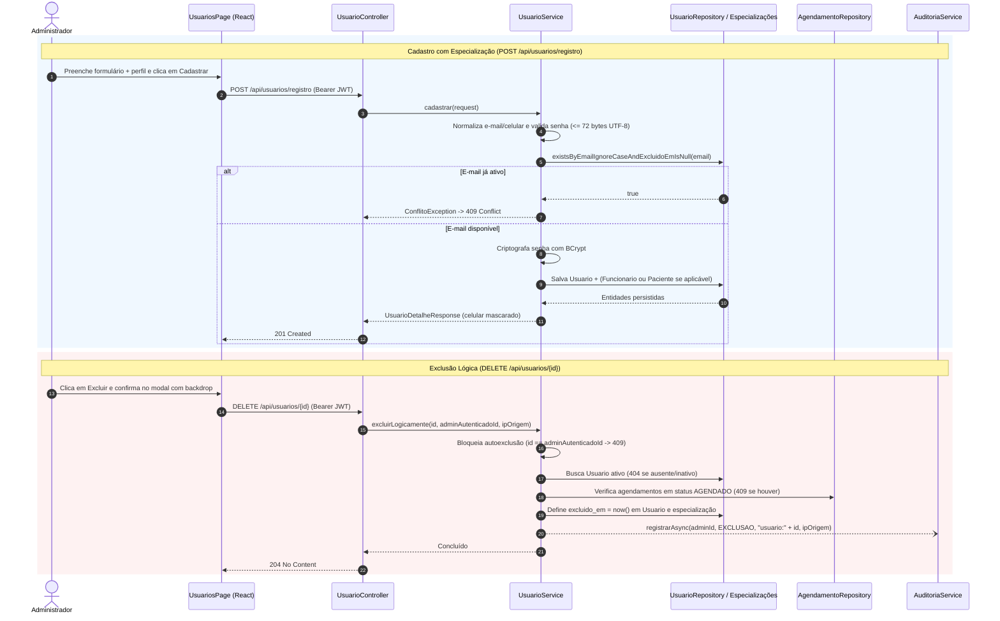

# Plano Técnico de Implementação: Autenticação, Controle de Acesso e Gestão de Usuários

> **ID da Spec:** `SPEC-001`  
> **Status:** Planejamento  
> **Referência Funcional:** [spec.md](spec.md)  
> **Delta de Banco de Dados:** [data-model.md](data-model.md)  
> **Foco:** **Como** (Arquitetura, Decisões de Engenharia, Interfaces, Segurança e Testes)

---

## 1. Visão Técnica Geral e Abordagem

A implementação da **`SPEC-001`** estabelece a base de segurança e identidade do **AMDE Digital** no monólito modular Spring Boot 3 (Java 17) e na SPA React 18 (TypeScript/Vite), respeitando integralmente a [constitution.md](../../memory/constitution.md) e as convenções de persistência de [AGENTS.md](../../../AGENTS.md).

### Decisões Arquiteturais Principais

1. **Autenticação Stateless via JWT (`UC01`–`UC03`, `RN18`–`RN20`):**
   - O `AuthController` (`POST /api/auth/login`) delega ao `AuthService` a normalização do e-mail (`trim().toLowerCase(Locale.ROOT)`), busca de usuário ativo (`excluido_em IS NULL`) e verificação da senha via `BCryptPasswordEncoder` (`RN01`).
   - E-mail inexistente, conta logicamente inativada e senha incorreta convergem para a mesma exceção de autenticação (`401 Unauthorized`) com payload e mensagem únicos (`"E-mail ou senha inválidos"`), garantindo `RN19` e `RNF-01.3`.
   - O `JwtService` (`io.jsonwebtoken` / JJWT) assina tokens com `HMAC-SHA256` (`HS256`) usando `JWT_SECRET` (mínimo de 256 bits via variável de ambiente), `iat`, `exp` fixo em **8 horas (`28.800` segundos)** sem renovação automática (`RN20`), `sub` (`id` do usuário) e claims mínimas (`email`, `nivelAcesso`). Dados clínicos e hash de senha jamais entram nas claims.
   - O filtro `JwtAuthenticationFilter` (`OncePerRequestFilter`) valida assinatura e expiração do Bearer token e **consulta o estado ativo do usuário no banco (`excluido_em IS NULL`)** a cada requisição autenticada, garantindo revogação imediata após exclusão lógica (`RN18`).
   - `AuthenticationEntryPoint` e `AccessDeniedHandler` customizados devolvem respostas JSON uniformes (`401 Unauthorized` para sessão ausente, vencida, adulterada ou usuário inativado; `403 Forbidden` para violação da matriz `RN17`).
   - O encerramento de sessão ("Sair", `RF-01.5`) é executado no front-end removendo o token e os metadados de sessão armazenados no cliente e redirecionando para `/login`, coerente com o modelo stateless (`RN20`).

2. **Validação de Senha e Regras de Cadastro (`UC04`, `RN21`–`RN23`):**
   - Antes de aplicar `BCryptPasswordEncoder.encode()`, o `UsuarioService` valida explicitamente a senha em texto plano: mínimo de 8 caracteres, não composta exclusivamente por espaços em branco (`!senha.trim().isEmpty()`) e **máximo de 72 bytes em UTF-8** (`senha.getBytes(StandardCharsets.UTF_8).length <= 72`). Senhas que excedam 72 bytes são rejeitadas com `400 Bad Request` e nunca truncadas silenciosamente (`RN21`).
   - No cadastro (`POST /api/usuarios/registro`) e na edição (`PUT /api/usuarios/{id}`), o e-mail é normalizado (`trim` + minúsculas) e a máscara do celular (quando informado) é removida antes da validação estrita de 10 ou 11 dígitos (`RN22`).
   - A criação de `Usuario` e de sua especialização 1:1 (`Funcionario` para `MEDICO`; `Paciente` para `PACIENTE`; nenhuma para `ADMINISTRADOR`) ocorre em única transação `@Transactional` (`RN04`, `RN23`). Violações do índice único parcial `uq_usuario_email_ativo` (`DataIntegrityViolationException`) e checagens prévias de duplicidade retornam `409 Conflict` (`RN02`, `RNF-02.4`).

3. **Consulta, Totalizadores, Edição e Exclusão Lógica (`UC05`–`UC07`, `RN24`–`RN28`):**
   - **Listagem (`GET /api/usuarios`):** paginada (`page` padrão `0`, `size` padrão `10` e limitado a `50`, `sort` padrão `nome,ASC`), com busca textual até 100 caracteres utilizando `unaccent`/`lower` e `LIKE`/`pg_trgm` sobre `nome` e `email`, filtro opcional por `nivelAcesso` e cálculo de totalizadores agregados de usuários ativos (`total`, `administradores`, `medicos`, `pacientes`).
   - **Mascaramento de Celular (`RN28`):** o `UsuarioMapper` mascara `num_celular` por padrão (`(XX) *****-XXXX` para 11 dígitos ou `(XX) ****-XXXX` para 10 dígitos) na listagem e no detalhe. O número completo só é devolvido no endpoint de detalhe `GET /api/usuarios/{id}?revelarCelular=true` para usuário `ADMINISTRADOR`. Quando `num_celular` for `NULL`, retorna `null` sem erro.
   - **Atualização (`PUT /api/usuarios/{id}`):** proíbe alteração de `nivelAcesso` (`RN24` -> `400 Bad Request`), revalida duplicidade de e-mail entre outros usuários ativos (`RN02` -> `409 Conflict`), só re-hasheia a senha se informada (`RN21`) e atualiza os dados da especialização correspondente (`Funcionario` ou `Paciente`).
   - **Exclusão Lógica (`DELETE /api/usuarios/{id}`):** valida se o Administrador não está excluindo a própria conta (`RN26` -> `409 Conflict`) e consulta `AgendamentoRepository` para bloquear exclusão de `MEDICO` ou `PACIENTE` com agendamentos em situação `AGENDADO` (`RN27` -> `409 Conflict`). Em caso válido, preenche `excluido_em` com o instante atual em `usuario` e na especialização (`RN25`) e dispara o evento `EXCLUSAO` via `AuditoriaService` (`RN16`, `SPEC-005`).

4. **Provisionamento do Primeiro Administrador:**
   - Em ambiente local/desenvolvimento e testes, o primeiro `ADMINISTRADOR` é criado via seed sintético (`data/seeds/001_seed_inicial_dev.sql` / `data/seeds/001_usuarios_seed_sintetico.sql`, detalhado em [data-model.md](data-model.md)) com senha fictícia e hash BCrypt, sem jamais versionar dados reais. Em implantação produtiva, o primeiro administrador é provisionado por procedimento operacional controlado fora do controle de versão, utilizando credenciais injetadas no ambiente.

---

## 2. Metas Técnicas Derivadas dos RNFs

| ID RNF (Origem Spec) | Meta Técnica Quantificável | Decisão de Arquitetura / Solução Técnica |
|---|---|---|
| **RNF-01.1** | 0 ocorrências de senha em texto puro ou hash em logs/DTOs | Uso exclusivo de `BCryptPasswordEncoder`; DTOs de resposta (`UsuarioResumoResponse`, `UsuarioDetalheResponse`, `LoginResponse`) não possuem campo `senha`; `Usuario.toString()` omite credenciais e PII; tratamento global de exceções sem echo do payload. |
| **RNF-01.2** | Validade exata de 8h sem renovação e 100% de rejeição de tokens inválidos/expirados | `jwt.expiration-ms=28800000` sem endpoint de refresh; `JwtService.validarToken` verifica assinatura HS256 e `exp`, e `JwtAuthenticationFilter` checa `excluido_em IS NULL` no banco. |
| **RNF-01.3** | Respostas idênticas para e-mail inexistente, senha errada e usuário inativado | Fluxo único em `AuthService` lançando `CredenciaisInvalidasException` tratada no `GlobalExceptionHandler` com `401` e mensagem fixa `"E-mail ou senha inválidos"`. |
| **RNF-01.4** | Comunicação protegida por HTTPS em produção e HSTS configurado | Terminação TLS no AWS CloudFront / Load Balancer e cabeçalhos de segurança do Spring Security (`HSTS`, `X-Content-Type-Options`, `X-Frame-Options`). |
| **RNF-01.5** | p95 < 500 ms no login com 20 logins simultâneos | Consulta direta indexada via `uq_usuario_email_ativo` (`lower(email) WHERE excluido_em IS NULL`), Pool HikariCP dimensionado e fator de custo padrão equilibrado no BCrypt (custo 10). |
| **RNF-01.6** | Conformidade WCAG 2.1 AA na tela de login | Labels explícitos (`htmlFor`), `aria-invalid` e `aria-describedby` nos erros de campo, submissão por `Enter`, anéis de foco visíveis e contraste ≥ 4,5:1 via tokens de `design/tokens.json`. |
| **RNF-02.1** | p95 < 500 ms na listagem paginada com 10.000 usuários | Índices `ix_usuario_nome_trgm` (GIN trigram parcial) e `ix_usuario_nivel_acesso` no PostgreSQL 18 + projeção paginada via Spring Data JPA. |
| **RNF-02.2** | 0 vazamentos de celular completo, endereço, data de nascimento ou senha em logs/erros | Log estruturado SLF4J registrando apenas `usuarioId` e código técnico; `GlobalExceptionHandler` devolve mensagens de validação por campo sem refletir valores sensíveis. |
| **RNF-02.3** | Formulários, validação inline, confirmação modal e 4 estados de tela | React Hook Form + Zod com `mode: "onBlur"`, botão de submit desabilitado com erros, `AlertDialog` com backdrop na exclusão e componentes dedicados para `Skeleton`, `EmptyState`, `ErrorState` e `Table`. |
| **RNF-02.4** | Exclusividade sob concorrência no cadastro de e-mail | Verificação prévia + índice único parcial `uq_usuario_email_ativo` no PostgreSQL 18 capturando `DataIntegrityViolationException` e traduzindo para `409 Conflict`. |

---

## 3. Componentes e Camadas Impactadas

| Camada / Módulo | Componentes Impactados | Responsabilidade Técnica |
|---|---|---|
| **Front-end Web (`frontend/`)** | `AuthContext`, `ProtectedRoute`, `Sidebar`, `Header`, `LoginPage`, `UsuariosPage`, `UsuarioFormModal`, `UsuarioDetalheModal`, `ConfirmarExclusaoDialog`, `authService.ts`, `usuarioService.ts` | Armazenamento de sessão no cliente, guarda de rotas por `NivelAcesso`, redirecionamento inicial, listagem com totalizadores/busca/filtro/ordenação/paginação, mascaramento/revelação de celular e validação de formulários consumindo [`design/tokens.json`](../../../design/tokens.json). |
| **API Controller (`backend/`)** | `AuthController`, `UsuarioController`, `GlobalExceptionHandler` | Exposição das rotas `/api/auth/login` e `/api/usuarios/**`, anotação `@PreAuthorize("hasRole('ADMINISTRADOR')")`, validação `@Valid` de DTOs e mapeamento uniforme de erros HTTP (`400`, `401`, `403`, `404`, `409`). |
| **Serviço / Caso de Uso (`backend/`)** | `AuthService`, `JwtService`, `UsuarioService`, `CelularMasker` | Regras `RN01`–`RN04`, `RN17`–`RN28`, validação UTF-8 de 72 bytes da senha, normalização de e-mail/celular, transações `@Transactional` e mascaramento de telefone. |
| **Mappers (`backend/`)** | `UsuarioMapper` (MapStruct) | Conversão segura entre entidades (`Usuario`, `Funcionario`, `Paciente`) e DTOs de entrada/saída, sem jamais expor `senha`. |
| **Repositório / Persistência (`backend/`)** | `Usuario`, `Funcionario`, `Paciente`, `NivelAcesso`, `GrauSuporte`, `UsuarioRepository`, `FuncionarioRepository`, `PacienteRepository`, `AgendamentoRepository` | Mapeamento JPA/Hibernate 6 no schema `amde_digital` (role `amde_digital_app`) com `columnDefinition = "text"` para colunas `text`/domínios (`telefone`), `OffsetDateTime` para `timestamptz`, `LocalDate` para `date`, `@Enumerated(EnumType.STRING)` e `@SQLRestriction("excluido_em IS NULL")`. |
| **Banco de Dados (`PostgreSQL 18`)** | [`001_esquema_inicial.sql`](../../../backend/src/main/resources/db/changelog/migrations/001_esquema_inicial.sql) | Já contém as tabelas `usuario`, `funcionario`, `paciente` e `log_auditoria`, constraints `ck_`, índice único parcial `uq_usuario_email_ativo`, índices parciais e triggers `tg_*_atualizado_em` (nenhuma migration incremental necessária para `SPEC-001`). |
| **Auditoria e Logs (`backend/`)** | `AuditoriaService` (`SPEC-005`) | Gravação assíncrona de eventos `LOGIN` (em `AuthService`) e `EXCLUSAO` (em `UsuarioService`), seguindo a `RN44` (falha de auditoria não bloqueia login nem exclusão de usuário). |

---

## 4. Diagramas de Sequência da Solução

### 4.1. Fluxo de Autenticação (`POST /api/auth/login` — `UC01`, `UC02`, `UC03`, `UC20`)

### 4.2. Fluxo de Cadastro e Exclusão Lógica (`UC04`, `UC07`, `UC20`)

---

## 5. Plano de Interface e Componentes (UI Plan)

- **Rotas da Aplicação:**
  - `/login` (pública; redireciona usuário já autenticado para a tela inicial do seu perfil).
  - `/usuarios` (protegida por `ProtectedRoute` restrita a `ADMINISTRADOR`; redireciona ou exibe acesso negado para `MEDICO` e `PACIENTE`).
  - Redirecionamento pós-login (`RF-01.6`): `ADMINISTRADOR` ➔ `/dashboard`; `MEDICO` e `PACIENTE` ➔ `/agendamentos`.
- **Menu Lateral (`Sidebar`) Condicional por Perfil:**
  - `ADMINISTRADOR`: `Visão Geral / Dashboard`, `Pacientes`, `Agendamentos`, `Usuários`, `Sair`.
  - `MEDICO`: `Pacientes`, `Agendamentos`, `Sair`.
  - `PACIENTE`: `Meu prontuário`, `Agendamentos`, `Sair`.
- **Componentes Base (Shadcn/ui + Tailwind CSS via [`design/tokens.json`](../../../design/tokens.json)):**
  - `Card` para os 4 totalizadores (`Total`, `Administradores`, `Médicos`, `Pacientes`).
  - `Badge` usando os tokens semânticos de perfil (`role.admin-badge`, `role.medico-badge`, `role.paciente-badge`).
  - `Table` com cabeçalhos clicáveis indicando ordenação (`ASC`/`DESC`), barra superior com busca textual (nome/e-mail) e filtro por `nivelAcesso`, paginação na base (`10`, `20`, `50` itens por página) e coluna fixa de ações (Visualizar, Editar, Excluir).
  - `Dialog` para criação/edição (exibindo dinamicamente os campos de `Funcionario` ou `Paciente` conforme o perfil selecionado no cadastro, mantendo o campo perfil bloqueado na edição).
  - `Dialog` de visualização detalhada com botão explícito **"Revelar celular"** (acionando `?revelarCelular=true`) quando houver celular cadastrado.
  - `AlertDialog` com fundo escurecido (*backdrop*) e suporte a `Esc` para confirmação de exclusão lógica.
- **Comportamento por Estado Obrigatório:**
  - *Carregando:* `Skeleton` dos cards totalizadores e das linhas da tabela.
  - *Vazio:* Ícone ilustrativo + mensagem orientativa (*"Nenhum usuário encontrado para os filtros aplicados"*).
  - *Erro:* Alerta amigável sem detalhes técnicos com botão **"Recarregar"**.
  - *Sucesso:* Totalizadores e tabela paginada renderizados com máscara `(XX) *****-XXXX` / `(XX) ****-XXXX` no celular (ou indicação de não informado quando ausente).
- **Acessibilidade (WCAG 2.1 AA):**
  - Navegação integral via `Tab`, `Enter` e `Esc`; indicadores de foco nítidos; rótulos visíveis com `*` nos campos obrigatórios; mensagens de erro vinculadas via `aria-describedby` e contraste ≥ 4,5:1 usando exclusivamente os tokens do Design System.

---

## 6. Endpoints e Contratos de API

- **Arquivo de Contrato:** [`contracts/api-contract.yaml`](contracts/api-contract.yaml)
- **Rotas Envolvidas:**
  - `POST /api/auth/login` — Autenticação por e-mail e senha e emissão de JWT (`UC01`, `UC02`, `UC03`).
  - `POST /api/usuarios/registro` — Cadastro de usuário com especialização 1:1 (`UC04`).
  - `GET /api/usuarios` — Listagem paginada de usuários ativos com busca, filtro por perfil, ordenação e totalizadores (`UC05`).
  - `GET /api/usuarios/{id}` — Consulta detalhada de usuário ativo com parâmetro opcional `revelarCelular` (`UC05`).
  - `PUT /api/usuarios/{id}` — Atualização cadastral e da especialização sem troca de perfil (`UC06`).
  - `DELETE /api/usuarios/{id}` — Exclusão lógica do usuário e da especialização vinculada (`UC07`).

---

## 7. Estratégia de Testes

1. **Testes Unitários (JUnit 5 + Mockito):**
   - `AuthServiceTest`: normalização de e-mail, rejeição uniforme (`401`) para senha errada, e-mail inexistente e usuário inativado (`RNF-01.3`), disparo assíncrono de `LOGIN` e resiliência quando `AuditoriaService` falha (`RN44`).
   - `JwtServiceTest`: geração de claims sem dados sensíveis, expiração exata de 8h e rejeição de tokens expirados ou com assinatura adulterada (`RN20`, `RNF-01.2`).
   - `UsuarioServiceTest`: validações de senha (`< 8` chars, só espaços, `> 72` bytes UTF-8), limites de campos (`RN22`, `RN23`), opcionalidade de campos anuláveis (`dataNascimento`, `numCelular`, endereço, `crm`, `descricao`), bloqueio de troca de perfil (`RN24`), bloqueio de autoexclusão (`RN26`), bloqueio por agendamentos `AGENDADO` (`RN27`) e mascaramento/revelação de celular (`RN28`).
2. **Testes de Integração e Concorrência (Spring Boot Test + PostgreSQL 18 via Testcontainers):**
   - Validação real das constraints `CHECK`, do índice único parcial `uq_usuario_email_ativo` (incluindo recadastro após exclusão lógica, `RN25`) e da revogação imediata na requisição seguinte após `DELETE /api/usuarios/{id}` (`RN18`).
   - Teste concorrente com `ExecutorService`/`CountDownLatch` disparando dois `POST /api/usuarios/registro` simultâneos com o mesmo e-mail e garantindo 1 resposta `201` e 1 resposta `409` (`RNF-02.4`).
   - Verificação de `403 Forbidden` para `MEDICO` e `PACIENTE` em todos os endpoints `/api/usuarios/**`.
3. **Testes de Front-end e Aceitação BDD (Vitest + Testing Library + E2E/Axe):**
   - Cobertura completa dos **18 cenários BDD** da [`spec.md`](spec.md).
   - Verificação de acessibilidade (WCAG 2.1 AA com Axe DevTools), navegação por teclado, validação `onBlur`, estados da tela e varredura automatizada garantindo ausência de senhas e PII em logs (`RNF-01.1`, `RNF-02.2`).

---

## 8. Definição de Pronto (Definition of Done - DoD)

- [ ] Contrato [`contracts/api-contract.yaml`](contracts/api-contract.yaml) validado e sincronizado entre front-end e back-end.
- [ ] Scripts [`001_esquema_inicial.sql`](../../../backend/src/main/resources/db/changelog/migrations/001_esquema_inicial.sql) e seeds sintéticos validados com `sqlfluff lint --dialect postgres`.
- [ ] Todas as 9 consultas estruturais de [`data/verificacao.sql`](../../../data/verificacao.sql) retornando zero linhas e inventário `[LGPD: ...]` conferido.
- [ ] Checklist de Revisão de Banco de Dados ([`AGENTS.md`](../../../AGENTS.md)) e validação Hibernate `ddl-auto=validate` aprovados com a role `amde_digital_app`.
- [ ] Todas as regras `RN01`–`RN04`, `RN16`, `RN17`–`RN28` implementadas e cobertas por testes unitários e de integração.
- [ ] Eventos `LOGIN` e `EXCLUSAO` registrados via `AuditoriaService` sem exposição de dados sensíveis em logs.
- [ ] Todos os 18 cenários BDD da [`spec.md`](spec.md) e o teste de concorrência (`RNF-02.4`) executados e aprovados.
- [ ] Telas `/login` e `/usuarios` aderentes a [`design/tokens.json`](../../../design/tokens.json), acessíveis (WCAG 2.1 AA) e com os 4 estados obrigatórios implementados.
