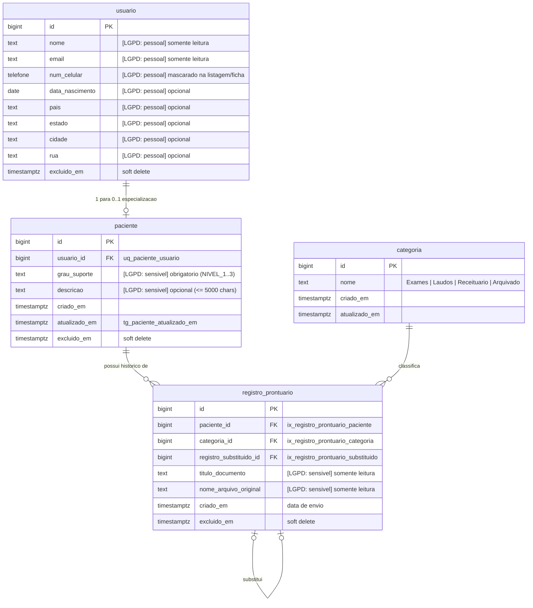

# Delta do Modelo de Dados: Gestão de Pacientes

> **ID da Spec:** `SPEC-002`  
> **Status:** Aplicado via Migration Inicial (`001_esquema_inicial.sql`)  
> **Referência Funcional:** [spec.md](spec.md)  
> **Modelo Conceitual Global:** [domain-model.md](../../memory/domain-model.md)  
> **Foco:** **Mapeamento Conceitual ➔ Lógico no Schema `amde_digital` (PostgreSQL 18) e Alinhamento JPA/Hibernate 6**

---

## 1. Mapeamento Conceitual ➔ Materialização Lógica

> Esta seção evidencia a derivação do Modelo Conceitual (`domain-model.md`) e dos requisitos da `SPEC-002` para o Modelo Lógico PostgreSQL 18 já materializado em [`001_esquema_inicial.sql`](../../../backend/src/main/resources/db/changelog/migrations/001_esquema_inicial.sql).

| Elemento Conceitual (DER / Spec) | Materialização Lógica (Tabela / Coluna / Constraint) | Alocação da Regra (Banco vs. Aplicação) | Justificativa / Rastreabilidade |
|---|---|---|---|
| `PACIENTE` (dados clínicos e vínculo 1:1 com `USUARIO`) | Tabela `amde_digital.paciente`, PK `id` (`pk_paciente`), FK única `usuario_id` (`fk_paciente_usuario`, `uq_paciente_usuario`), trigger `tg_paciente_atualizado_em` | Banco de Dados | Derivada de `domain-model.md` para atender `RF-03` e `RN04` |
| Grau de suporte TEA obrigatório (`RN31`, `RN32`) | Coluna `grau_suporte text not null`, constraint `ck_paciente_grau_suporte` (`in ('NIVEL_1', 'NIVEL_2', 'NIVEL_3')`), índice parcial `ix_paciente_grau_suporte` | Banco de Dados | Garante valores válidos e acelera filtro por nível na listagem (`RNF-03.1`) |
| Descrição clínica opcional (`RN32`) | Coluna `descricao text null`, constraint `ck_paciente_descricao` (`descricao is null or char_length(trim(descricao)) <= 5000`) | Banco de Dados + Aplicação | Anulável porque o cadastro inicial pela recepção pode preceder a avaliação clínica; aplicação permite edição apenas a `ADMINISTRADOR` e `MEDICO` |
| Busca por nome ou e-mail sem distinção de caixa/acentos (`RN30`) | Índice parcial `ix_usuario_nome_trgm` em `amde_digital.usuario` (`WHERE excluido_em IS NULL`) e extensão `public.unaccent` | Banco de Dados + Aplicação | Banco provê extensão `unaccent` e índice trigram; aplicação escapa curingas literais e ordena `nome`/`email`/`grau_suporte` |
| Soft delete de pacientes (`RN29`) | Coluna `excluido_em timestamptz null` em `paciente` e `usuario` + `@SQLRestriction("excluido_em IS NULL")` | Banco de Dados + Aplicação | Pacientes inativados não aparecem na listagem e respondem `404` na ficha para Admin/Médico |
| Autorização e titularidade da ficha (`RN29`) | Verificação de `nivel_acesso` e comparação entre `paciente.id` do usuário autenticado e o `{id}` solicitado | Aplicação (Controller / Service) | Garante `403 Forbidden` para `PACIENTE` tentando acessar listagem, edição ou ficha de terceiros (`RNF-03.3`) |
| Mascaramento e revelação de celular (`RN33`) | Leitura de `usuario.num_celular` (`telefone`) com aplicação condicional de máscara no `CelularMasker` | Aplicação (Service / Mapper) | Mascara por padrão e restringe revelação na ficha a `ADMINISTRADOR` e `MEDICO` |
| Histórico de documentos por categoria (`UC09`, `RF-03.3`) | Leitura das tabelas `amde_digital.registro_prontuario` e `amde_digital.categoria` (FKs `fk_registro_prontuario_paciente`, `fk_registro_prontuario_categoria`, `fk_registro_prontuario_substituido` e índices `ix_registro_prontuario_*`) | Banco de Dados + Aplicação | Banco armazena metadados e vínculo de substituição; aplicação calcula a situação (`VIGENTE`, `SUBSTITUIDO`, `ARQUIVADO`) e agrupa pelas 4 categorias sem ler binários |

---

## 2. Origem das Decisões do Modelo

- **Definido explicitamente na Spec (`SPEC-002`):**
  - Visibilidade diferenciada por perfil (`ADMINISTRADOR`/`MEDICO` vs. `PACIENTE` restrito à própria ficha, `RN29`).
  - Atualização exclusiva dos campos clínicos (`grau_suporte` obrigatório e `descricao` opcional até 5.000 caracteres) sem histórico de alterações da ficha (`RN32`).
  - Mascaramento padrão do celular e revelação restrita a `ADMINISTRADOR` e `MEDICO` (`RN33`).
  - Histórico exibindo somente metadados (`id`, `titulo_documento`, `nome_arquivo_original`, `categoria`, `criado_em`, `registro_substituido_id` / situação) agrupados nas 4 categorias e ordenados do mais recente ao mais antigo.
- **Derivado das convenções da Constituição e do Banco (`constitution.md` / `AGENTS.md` / `001_esquema_inicial.sql`):**
  - Schema `amde_digital`, `text` com `CHECK`, `timestamptz`, PK `bigint generated always as identity`, soft delete via `excluido_em`, triggers `tg_*_atualizado_em`, tags `[LGPD: sensível]` em dados clínicos e `[LGPD: pessoal]` em dados cadastrais.
  - Mapeamento JPA com `columnDefinition = "text"`, `OffsetDateTime` e `@SQLRestriction("excluido_em IS NULL")`.
- **Suposições da IA com Justificativa:**
  - A situação exibida no histórico (`VIGENTE`, `SUBSTITUIDO`, `ARQUIVADO`) é derivada em consulta a partir da categoria (`Arquivado`) e da existência de outro `registro_prontuario` ativo com `registro_substituido_id = registro.id`, evitando criar uma coluna redundante de status no banco que poderia dessincronizar com o auto-relacionamento.

---

## 3. Resumo e Diagrama do Delta

### 3.1. Resumo das Alterações
| Tipo de Operação | Objeto / Tabela | Modificação Detalhada |
|---|---|---|
| `Nenhuma alteração DDL` | `amde_digital.paciente`, `amde_digital.usuario`, `amde_digital.registro_prontuario`, `amde_digital.categoria` | Todas as tabelas, constraints (`pk_`, `fk_`, `uq_`, `ck_`), índices parciais (`ix_paciente_grau_suporte`, `ix_usuario_nome_trgm`, `ix_registro_prontuario_*`), triggers e comentários LGPD necessários para a `SPEC-002` **já existem** em [`001_esquema_inicial.sql`](../../../backend/src/main/resources/db/changelog/migrations/001_esquema_inicial.sql). |

### 3.2. Diagrama das Entidades Envolvidas (Mermaid)



---

## 4. Dicionário de Dados e Mapeamento JPA (`AGENTS.md`)

### Tabela Principal: `amde_digital.paciente` *(Leitura e Atualização Clínica)*

> **Política de Ciclo de Vida:** Soft delete gerenciado na `SPEC-001` via `excluido_em`. Nesta spec, permite apenas leitura e atualização de `grau_suporte` e `descricao`.

| Coluna | Tipo SQL (PG 18) | Nulo? | Mapeamento JPA / Java | Restrições / Chaves | Descrição / Classificação LGPD e Justificativa |
|---|---|---|---|---|---|
| `id` | `bigint generated always as identity` | Não | `@Id @GeneratedValue(strategy = GenerationType.IDENTITY) Long id` | `pk_paciente` | Identificador único do paciente. |
| `usuario_id` | `bigint` | Não | `@OneToOne(fetch = FetchType.LAZY) @JoinColumn(name = "usuario_id", nullable = false) Usuario usuario` | `fk_paciente_usuario`, `uq_paciente_usuario` | Vínculo 1:1 com dados cadastrais em `usuario`. |
| `grau_suporte` | `text` | Não | `@Enumerated(EnumType.STRING) @Column(name = "grau_suporte", nullable = false, columnDefinition = "text") GrauSuporte grauSuporte` | `ck_paciente_grau_suporte`, `ix_paciente_grau_suporte` | `[LGPD: sensível]` Nível de suporte TEA (`NIVEL_1`, `NIVEL_2`, `NIVEL_3`). |
| `descricao` | `text` | Sim | `@Column(name = "descricao", columnDefinition = "text") String descricao` | `ck_paciente_descricao` (`<= 5000`) | `[LGPD: sensível]` Anotações clínicas. **Anulável** porque o cadastro inicial pela recepção pode preceder a avaliação clínica pelo especialista. |
| `criado_em` | `timestamptz` | Não | `OffsetDateTime criadoEm` | Default `now()` | Timestamp com fuso de criação. |
| `atualizado_em` | `timestamptz` | Não | `OffsetDateTime atualizadoEm` | Trigger `tg_paciente_atualizado_em` | Timestamp com fuso da última atualização clínica. |
| `excluido_em` | `timestamptz` | Sim | `OffsetDateTime excluidoEm` | — | Data/hora de inativação lógica (`NULL` = ativo). |

### Tabelas Consultadas para Histórico: `amde_digital.categoria` e `amde_digital.registro_prontuario` *(Somente Leitura)*

| Tabela / Coluna | Tipo SQL (PG 18) | Nulo? | Mapeamento JPA / Java | Observação de Uso na `SPEC-002` |
|---|---|---|---|---|
| `categoria.id` | `bigint generated always as identity` | Não | `Long id` | PK `pk_categoria`. |
| `categoria.nome` | `text` | Não | `@Column(name = "nome", nullable = false, columnDefinition = "text") String nome` | Valores fixos: `Exames`, `Laudos`, `Receituario`, `Arquivado` (`uq_categoria_nome`). |
| `registro_prontuario.id` | `bigint generated always as identity` | Não | `Long id` | PK `pk_registro_prontuario`. |
| `registro_prontuario.paciente_id` | `bigint` | Não | `@ManyToOne(fetch = FetchType.LAZY) Paciente paciente` | FK indexada por `ix_registro_prontuario_paciente`. |
| `registro_prontuario.categoria_id` | `bigint` | Não | `@ManyToOne(fetch = FetchType.LAZY) Categoria categoria` | FK indexada por `ix_registro_prontuario_categoria`. |
| `registro_prontuario.registro_substituido_id` | `bigint` | Sim | `@ManyToOne(fetch = FetchType.LAZY) RegistroProntuario registroSubstituido` | Auto-relacionamento opcional que permite identificar versões `SUBSTITUIDO`. |
| `registro_prontuario.titulo_documento` | `text` | Não | `@Column(..., columnDefinition = "text") String tituloDocumento` | `[LGPD: sensível]` Exibido na ficha. |
| `registro_prontuario.nome_arquivo_original` | `text` | Não | `@Column(..., columnDefinition = "text") String nomeArquivoOriginal` | `[LGPD: sensível]` Exibido como metadado na ficha (`UC09`), sem tráfego do binário nem exposição de `nome_arquivo_armazenado`. |
| `registro_prontuario.criado_em` | `timestamptz` | Não | `OffsetDateTime criadoEm` | Data de envio usada para ordenação cronológica descendente. |
| `registro_prontuario.excluido_em` | `timestamptz` | Sim | `OffsetDateTime excluidoEm` | Filtrado com `excluido_em IS NULL`. |

---

## 5. Validação Automática do Esquema

1. Executar `sqlfluff lint --dialect postgres backend/src/main/resources/db/changelog/migrations/ data/verificacao.sql`.
2. Executar `psql -h localhost -U postgres -d amde_digital -f data/verificacao.sql` confirmando **zero linhas** nas 9 verificações estruturais e conferindo o inventário `[LGPD: ...]`.

---

## 6. Dados Sintéticos para Testes e Validação (Seeds)

> **Atenção:** Seeds ficam em arquivos separados das migrations estruturais (`data/seeds/002_pacientes_seed_sintetico.sql`) e utilizam **exclusivamente massas sintéticas**, sem qualquer dado real da AMDE.

```sql
-- Arquivo sugerido: data/seeds/002_pacientes_seed_sintetico.sql
-- Seed sintético das 4 categorias oficiais, pacientes nos 3 graus e metadados de prontuário para testes da SPEC-002
set search_path = amde_digital, public;

insert into categoria (nome)
values
    ('Exames'),
    ('Laudos'),
    ('Receituario'),
    ('Arquivado')
on conflict (nome) do nothing;

with pac_n1 as (
    insert into usuario (nome, email, senha, nivel_acesso, num_celular, cidade, estado)
    values (
        'José Lucas Teste',
        'jose.lucas@amde.example.org',
        '$2a$10$N9qo8uLOickgx2ZMRZoMyeIjZAgcfl7p92ldGxad68LJZdL17lhWy',
        'PACIENTE',
        '15999990011',
        'Sorocaba',
        'SP'
    )
    on conflict do nothing
    returning id
),
pac_n1_reg as (
    insert into paciente (usuario_id, grau_suporte, descricao)
    select id, 'NIVEL_1', 'Paciente sintetico Nivel 1 para testes de busca com acentuacao.'
    from pac_n1
    returning id
),
laudo_antigo as (
    insert into registro_prontuario (
        paciente_id, categoria_id, titulo_documento, nome_arquivo_original, nome_arquivo_armazenado
    )
    select
        pac_n1_reg.id,
        c.id,
        'Laudo Inicial Sintetico',
        'laudo-inicial.pdf',
        '00000000-0000-0000-0000-000000000001.pdf'
    from pac_n1_reg
    cross join categoria c
    where c.nome = 'Laudos'
    returning id, paciente_id, categoria_id
)
insert into registro_prontuario (
    paciente_id, categoria_id, registro_substituido_id, titulo_documento, nome_arquivo_original, nome_arquivo_armazenado
)
select
    laudo_antigo.paciente_id,
    laudo_antigo.categoria_id,
    laudo_antigo.id,
    'Laudo Atualizado Sintetico',
    'laudo-revisado.pdf',
    '00000000-0000-0000-0000-000000000002.pdf'
from laudo_antigo;
```
