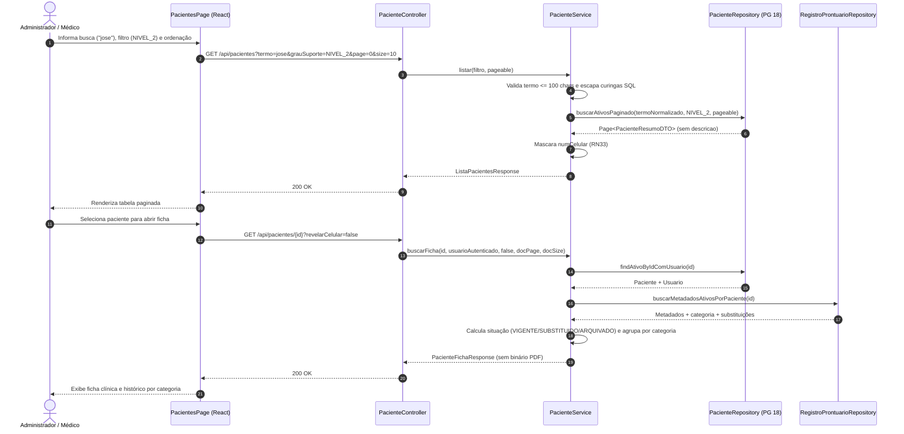
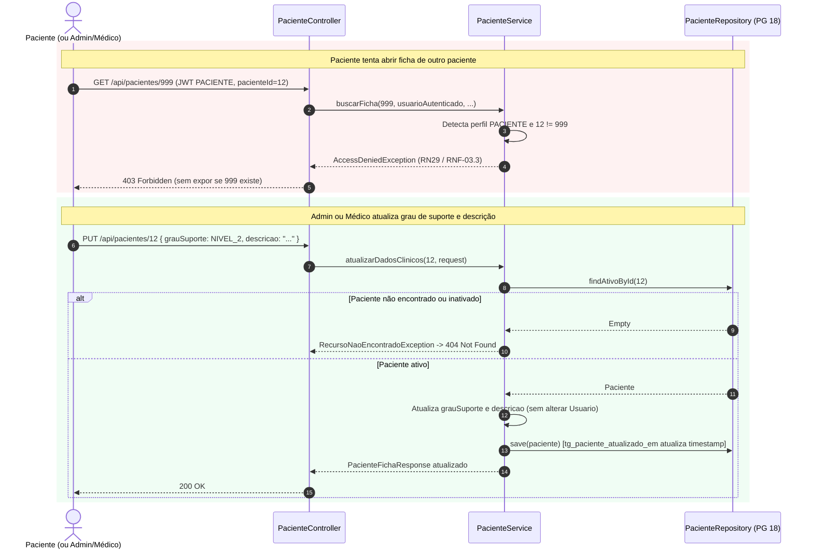

# Plano Técnico de Implementação: Gestão de Pacientes

> **ID da Spec:** `SPEC-002`  
> **Status:** Planejamento  
> **Referência Funcional:** [spec.md](spec.md)  
> **Delta de Banco de Dados:** [data-model.md](data-model.md)  
> **Foco:** **Como** (Arquitetura, Decisões de Engenharia, Interfaces, Segurança e Testes)

---

## 1. Visão Técnica Geral e Abordagem

A implementação da **`SPEC-002`** entrega a consulta paginada de pacientes, a ficha clínica única com o histórico documental agrupado por categoria e a atualização dos dados clínicos (`grau_suporte` e `descricao`), preservando a separação estrita de permissões entre `ADMINISTRADOR`, `MEDICO` e `PACIENTE` definida na [constitution.md](../../memory/constitution.md) e na [`SPEC-001`](../001-autenticacao-e-usuarios/spec.md).

### Decisões Arquiteturais Principais

1. **Listagem Paginada, Busca Literal, Filtro e Ordenação (`UC08`, `RF-03.1`, `RF-03.2`, `RN29`–`RN31`, `RN33`):**
   - O endpoint `GET /api/pacientes` é protegido com `@PreAuthorize("hasAnyRole('ADMINISTRADOR', 'MEDICO')")`; qualquer requisição com perfil `PACIENTE` é rejeitada com `403 Forbidden` antes da camada de serviço (`RN29`).
   - A consulta considera exclusivamente registros ativos (`paciente.excluido_em IS NULL` e `usuario.excluido_em IS NULL`, garantido via `@SQLRestriction("excluido_em IS NULL")` e filtro explícito na junção).
   - **Projeção enxuta (`RNF-03.2`):** a listagem retorna `PacienteResumoResponse` (`id`, `usuarioId`, `nome`, `email`, `grauSuporte`, `numCelular` mascarado), **sem nunca carregar ou retornar `descricao` clínica**.
   - **Busca textual (`RN30`):** o parâmetro `termo` (máximo 100 caracteres; acima disso retorna `400 Bad Request`) passa por sanitização escapando curingas SQL (`\`, `%`, `_`) para tratamento literal e é comparado com `public.unaccent(lower(...))` sobre `usuario.nome` e `usuario.email`.
   - **Filtro e ordenação (`RN30`, `RN31`):** filtro opcional por `grauSuporte` (`NIVEL_1`, `NIVEL_2`, `NIVEL_3`) aproveitando o índice parcial `ix_paciente_grau_suporte`; ordenação permitida exclusivamente por lista fechada (`nome` padrão `ASC`, `email`, `grauSuporte`); paginação com padrão `size=10` e limite máximo `50` (`page >= 0`).

2. **Ficha Clínica, Titularidade do Paciente e Mascaramento (`UC08`, `UC09`, `RF-03.3`, `RF-03.4`, `RF-03.6`, `RN29`, `RN33`):**
   - Expostos dois pontos de entrada complementares:
     - `GET /api/pacientes/{id}`: acessível a `ADMINISTRADOR`, `MEDICO` e `PACIENTE` (somente o próprio).
     - `GET /api/pacientes/meu-prontuario`: acessível ao `PACIENTE` autenticado, resolvendo automaticamente o registro pelo `usuario_id` da sessão para alimentar a tela `"Meu prontuário"`.
   - **Verificação estrita de titularidade (`RNF-03.3`, `RN29`):** quando o solicitante possui perfil `PACIENTE` em `GET /api/pacientes/{id}`, o `PacienteService` resolve o `pacienteId` associado ao `usuario_id` autenticado e compara com o `{id}` solicitado. Se forem diferentes, lança imediatamente `AccessDeniedException` (`403 Forbidden`), sem consultar ou revelar se o `{id}` pertence a outro paciente existente ou inexistente. Para `ADMINISTRADOR` e `MEDICO`, um `{id}` inexistente ou inativado retorna `404 Not Found`.
   - **Mascaramento e revelação do celular (`RN33`):** o `CelularMasker` (reaproveitado da `SPEC-001`) aplica a máscara por padrão em listagens e fichas. O parâmetro `?revelarCelular=true` só revela o número completo em `GET /api/pacientes/{id}` quando o solicitante tem perfil `ADMINISTRADOR` ou `MEDICO`; para `PACIENTE`, o parâmetro é ignorado e o celular permanece sempre mascarado (`celularMascarado = true`). Caso `num_celular` seja `NULL`, retorna `null` sem erro.

3. **Montagem do Histórico Documental por Categoria (`UC09`, `RF-03.3`):**
   - O `PacienteService` consulta os metadados ativos (`registro_prontuario.excluido_em IS NULL`) pertencentes ao `paciente_id`, ordenados por `criado_em DESC` (do mais recente para o mais antigo), com junção à tabela `categoria` (`Exames`, `Laudos`, `Receituario`, `Arquivado`).
   - A situação derivada de cada documento no histórico é calculada sem leitura de arquivo físico:
     - `ARQUIVADO`: quando a categoria é `Arquivado`.
     - `SUBSTITUIDO`: quando existe outro registro ativo cujo `registro_substituido_id` aponta para este documento.
     - `VIGENTE`: nos demais casos ativos.
   - Os metadados retornados por documento (`id`, `tituloDocumento`, `nomeArquivoOriginal`, `categoria`, `registroSubstituidoId`, `situacao`, `criadoEm`) são agrupados pelas 4 categorias oficiais, exibindo o contador total por categoria e suportando paginação por categoria (padrão 10 itens por página, configurável via `docPage` e `docSize`, limitado a 50). Nenhum conteúdo binário de PDF nem `nome_arquivo_armazenado` é carregado ou exposto.

4. **Atualização de Dados Clínicos (`UC08` Fluxo Alternativo Passo 4–5, `RF-03.5`, `RN32`):**
   - O endpoint `PUT /api/pacientes/{id}` (restrito a `ADMINISTRADOR` e `MEDICO` via `@PreAuthorize("hasAnyRole('ADMINISTRADOR', 'MEDICO')")`) aceita apenas `grauSuporte` (obrigatório: `NIVEL_1`, `NIVEL_2` ou `NIVEL_3`) e `descricao` (opcional/anulável, máximo de 5.000 caracteres após `trim()`).
   - A alteração ocorre em `@Transactional`, preservando integralmente os dados cadastrais de `usuario`, sem manter versionamento anterior da ficha e com atualização automática de `atualizado_em` pelo trigger `tg_paciente_atualizado_em`.

---

## 2. Metas Técnicas Derivadas dos RNFs

| ID RNF (Origem Spec) | Meta Técnica Quantificável | Decisão de Arquitetura / Solução Técnica |
|---|---|---|
| **RNF-03.1** | p95 < 500 ms na listagem e na abertura de ficha com 10.000 pacientes | Projeção JPQL/DTO direta na listagem sem carregar `descricao` nem coleções; índices parciais `ix_usuario_nome_trgm`, `ix_paciente_grau_suporte` e `ix_registro_prontuario_paciente`. |
| **RNF-03.2** | 0 vazamentos de `descricao`, `grau_suporte` ou contato em logs/erros e `descricao` ausente da listagem | DTO separado `PacienteResumoResponse` (sem `descricao`) na listagem; logs SLF4J gravando apenas `pacienteId` e código técnico; `GlobalExceptionHandler` sanitizado. |
| **RNF-03.3** | 100% das tentativas de `PACIENTE` acessar outro paciente retornam `403 Forbidden` | Checagem prévia de propriedade (`pacienteAutenticadoId.equals(idSolicitado)`) no `PacienteService` antes da busca por `{id}`, evitando enumeração de IDs. |
| **RNF-03.4** | 4 estados de tela, ordenação visível em cabeçalhos e paginação na base | Componentes `Skeleton`, `EmptyState`, `ErrorState` (com botão Recarregar) e `Table` ordenável com paginação na base na tela `/pacientes` e na ficha. |
| **RNF-03.5** | Navegação integral por teclado, foco visível e contraste ≥ 4,5:1 (WCAG 2.1 AA) | Componentes Shadcn/ui baseados em Radix UI (tabs/acordeão, modal, select, botões) com atributos ARIA e tokens de [`design/tokens.json`](../../../design/tokens.json). |

---

## 3. Componentes e Camadas Impactadas

| Camada / Módulo | Componentes Impactados | Responsabilidade Técnica |
|---|---|---|
| **Front-end Web (`frontend/`)** | `PacientesPage`, `PacienteFichaView`, `PacienteFichaModal`, `HistoricoDocumentosTabs`, `EditarDadosClinicosForm`, `pacienteService.ts` | Listagem paginada (`/pacientes`), visão exclusiva do titular (`/meu-prontuario`), ficha cadastral e clínica, abas/acordeões com contadores das 4 categorias, revelação condicional de celular e atualização de notas clínicas. |
| **API Controller (`backend/`)** | `PacienteController` | Exposição de `GET /api/pacientes`, `GET /api/pacientes/meu-prontuario`, `GET /api/pacientes/{id}` e `PUT /api/pacientes/{id}` com `@PreAuthorize` e `@Valid`. |
| **Serviço / Caso de Uso (`backend/`)** | `PacienteService` | Regras `RN29`–`RN33`, sanitização de busca literal, controle de titularidade para `PACIENTE`, revelação restrita de celular, agrupamento/paginação de metadados de prontuário e edição clínica. |
| **Mappers (`backend/`)** | `PacienteMapper` (MapStruct) + `CelularMasker` (`SPEC-001`) | Conversão de `Paciente` + `Usuario` para `PacienteResumoResponse` e `PacienteFichaResponse` aplicando máscara no telefone. |
| **Repositório / Persistência (`backend/`)** | `Paciente`, `Usuario`, `RegistroProntuario`, `Categoria`, `GrauSuporte`, `PacienteRepository`, `RegistroProntuarioRepository`, `CategoriaRepository` | Consultas no schema `amde_digital` (role `amde_digital_app`) com `columnDefinition = "text"`, `OffsetDateTime` e `@SQLRestriction("excluido_em IS NULL")`. |
| **Banco de Dados (`PostgreSQL 18`)** | [`001_esquema_inicial.sql`](../../../backend/src/main/resources/db/changelog/migrations/001_esquema_inicial.sql) | Tabelas `paciente`, `usuario`, `registro_prontuario` e `categoria`, constraints `ck_paciente_*`, índices parciais e trigger `tg_paciente_atualizado_em` já materializados. |

---

## 4. Diagramas de Sequência da Solução

### 4.1. Listagem, Busca e Abertura da Ficha com Histórico (`UC08`, `UC09`)

### 4.2. Acesso do Paciente vs. Ficha Alheia e Atualização Clínica (`RN29`, `RN32`)

---

## 5. Plano de Interface e Componentes (UI Plan)

- **Rotas da Aplicação:**
  - `/pacientes` — Acessível apenas a `ADMINISTRADOR` e `MEDICO` (listagem paginada + abertura da ficha em modal ou painel detalhado).
  - `/meu-prontuario` — Acessível a `PACIENTE` (renderiza diretamente a própria ficha clínica e histórico de documentos, sem listagem nem ações de edição clínica ou revelação de celular).
- **Componentes Base (Shadcn/ui + Tailwind CSS via [`design/tokens.json`](../../../design/tokens.json)):**
  - `Input` de busca textual (nome ou e-mail) + `Select` de filtro por grau de suporte (`Todos`, `Nível 1`, `Nível 2`, `Nível 3`).
  - `Table` com cabeçalhos ordenáveis (`Nome`, `E-mail`, `Grau de Suporte`) indicando direção `ASC`/`DESC`, paginação na base (`10`, `20`, `50`) e `Badge` diferenciando os níveis `NIVEL_1`, `NIVEL_2` e `NIVEL_3`.
  - `Dialog` / visão de ficha exibindo:
    - Bloco de dados cadastrais somente leitura (`nome`, `e-mail`, `data de nascimento`, endereço e `celular` mascarado com botão **"Revelar celular"** visível exclusivamente para `ADMINISTRADOR` e `MEDICO` quando houver telefone cadastrado).
    - Bloco clínico com exibição/edição de `grau de suporte` e `descrição clínica` (formulário habilitado apenas para `ADMINISTRADOR` e `MEDICO`, com validação inline e botão **"Salvar Notas"**).
    - Bloco de histórico documental com `Tabs` ou `Accordion` para as 4 categorias (`Exames`, `Laudos`, `Receituário`, `Arquivado`), exibindo o contador em cada aba, lista ordenada do mais recente para o mais antigo (título, nome original do arquivo, data de envio e badge de situação `Vigente`, `Substituído`, `Arquivado`) e paginação de 10 itens por categoria. Os botões de upload/download/exclusão integram-se com a `SPEC-003`.
- **Comportamento por Estado Obrigatório (`RNF-03.4`):**
  - *Carregando:* `Skeleton` estrutural para a tabela e para os blocos da ficha/abas de documentos.
  - *Vazio:* Ícone ilustrativo e mensagem orientativa tanto na busca sem resultados quanto em categorias de prontuário sem documentos (*"Nenhum documento nesta categoria"*).
  - *Erro:* Alerta amigável sem detalhes técnicos com botão **"Recarregar"**.
  - *Sucesso:* Dados renderizados com máscaras aplicadas e sem exibição de conteúdo binário de PDF.
- **Acessibilidade (WCAG 2.1 AA, `RNF-03.5`):**
  - Operação completa por teclado (`Tab`, `Enter`, `Esc` em modais, setas em `Tabs`), indicadores de foco visíveis e contraste ≥ 4,5:1 via tokens oficiais.

---

## 6. Endpoints e Contratos de API

- **Arquivo de Contrato:** [`contracts/api-contract.yaml`](contracts/api-contract.yaml)
- **Rotas Envolvidas:**
  - `GET /api/pacientes` — Listagem paginada de pacientes ativos com busca, filtro por grau de suporte e ordenação (`UC08`, exclusivo Admin/Médico).
  - `GET /api/pacientes/meu-prontuario` — Consulta da própria ficha e histórico de documentos pelo `PACIENTE` autenticado (`UC08`, `UC09`).
  - `GET /api/pacientes/{id}` — Consulta da ficha completa de um paciente ativo com histórico agrupado por categoria e parâmetro opcional `revelarCelular` (`UC08`, `UC09`).
  - `PUT /api/pacientes/{id}` — Atualização de `grauSuporte` e `descricao` clínica por Admin ou Médico (`UC08` Fluxo Alternativo).

---

## 7. Estratégia de Testes

1. **Testes Unitários (JUnit 5 + Mockito):**
   - `PacienteServiceTest`: sanitização de curingas na busca (`%`, `_`, `\`), limite de 100 chars no termo (`400`), verificação de titularidade para `PACIENTE` (`403`), mascaramento forçado do celular para `PACIENTE` (`RN33`), revelação condicional para `ADMINISTRADOR`/`MEDICO`, cálculo correto de situação (`VIGENTE`, `SUBSTITUIDO`, `ARQUIVADO`) e validação de atualização clínica (`RN32`, aceitando `descricao` nula/vazia e rejeitando `> 5.000` chars).
2. **Testes de Integração (Spring Boot Test + Testcontainers PostgreSQL 18):**
   - Validação real de busca `unaccent`/`lower` (`"jose"` encontrando `"José"`), ordenação por nome/e-mail/grau, exclusão de `descricao` na resposta da listagem (`RNF-03.2`), resposta `404` para paciente inativado (`RN29`) e resposta `403` quando `PACIENTE` solicita listagem, alteração clínica ou ficha de terceiro (`RNF-03.3`).
3. **Testes de Front-end e Aceitação BDD (Vitest + Testing Library + E2E/Axe):**
   - Cobertura integral dos **11 cenários BDD** de [`spec.md`](spec.md).
   - Verificação WCAG 2.1 AA com Axe DevTools (`RNF-03.5`), estados de tela (`RNF-03.4`) e varredura de logs e payloads (`RNF-03.2`).

---

## 8. Definição de Pronto (Definition of Done - DoD)

- [ ] Contrato [`contracts/api-contract.yaml`](contracts/api-contract.yaml) validado e sincronizado entre front-end e back-end.
- [ ] Validação SQL com `sqlfluff lint --dialect postgres` e [`data/verificacao.sql`](../../../data/verificacao.sql) (zero linhas nas 9 consultas) + seed sintético com as 4 categorias e pacientes de teste.
- [ ] Checklist de Revisão de Banco de Dados ([`AGENTS.md`](../../../AGENTS.md)) e `ddl-auto=validate` aprovados com a role `amde_digital_app`.
- [ ] Regras `RN04` e `RN29`–`RN33` implementadas sem vazar `descricao` na listagem nem expor celular completo ao `PACIENTE`.
- [ ] Todos os 11 cenários BDD da [`spec.md`](spec.md) executados e aprovados em testes automatizados.
- [ ] Telas `/pacientes` e `/meu-prontuario` aderentes a [`design/tokens.json`](../../../design/tokens.json), acessíveis (WCAG 2.1 AA) e com os 4 estados obrigatórios implementados.
