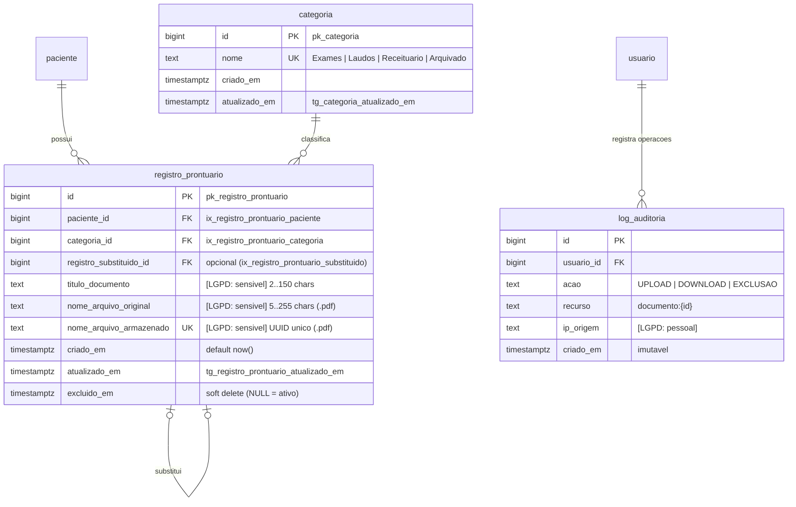

# Delta do Modelo de Dados: Prontuários Digitais e Anexos

> **ID da Spec:** `SPEC-003`  
> **Status:** Aplicado via Migration Inicial (`001_esquema_inicial.sql`)  
> **Referência Funcional:** [spec.md](spec.md)  
> **Modelo Conceitual Global:** [domain-model.md](../../memory/domain-model.md)  
> **Foco:** **Mapeamento Conceitual ➔ Lógico no Schema `amde_digital` (PostgreSQL 18) e Alinhamento JPA/Hibernate 6**

---

## 1. Mapeamento Conceitual ➔ Materialização Lógica

> Esta seção evidencia a derivação do Modelo Conceitual (`domain-model.md`) e dos requisitos da `SPEC-003` para o Modelo Lógico PostgreSQL 18 já materializado em [`001_esquema_inicial.sql`](../../../backend/src/main/resources/db/changelog/migrations/001_esquema_inicial.sql).

| Elemento Conceitual (DER / Spec) | Materialização Lógica (Tabela / Coluna / Constraint) | Alocação da Regra (Banco vs. Aplicação) | Justificativa / Rastreabilidade |
|---|---|---|---|
| `REGISTRO_PRONTUARIO` (documento PDF clínico) | Tabela `amde_digital.registro_prontuario`, PK `id` (`pk_registro_prontuario`), trigger `tg_registro_prontuario_atualizado_em` | Banco de Dados | Derivada de `domain-model.md` para atender `RF-04` |
| Vínculo titular com `PACIENTE` (`RN34`) | Coluna `paciente_id bigint not null`, FK `fk_registro_prontuario_paciente` (`on delete restrict`), índice `ix_registro_prontuario_paciente` | Banco de Dados + Aplicação | Garante integridade referencial; aplicação valida que o paciente está ativo (`excluido_em IS NULL`) |
| `CATEGORIA` fixa e classificação (`RN08`, `RN34`, `RN36`) | Tabela `amde_digital.categoria` (`uq_categoria_nome`, `ck_categoria_nome`), coluna `categoria_id bigint not null`, FK `fk_registro_prontuario_categoria`, índice `ix_registro_prontuario_categoria` | Banco de Dados + Aplicação | Quatro categorias fixas (`Exames`, `Laudos`, `Receituario`, `Arquivado`); reclassificação atualiza `categoria_id` |
| Versionamento / Substituição (`RN08`, `RN35`) | Coluna anulável `registro_substituido_id bigint`, FK `fk_registro_prontuario_substituido` (`on delete set null`), índice `ix_registro_prontuario_substituido`, constraint `ck_registro_prontuario_auto_substituicao` (`registro_substituido_id <> id`) | Banco de Dados + Aplicação | Auto-relacionamento preserva histórico; aplicação garante via lock pessimista (`PESSIMISTIC_WRITE`) que só documentos vigentes sejam substituídos |
| Título e nome original preservados (`RN07`, `RN34`, `RN38`) | `titulo_documento text not null` (`ck_registro_prontuario_titulo`: `2..150`) e `nome_arquivo_original text not null` (`ck_registro_prontuario_arquivo_original`: `5..255` e `lower(...) like '%.pdf'`) | Banco de Dados + Aplicação | Preserva metadados originais e impõe limites e extensão `.pdf` em nível de banco |
| Identificador físico único por UUID (`RN07`, `RNF-04.5`) | `nome_arquivo_armazenado text not null`, constraint `uq_registro_prontuario_arquivo_armazenado`, `ck_registro_prontuario_arquivo_armazenado` (`5..255`) | Banco de Dados + Aplicação | Garante nome interno UUID único sem colisões e nunca exposto ao cliente (`RN38`) |
| Validação de arquivo PDF < 10 MB (`RN05`, `UC13`) | Verificação de tamanho (`0 < bytes < 10.485.760`), `Content-Type` e *magic bytes* `%PDF-` | Aplicação (`PdfValidator`) | Conteúdo binário não trafega para o banco; validação ocorre antes do storage |
| Exclusão em 3 passos com auditoria prévia (`RN10`, `RN37`) | Registro síncrono `REQUIRES_NEW` em `amde_digital.log_auditoria` (`acao = 'EXCLUSAO'`), remoção do arquivo no storage e preenchimento de `excluido_em` | Aplicação + Banco de Dados | Preserva rastreabilidade mesmo em falha parcial de remoção física, com soft delete no banco |
| Auditoria de `UPLOAD` e `DOWNLOAD` (`RN16`) | Inserção assíncrona em `amde_digital.log_auditoria` via `AuditoriaService` (`SPEC-005`) | Aplicação + Banco de Dados | Dispara apenas após commit de upload ou abertura bem-sucedida do arquivo no download |

---

## 2. Origem das Decisões do Modelo

- **Definido explicitamente na Spec (`SPEC-003`):**
  - Título de `2..150` caracteres e nome original de `5..255` caracteres terminado em `.pdf` (`RN34`).
  - Quatro categorias oficiais fixas (`Exames`, `Laudos`, `Receituario`, `Arquivado`), com suporte tanto ao envio em qualquer categoria (`UC10`) quanto à reclassificação e arquivamento posterior (`RN36`).
  - Preservação de versão anterior via substituição (`RN35`) sem substituição de documentos já substituídos, arquivados ou excluídos.
  - Ordem obrigatória da exclusão (`RN37`) garantindo auditoria prévia antes de remover o arquivo físico e inativar o registro.
- **Derivado das convenções da Constituição e do Banco (`constitution.md` / `AGENTS.md` / `001_esquema_inicial.sql`):**
  - Schema `amde_digital`, colunas `text` com `CHECK`, `timestamptz`, PK `bigint generated always as identity`, soft delete via `excluido_em`, caminho físico `uploads/prontuarios/paciente-{id}/{uuid}.pdf` e tags `[LGPD: sensível]` em `titulo_documento`, `nome_arquivo_original` e `nome_arquivo_armazenado`.
- **Suposições da IA com Justificativa:**
  - Uso de bloqueio pessimista (`SELECT ... FOR UPDATE`) sobre o `RegistroProntuario` alvo durante a operação de substituição para evitar condição de corrida que gere duas versões vigentes apontando para o mesmo `registro_substituido_id`.

---

## 3. Resumo e Diagrama do Delta

### 3.1. Resumo das Alterações
| Tipo de Operação | Objeto / Tabela | Modificação Detalhada |
|---|---|---|
| `Nenhuma alteração DDL` | `amde_digital.registro_prontuario`, `amde_digital.categoria`, `amde_digital.paciente`, `amde_digital.log_auditoria` | Todas as tabelas, constraints (`pk_`, `fk_`, `uq_`, `ck_`), índices e triggers necessários para a `SPEC-003` **já estão criados** em [`001_esquema_inicial.sql`](../../../backend/src/main/resources/db/changelog/migrations/001_esquema_inicial.sql). |

### 3.2. Diagrama das Entidades Envolvidas (Mermaid)



---

## 4. Dicionário de Dados e Mapeamento JPA (`AGENTS.md`)

### Tabela: `amde_digital.registro_prontuario`

> **Política de Ciclo de Vida:** Soft delete via `excluido_em` (`NULL` = documento ativo/visível; `NOT NULL` = excluído logicamente após remoção física em `UC12`). Entidade JPA anotada com `@Table(name = "registro_prontuario", schema = "amde_digital")` e `@SQLRestriction("excluido_em IS NULL")`.

| Coluna | Tipo SQL (PG 18) | Nulo? | Mapeamento JPA / Java | Restrições / Chaves | Descrição / Classificação LGPD e Justificativa |
|---|---|---|---|---|---|
| `id` | `bigint generated always as identity` | Não | `@Id @GeneratedValue(strategy = GenerationType.IDENTITY) Long id` | `pk_registro_prontuario` | Identificador único do documento. |
| `paciente_id` | `bigint` | Não | `@ManyToOne(fetch = FetchType.LAZY) @JoinColumn(name = "paciente_id", nullable = false) Paciente paciente` | `fk_registro_prontuario_paciente`, `ix_registro_prontuario_paciente` | Titular do prontuário. |
| `categoria_id` | `bigint` | Não | `@ManyToOne(fetch = FetchType.LAZY) @JoinColumn(name = "categoria_id", nullable = false) Categoria categoria` | `fk_registro_prontuario_categoria`, `ix_registro_prontuario_categoria` | Categoria oficial do documento. |
| `registro_substituido_id` | `bigint` | Sim | `@ManyToOne(fetch = FetchType.LAZY) @JoinColumn(name = "registro_substituido_id") RegistroProntuario registroSubstituido` | `fk_registro_prontuario_substituido`, `ix_registro_prontuario_substituido`, `ck_registro_prontuario_auto_substituicao` | **Anulável** porque o primeiro envio não substitui nenhum documento prévio. |
| `titulo_documento` | `text` | Não | `@Column(name = "titulo_documento", nullable = false, columnDefinition = "text") String tituloDocumento` | `ck_registro_prontuario_titulo` (`2..150`) | `[LGPD: sensível]` Título descritivo do documento clínico. |
| `nome_arquivo_original` | `text` | Não | `@Column(name = "nome_arquivo_original", nullable = false, columnDefinition = "text") String nomeArquivoOriginal` | `ck_registro_prontuario_arquivo_original` (`5..255`, `%.pdf`) | `[LGPD: sensível]` Nome original enviado no upload, entregue no download (`RN38`). |
| `nome_arquivo_armazenado` | `text` | Não | `@Column(name = "nome_arquivo_armazenado", nullable = false, columnDefinition = "text") String nomeArquivoArmazenado` | `uq_registro_prontuario_arquivo_armazenado`, `ck_registro_prontuario_arquivo_armazenado` (`5..255`) | `[LGPD: sensível]` Nome físico único com UUID (`{uuid}.pdf`); nunca exibido ao usuário (`RN38`). |
| `criado_em` | `timestamptz` | Não | `OffsetDateTime criadoEm` | Default `now()` | Timestamp com fuso do upload. |
| `atualizado_em` | `timestamptz` | Não | `OffsetDateTime atualizadoEm` | Trigger `tg_registro_prontuario_atualizado_em` | Timestamp com fuso da última alteração (ex.: reclassificação). |
| `excluido_em` | `timestamptz` | Sim | `OffsetDateTime excluidoEm` | — | Data/hora de exclusão lógica (`NULL` = ativo). |

### Tabela: `amde_digital.categoria`

| Coluna | Tipo SQL (PG 18) | Nulo? | Mapeamento JPA / Java | Restrições / Chaves | Descrição |
|---|---|---|---|---|---|
| `id` | `bigint generated always as identity` | Não | `@Id @GeneratedValue(strategy = GenerationType.IDENTITY) Long id` | `pk_categoria` | Identificador único da categoria. |
| `nome` | `text` | Não | `@Column(name = "nome", nullable = false, columnDefinition = "text") String nome` | `uq_categoria_nome`, `ck_categoria_nome` (`2..50`) | Valores fixos: `Exames`, `Laudos`, `Receituario`, `Arquivado`. |
| `criado_em` | `timestamptz` | Não | `OffsetDateTime criadoEm` | Default `now()` | Timestamp com fuso de criação. |
| `atualizado_em` | `timestamptz` | Não | `OffsetDateTime atualizadoEm` | Trigger `tg_categoria_atualizado_em` | Timestamp com fuso da última alteração. |

---

## 5. Validação Automática do Esquema

1. Executar `sqlfluff lint --dialect postgres backend/src/main/resources/db/changelog/migrations/ data/verificacao.sql`.
2. Executar `psql -h localhost -U postgres -d amde_digital -f data/verificacao.sql` confirmando **zero linhas** nas 9 verificações estruturais e conferindo o inventário `[LGPD: sensível]` da tabela `registro_prontuario`.

---

## 6. Dados Sintéticos para Testes e Validação (Seeds)

> **Atenção:** Seeds ficam em arquivos separados das migrations estruturais (`data/seeds/003_prontuarios_seed_sintetico.sql`) e utilizam **exclusivamente massas sintéticas**, sem documentos reais de pacientes. Os arquivos PDF correspondentes no ambiente local são gerados sinteticamente por rotina de teste.

```sql
-- Arquivo sugerido: data/seeds/003_prontuarios_seed_sintetico.sql
-- Seed sintético das 4 categorias e registros de prontuário (vigente, substituído e arquivado)
set search_path = amde_digital, public;

insert into categoria (nome)
values
    ('Exames'),
    ('Laudos'),
    ('Receituario'),
    ('Arquivado')
on conflict (nome) do nothing;

with pac_teste as (
    select p.id as paciente_id
    from paciente p
    where p.excluido_em is null
    order by p.id
    limit 1
),
doc_v1 as (
    insert into registro_prontuario (
        paciente_id, categoria_id, titulo_documento, nome_arquivo_original, nome_arquivo_armazenado
    )
    select
        pt.paciente_id,
        c.id,
        'Exame Auditivo Sintetico v1',
        'exame-v1.pdf',
        '11111111-1111-4111-8111-111111111111.pdf'
    from pac_teste pt
    cross join categoria c
    where c.nome = 'Exames'
    on conflict (nome_arquivo_armazenado) do nothing
    returning id, paciente_id, categoria_id
),
doc_v2 as (
    insert into registro_prontuario (
        paciente_id, categoria_id, registro_substituido_id, titulo_documento, nome_arquivo_original, nome_arquivo_armazenado
    )
    select
        d.paciente_id,
        d.categoria_id,
        d.id,
        'Exame Auditivo Sintetico v2',
        'exame-v2.pdf',
        '22222222-2222-4222-8222-222222222222.pdf'
    from doc_v1 d
    on conflict (nome_arquivo_armazenado) do nothing
    returning id
)
insert into registro_prontuario (
    paciente_id, categoria_id, titulo_documento, nome_arquivo_original, nome_arquivo_armazenado
)
select
    pt.paciente_id,
    c.id,
    'Documento Antigo Arquivado Sintetico',
    'documento-arquivado.pdf',
    '33333333-3333-4333-8333-333333333333.pdf'
from pac_teste pt
cross join categoria c
where c.nome = 'Arquivado'
on conflict (nome_arquivo_armazenado) do nothing;
```
