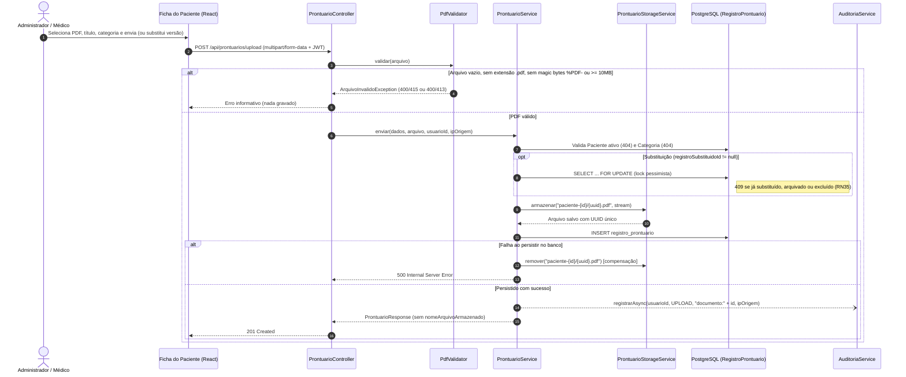

# Plano Técnico de Implementação: Prontuários Digitais e Anexos

> **ID da Spec:** `SPEC-003`  
> **Status:** Planejamento  
> **Referência Funcional:** [spec.md](spec.md)  
> **Delta de Banco de Dados:** [data-model.md](data-model.md)  
> **Foco:** **Como** (Arquitetura, Decisões de Engenharia, Interfaces, Segurança e Testes)

---

## 1. Visão Técnica Geral e Abordagem

A implementação da **`SPEC-003`** entrega o ciclo de vida completo de documentos clínicos em PDF (upload, validação estrita, substituição com versionamento, reclassificação/arquivamento, download seguro e exclusão auditada), garantindo conformidade com a LGPD, a Resolução CFM nº 1.821/2007 e a [constitution.md](../../memory/constitution.md).

### Decisões Arquiteturais Principais

1. **Abstração de Armazenamento Seguro (`ProntuarioStorageService`, `RN07`, `RNF-04.2`, `RNF-04.4`, `RNF-04.5`):**
   - Interface `ProntuarioStorageService` com duas implementações selecionadas via Spring `@Profile`:
     - `LocalFileSystemStorageService` (desenvolvimento e testes): grava em `${UPLOAD_DIR}` (padrão `uploads/prontuarios`) usando criação atômica e `Files.copy` / stream direto, sem carregar o arquivo inteiro em memória.
     - `S3ProntuarioStorageService` (produção AWS S3): grava em bucket privado sem acesso público.
   - Chave física padronizada pela Constituição (§2 e §3.1): `paciente-{pacienteId}/{uuid}.pdf` sob a raiz configurada (`uploads/prontuarios/paciente-{pacienteId}/{uuid}.pdf`).
   - **Prevenção de colisão e path traversal:** o `nome_arquivo_armazenado` é gerado exclusivamente pelo back-end via `UUID.randomUUID()` + `".pdf"` (`uq_registro_prontuario_arquivo_armazenado`). O `nome_arquivo_original` enviado pelo cliente é salvo apenas como metadado no banco e **nunca** entra na composição de caminhos no sistema de arquivos ou S3, além de nunca ser exposto na API (`RN38`). Nenhum endpoint estático expõe a pasta de uploads (`RNF-04.2`).

2. **Validação Estrita de Arquivo PDF (`PdfValidator` — `UC13`, `RF-04.2`, `RN05`, `RN34`):**
   - Executada em memória/stream sobre os primeiros bytes **antes** de qualquer gravação física ou persistência no banco:
     1. Verifica se o arquivo não está ausente nem vazio (`size > 0`).
     2. Verifica o limite exclusivo de tamanho: `size < 10.485.760` bytes (`10 MB` binários). Arquivos com `10.485.760` bytes ou mais são rejeitados (`400 Bad Request` / `413 Payload Too Large`), incluindo interceptação de `MaxUploadSizeExceededException` no `GlobalExceptionHandler`.
     3. Valida `nome_arquivo_original` entre 5 e 255 caracteres terminando em `.pdf` (case-insensitive, alinhado a `ck_registro_prontuario_arquivo_original`).
     4. Valida `Content-Type` (`application/pdf`) e os 5 primeiros bytes do conteúdo binário (*magic bytes* `%PDF-`), rejeitando com `400 Bad Request` (ou `415 Unsupported Media Type`) arquivos renomeados ou corrompidos (`Cenário 2`).

3. **Upload, Substituição/Versionamento e Compensação (`UC10`, `RF-04.1`, `RF-04.4`, `RN34`, `RN35`):**
   - Endpoints `POST /api/prontuarios/upload` e `POST /api/prontuarios/{id}/substituir` (`multipart/form-data`), protegidos com `@PreAuthorize("hasAnyRole('ADMINISTRADOR', 'MEDICO')")` (`403` para `PACIENTE`).
   - Valida existência e estado ativo do paciente (`404` se inexistente/inativado), título (`2..150` chars após `trim()`) e categoria oficial (`Exames`, `Laudos`, `Receituario`, `Arquivado`).
   - **Substituição (`RN35`):** quando `registroSubstituidoId` é informado (no upload ou via `/substituir`), o `ProntuarioService` adquire **lock pessimista** (`@Lock(LockModeType.PESSIMISTIC_WRITE)`) no registro alvo para serializar substituições simultâneas (`Seção 8`). Valida que o alvo existe e está ativo (`404`), não pertence à categoria `Arquivado` e ainda não foi substituído por outro registro ativo (`409 Conflict` caso contrário). O novo registro herda `paciente_id` e `categoria_id` do documento substituído e usa o título informado (ou o anterior como padrão).
   - **Limpeza compensatória (`UC10` Fluxo Alternativo Passo 6):** grava o arquivo físico no storage e persiste `RegistroProntuario`; se ocorrer falha na persistência ou commit (`TransactionSynchronization.afterCompletion(STATUS_ROLLED_BACK)` / bloco `catch`), o arquivo físico recém-gravado é removido imediatamente, evitando arquivos órfãos.
   - Após commit bem-sucedido, dispara assincronamente o evento `UPLOAD` via `AuditoriaService` (`RN16`, `RN44`).

4. **Reclassificação e Arquivamento (`RF-04.5`, `RN08`, `RN36`):**
   - Endpoint `PATCH /api/prontuarios/{id}/categoria` (restrito a `ADMINISTRADOR` e `MEDICO`) altera apenas `categoria_id` do registro ativo (`404` se inexistente/excluído) para `Exames`, `Laudos`, `Receituario` ou `Arquivado`, sem modificar o arquivo físico e sem gerar evento de auditoria.

5. **Download Seguro e Auditado (`UC11`, `RF-04.3`, `RN06`, `RN09`, `RN38`):**
   - Endpoint `GET /api/prontuarios/{id}/download`:
     1. Busca o `RegistroProntuario` ativo (`404` se inexistente ou excluído).
     2. Se o solicitante for `PACIENTE`, valida `registro.paciente.usuario.id.equals(usuarioAutenticado.id)` (`403 Forbidden` se pertencer a outro paciente, sem ler o arquivo nem gravar `DOWNLOAD`).
     3. Verifica existência e legibilidade do recurso no `ProntuarioStorageService`; se ausente/ilegível, retorna `500 Internal Server Error` com mensagem genérica, **sem expor caminhos internos** e **sem registrar `DOWNLOAD`** (`RN09`, `Cenário 8`).
     4. Com o stream validado para entrega, dispara assincronamente o evento `DOWNLOAD` no `AuditoriaService` (`RN16`, `RN44`) e devolve `200 OK` com `Content-Type: application/pdf` e cabeçalho `Content-Disposition` contendo o `nome_arquivo_original` codificado em UTF-8 (`filename` + `filename*`), entregando os bytes idênticos aos enviados (`RNF-04.4`).

6. **Exclusão em 3 Passos com Auditoria Prévia Síncrona (`UC12`, `RF-04.6`, `RN10`, `RN37`, `RN44`):**
   - Endpoint `DELETE /api/prontuarios/{id}` (restrito a `ADMINISTRADOR` e `MEDICO`):
     1. Localiza o registro ativo (`404` se inexistente ou já excluído).
     2. **Passo 1 (Auditoria Prévia Síncrona):** invoca `AuditoriaService.registrarSincrono(usuarioId, AcaoAuditoria.EXCLUSAO, "documento:" + id, ipOrigem)` em transação autônoma (`Propagation.REQUIRES_NEW`). Se a gravação falhar, a exclusão é abortada com `500` antes de tocar no arquivo ou no registro (`RN37`, `RN44`).
     3. **Passo 2 (Remoção Física):** executa `storageService.remover(chaveArmazenada)`. Se falhar, lança exceção (`500`), mantendo o registro ativo no banco (`excluido_em IS NULL`) e preservando o evento `EXCLUSAO` já gravado em transação autônoma como registro da tentativa (`RN37`, `Cenário 14`).
     4. **Passo 3 (Inativação Lógica):** preenche `excluido_em = OffsetDateTime.now()` em `registro_prontuario`, comita e retorna `204 No Content`.

---

## 2. Metas Técnicas Derivadas dos RNFs

| ID RNF (Origem Spec) | Meta Técnica Quantificável | Decisão de Arquitetura / Solução Técnica |
|---|---|---|
| **RNF-04.1** | Upload < 5s e início de download < 2s no p95 para PDFs < 10 MB | Streaming direto (`InputStream`/`Resource` e `MultipartFile.getInputStream()`) sem carregamento integral em `byte[]`, além de índices em `paciente_id` e `id`. |
| **RNF-04.2** | 100% dos downloads autenticados/autorizados e 0 URLs públicas | Armazenamento privado fora da raiz web (`uploads/prontuarios`), ausência de exposição estática e checagem de JWT + RBAC/titularidade em `GET /api/prontuarios/{id}/download`. |
| **RNF-04.3** | 0 ocorrências de conteúdo, título ou nome original em logs/erros | Logs SLF4J registram apenas `documentoId` e `pacienteId`; exceções de storage devolvem mensagem genérica ao cliente sem incluir caminhos de disco/S3 ou nomes de arquivo. |
| **RNF-04.4** | Integridade byte a byte entre arquivo enviado e baixado | Transferência binária sem recodificação, validada em testes comparando SHA-256 do arquivo enviado com o recebido no download. |
| **RNF-04.5** | 0 colisões/sobrescritas mesmo em envios simultâneos de mesmo nome | Nomenclatura física por `UUID` único (`uq_registro_prontuario_arquivo_armazenado`) garantindo caminhos distintos no storage. |
| **RNF-04.6** | Progresso de upload, feedback sem reload, modal de exclusão e acesso por teclado | Axios `onUploadProgress`, formulários reativos sem refresh, `AlertDialog` com backdrop na exclusão e suporte integral a `Tab`, `Enter` e `Esc`. |

---

## 3. Componentes e Camadas Impactadas

| Camada / Módulo | Componentes Impactados | Responsabilidade Técnica |
|---|---|---|
| **Front-end Web (`frontend/`)** | `UploadProntuarioModal`, `SubstituirProntuarioModal`, `ReclassificarCategoriaDialog`, `ConfirmarExclusaoProntuarioDialog`, `prontuarioService.ts` | Upload `multipart/form-data` com barra de progresso, substituição de versão vigente, alteração de categoria/arquivamento, download via Blob com nome original e confirmação modal de exclusão. |
| **API Controller (`backend/`)** | `ProntuarioController`, `GlobalExceptionHandler` | Exposição das rotas `/api/prontuarios/**`, `@PreAuthorize`, tratamento de `MaxUploadSizeExceededException` (`413`) e respostas padronizadas (`400`, `401`, `403`, `404`, `409`, `413`, `415`, `500`). |
| **Serviço / Caso de Uso (`backend/`)** | `ProntuarioService`, `PdfValidator`, `ProntuarioStorageService` (`LocalFileSystemStorageService` / `S3ProntuarioStorageService`) | Validação de Magic Bytes/tamanho, upload com compensação física, substituição com lock pessimista, reclassificação/arquivamento, download seguro e exclusão em 3 passos. |
| **Mappers (`backend/`)** | `ProntuarioMapper` (MapStruct) | Conversão de `RegistroProntuario` para `ProntuarioResponse` omitindo sempre `nomeArquivoArmazenado` (`RN38`). |
| **Repositório / Persistência (`backend/`)** | `RegistroProntuario`, `Categoria`, `RegistroProntuarioRepository`, `CategoriaRepository` | Mapeamento JPA/Hibernate 6 em `amde_digital`, `@Lock(PESSIMISTIC_WRITE)`, `@SQLRestriction("excluido_em IS NULL")`, `columnDefinition = "text"` e `OffsetDateTime`. |
| **Banco de Dados (`PostgreSQL 18`)** | [`001_esquema_inicial.sql`](../../../backend/src/main/resources/db/changelog/migrations/001_esquema_inicial.sql) | Tabelas `registro_prontuario` e `categoria`, FKs, constraints `ck_registro_prontuario_*`, unicidade `uq_registro_prontuario_arquivo_armazenado` e trigger `tg_registro_prontuario_atualizado_em`. |
| **Auditoria e Logs (`backend/`)** | `AuditoriaService` (`SPEC-005`) | Gravação assíncrona de `UPLOAD` e `DOWNLOAD` (`RN44`) e gravação síncrona prévia `REQUIRES_NEW` de `EXCLUSAO` (`RN10`, `RN37`). |

---

## 4. Diagramas de Sequência da Solução

### 4.1. Upload e Substituição com Validação de Magic Bytes (`UC10`, `UC13`, `UC20`)



### 4.2. Download Autorizado (`UC11`) e Exclusão em 3 Passos (`UC12`, `RN37`)

```mermaid
sequenceDiagram
    autonumber
    actor U as Usuário Autenticado
    participant C as ProntuarioController
    participant S as ProntuarioService
    participant AUD as AuditoriaService
    participant ST as ProntuarioStorageService
    participant DB as PostgreSQL (RegistroProntuario)

    rect rgb(240, 248, 255)
        Note over U,DB: Download Seguro (GET /api/prontuarios/{id}/download)
        U->>C: GET /api/prontuarios/{id}/download
        C->>S: prepararDownload(id, usuarioAutenticado, ipOrigem)
        S->>DB: Busca registro ativo (404 se ausente/excluído)
        S->>S: Se PACIENTE, valida titularidade (403 se outro paciente)
        S->>ST: abrirRecurso("paciente-{id}/{uuid}.pdf")
        alt Arquivo físico ausente ou ilegível
            ST-->>S: RecursoAusenteException
            S-->>C: 500 Internal Server Error (sem gravar DOWNLOAD)
        else Recurso disponível
            ST-->>S: Resource / InputStream
            S--)AUD: registrarAsync(usuarioId, DOWNLOAD, "documento:" + id, ipOrigem)
            S-->>C: Resource + nomeArquivoOriginal
            C-->>U: 200 OK (application/pdf + Content-Disposition)
        end
    end

    rect rgb(254, 242, 242)
        Note over U,DB: Exclusão em 3 Passos (DELETE /api/prontuarios/{id})
        U->>C: DELETE /api/prontuarios/{id} (Admin / Médico)
        C->>S: excluir(id, usuarioId, ipOrigem)
        S->>DB: Busca registro ativo (404 se ausente/excluído)
        S->>AUD: 1. registrarSincrono(REQUIRES_NEW: EXCLUSAO, "documento:" + id, ipOrigem)
        alt Falha ao gravar auditoria
            AUD-->>S: ErroAuditoriaException
            S-->>C: 500 (arquivo e registro intactos)
        else Auditoria gravada
            S->>ST: 2. remover("paciente-{id}/{uuid}.pdf")
            alt Falha ao remover arquivo físico
                ST-->>S: ErroStorageException
                S-->>C: 500 (registro continua ativo; tentativa permanece auditada)
            else Arquivo removido
                S->>DB: 3. UPDATE registro_prontuario SET excluido_em = now()
                S-->>C: Concluído
                C-->>U: 204 No Content
            end
        end
    end
```

---

## 5. Plano de Interface e Componentes (UI Plan)

- **Ponto de Integração na Aplicação:**
  - As ações desta spec integram-se diretamente ao histórico documental da ficha do paciente nas rotas `/pacientes` (`ADMINISTRADOR` e `MEDICO`) e `/meu-prontuario` (`PACIENTE` — apenas botão de download).
- **Componentes Base (Shadcn/ui + Tailwind CSS via [`design/tokens.json`](../../../design/tokens.json)):**
  - `UploadProntuarioModal` (`Button` primário `"Enviar Documento"` visível apenas para Admin/Médico): inputs para título (`2..150` chars, `*`), seletor de categoria (`Exames`, `Laudos`, `Receituário`, `Arquivado`, `*`), seletor de arquivo PDF (`accept=".pdf,application/pdf"`) com validação antecipada de extensão/tamanho (< 10 MB) e barra de progresso (`Progress`).
  - `SubstituirProntuarioModal` (acionado em documentos em situação `Vigente`): informa o título opcional (pré-preenchido com o título atual), exige novo PDF válido e atualiza o histórico preservando a versão anterior marcada como `"Substituído"`.
  - `ReclassificarCategoriaDialog` e ação rápida **"Arquivar"** (visíveis apenas para Admin/Médico em documentos não excluídos).
  - Ação **"Baixar"** (visível para Admin, Médico e Paciente titular): dispara `GET /api/prontuarios/{id}/download` via Axios (`responseType: 'blob'`) preservando o nome original sem abrir endereço previsível.
  - `ConfirmarExclusaoProntuarioDialog` (`AlertDialog` com fundo escurecido *backdrop* e suporte a `Esc`): exibe aviso explícito de que o arquivo físico será removido permanentemente antes da inativação do registro (`RNF-04.6`).
- **Acessibilidade e Feedback:**
  - Feedback por `Toast` / alerta inline sem recarregar a página, foco retornado ao acionador ao fechar modais e suporte integral a `Tab`, `Enter` e `Esc`.

---

## 6. Endpoints e Contratos de API

- **Arquivo de Contrato:** [`contracts/api-contract.yaml`](contracts/api-contract.yaml)
- **Rotas Envolvidas:**
  - `POST /api/prontuarios/upload` — Envio de novo documento PDF (ou substituição via `registroSubstituidoId`) (`UC10`, `UC13`).
  - `POST /api/prontuarios/{id}/substituir` — Substituição explícita de documento vigente preservando histórico (`UC10`, `UC13`).
  - `PATCH /api/prontuarios/{id}/categoria` — Reclassificação entre categorias ou arquivamento na categoria `Arquivado` (`RN36`).
  - `GET /api/prontuarios/{id}/download` — Download autenticado do PDF original (`UC11`).
  - `DELETE /api/prontuarios/{id}` — Exclusão em 3 passos (auditoria prévia síncrona, remoção física e inativação lógica) (`UC12`).

---

## 7. Estratégia de Testes

1. **Testes Unitários (JUnit 5 + Mockito):**
   - `PdfValidatorTest`: arquivo de 0 byte, extensão `.pdf` com conteúdo PNG/TXT (sem magic bytes `%PDF-`), exatamente `10.485.760` bytes (`>= 10 MB` rejeitado), `10.485.759` bytes aceito e nome original > 255 chars rejeitado.
   - `ProntuarioServiceTest`: compensação removendo arquivo físico quando a persistência falha, bloqueio `409` ao substituir documento já substituído/arquivado/excluído (`RN35`), ordem estrita da exclusão em 3 passos (`RN37`), preservação do registro ativo e do log de tentativa se a remoção física falhar (`Cenário 14`), e omissão de `DOWNLOAD` se arquivo físico faltar (`Cenário 8`).
2. **Testes de Integração e Concorrência (Spring Boot Test + Testcontainers PostgreSQL 18 + Storage Temporário):**
   - Comparação de hash **SHA-256** entre o PDF enviado e o baixado (`RNF-04.4`), preservando nomes originais acentuados (`RN38`).
   - Teste concorrente de dois uploads simultâneos com o mesmo `nome_arquivo_original` (`RNF-04.5`, zero sobrescrita).
   - Teste concorrente de duas substituições simultâneas do mesmo documento (`1` sucesso `201` + `1` `409 Conflict`, `Seção 8`).
   - Controle de acesso (`403` para `PACIENTE` em escrita e no download de terceiros; `404` após exclusão).
3. **Testes de Front-end e Aceitação BDD (Vitest + Testing Library + E2E):**
   - Cobertura completa dos **14 cenários BDD** da [`spec.md`](spec.md).
   - Verificação de ausência de título, nome original e caminhos internos em logs e respostas de erro (`RNF-04.3`).

---

## 8. Definição de Pronto (Definition of Done - DoD)

- [ ] Contrato [`contracts/api-contract.yaml`](contracts/api-contract.yaml) validado e sincronizado entre front-end e back-end.
- [ ] Validação SQL com `sqlfluff lint --dialect postgres` e [`data/verificacao.sql`](../../../data/verificacao.sql) (zero linhas nas 9 consultas) concluída.
- [ ] Checklist de Banco de Dados ([`AGENTS.md`](../../../AGENTS.md)) e `ddl-auto=validate` aprovados com `amde_digital_app`.
- [ ] Regras `RN05`–`RN10`, `RN16` e `RN34`–`RN38` implementadas, incluindo exclusão em 3 passos com auditoria prévia síncrona (`REQUIRES_NEW`).
- [ ] Todos os 14 cenários BDD da [`spec.md`](spec.md), teste de integridade SHA-256 (`RNF-04.4`) e testes de concorrência (`RNF-04.5` e substituição simultânea) aprovados.
- [ ] Componentes de upload (com progresso), substituição, reclassificação/arquivamento, download e modal de exclusão operando por teclado (`Tab`, `Enter`, `Esc`).
