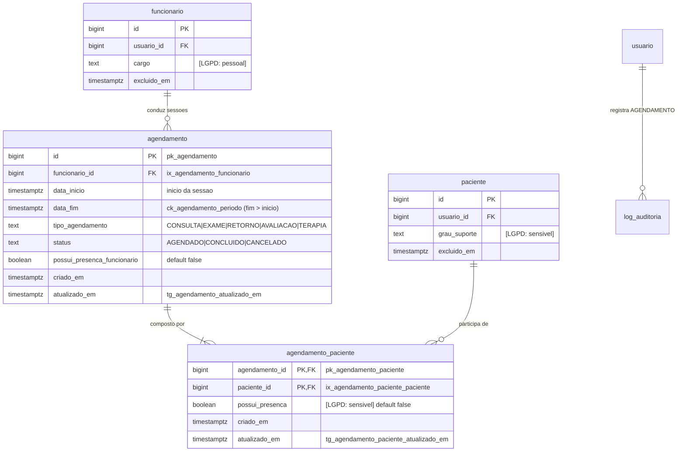

# Delta do Modelo de Dados: Agendamentos e Consultas

> **ID da Spec:** `SPEC-004`  
> **Status:** Aplicado via Migration Inicial (`001_esquema_inicial.sql`)  
> **Referência Funcional:** [spec.md](spec.md)  
> **Modelo Conceitual Global:** [domain-model.md](../../memory/domain-model.md)  
> **Foco:** **Mapeamento Conceitual ➔ Lógico no Schema `amde_digital` (PostgreSQL 18) e Alinhamento JPA/Hibernate 6**

---

## 1. Mapeamento Conceitual ➔ Materialização Lógica

> Esta seção evidencia a derivação do Modelo Conceitual (`domain-model.md`) e dos requisitos da `SPEC-004` para o Modelo Lógico PostgreSQL 18 já materializado em [`001_esquema_inicial.sql`](../../../backend/src/main/resources/db/changelog/migrations/001_esquema_inicial.sql).

| Elemento Conceitual (DER / Spec) | Materialização Lógica (Tabela / Coluna / Constraint) | Alocação da Regra (Banco vs. Aplicação) | Justificativa / Rastreabilidade |
|---|---|---|---|
| `AGENDAMENTO` (sessão clínica) | Tabela `amde_digital.agendamento`, PK `id` (`pk_agendamento`), trigger `tg_agendamento_atualizado_em` | Banco de Dados | Derivada de `domain-model.md` para atender `RF-05` |
| Profissional responsável (`RN11`, `RN40`) | `funcionario_id bigint not null`, FK `fk_agendamento_funcionario` (`on delete restrict`), índice `ix_agendamento_funcionario` | Banco de Dados + Aplicação | Banco garante integridade referencial; aplicação valida `MEDICO` ativo e lock pessimista na gravação |
| Consistência temporal de datas (`RN12`) | `data_inicio timestamptz not null`, `data_fim timestamptz not null`, constraint `ck_agendamento_periodo CHECK (data_fim > data_inicio)` | Banco de Dados + Aplicação | Banco veta término <= início; aplicação garante também `data_inicio > now()` na criação/edição (`RN41`) |
| Tipos e situação do agendamento (`RN14`, `RN39`) | `tipo_agendamento text not null` (`ck_agendamento_tipo`: `CONSULTA`, `EXAME`, `RETORNO`, `AVALIACAO`, `TERAPIA`), `status text not null default 'AGENDADO'` (`ck_agendamento_status`: `AGENDADO`, `CONCLUIDO`, `CANCELADO`) | Banco de Dados + Aplicação | Banco restringe domínios fechados; aplicação governa transições válidas (`AGENDADO` ➔ `CONCLUIDO`/`CANCELADO`) e preserva histórico sem `excluido_em` |
| Conflito de horário do profissional (`RN13`, `RN41`, `RNF-05.2`) | Índice parcial `ix_agendamento_funcionario_periodo` em `(funcionario_id, data_inicio, data_fim) WHERE status <> 'CANCELADO'` + consulta temporal sob lock pessimista em `funcionario` | Banco de Dados + Aplicação | Índice parcial acelera consultas ignorando cancelados (`RNF-05.1`); lock e consulta garantem `409 Conflict` sob concorrência |
| `AGENDAMENTO_PACIENTE` (vínculo N:N e presença individual, `RN14`, `RN40`, `RN42`) | Tabela `amde_digital.agendamento_paciente`, PK composta `(agendamento_id, paciente_id)` (`pk_agendamento_paciente`), `possui_presenca boolean not null default false`, FKs `fk_agendamento_paciente_agendamento` (`on delete cascade`) e `fk_agendamento_paciente_paciente` (`on delete restrict`), índice `ix_agendamento_paciente_paciente`, trigger `tg_agendamento_paciente_atualizado_em` | Banco de Dados + Aplicação | PK composta impede repetição do mesmo paciente na mesma sessão (`RN40`) e cobre a indexação da 1ª coluna (`agendamento_id`); aplicação exige `>= 1` paciente por sessão |
| Presença do profissional (`RN14`, `RN42`) | `possui_presenca_funcionario boolean not null default false` em `agendamento` | Banco de Dados + Aplicação | Aplicação libera registro/correção apenas a partir de `data_inicio` e nunca em `CANCELADO` |
| Visibilidade por perfil e minimização em grupo (`RN15`, `RN43`, `RNF-05.3`) | Filtros por `nivel_acesso`/`usuario_id` na consulta e filtragem do DTO `pacientes` para `PACIENTE` | Aplicação (Service / Mapper) | Evita exposição de outros participantes em sessões coletivas |
| Auditoria de operações (`RN16`) | Inserção assíncrona em `amde_digital.log_auditoria` (`acao = 'AGENDAMENTO'`) via `AuditoriaService` | Aplicação + Banco de Dados | Registra criar, editar, cancelar, concluir e presença apenas com identificador e operação (`RN47`) |

---

## 2. Origem das Decisões do Modelo

- **Definido explicitamente na Spec (`SPEC-004`):**
  - Sessões individuais ou em grupo (`1..n` pacientes sem repetição por agendamento).
  - Cancelamento muda `status` para `CANCELADO` sem exclusão física nem uso de `excluido_em` (preservação do histórico).
  - Presenças independentes do profissional (`possui_presenca_funcionario`) e de cada paciente (`possui_presenca`), iniciando como `false` e alteráveis apenas a partir de `data_inicio` em sessões não canceladas (`RN42`).
  - Minimização LGPD para `PACIENTE` ocultando identidade e presença de terceiros em sessões em grupo (`RN43`).
- **Derivado das convenções da Constituição e do Banco (`constitution.md` / `AGENTS.md` / `001_esquema_inicial.sql`):**
  - Schema `amde_digital`, timestamps com fuso `timestamptz` (`OffsetDateTime` no Java), enums mapeados como `text` + `CHECK` + `@Enumerated(EnumType.STRING)`, booleanos com prefixo `possui_*`, chave primária composta na associativa mapeada com `@EmbeddedId` (`AgendamentoPacienteId`) e `@MapsId`, e tag `[LGPD: sensível]` em `agendamento_paciente.possui_presenca`.
- **Suposições da IA com Justificativa:**
  - Aquisição de lock pessimista na linha de `funcionario` (e não apenas em linhas existentes de `agendamento`) porque, quando o profissional ainda não possui nenhum agendamento no intervalo, um lock sobre linhas de `agendamento` não bloquearia duas inserções concorrentes simultâneas.

---

## 3. Resumo e Diagrama do Delta

### 3.1. Resumo das Alterações
| Tipo de Operação | Objeto / Tabela | Modificação Detalhada |
|---|---|---|
| `Nenhuma alteração DDL` | `amde_digital.agendamento`, `amde_digital.agendamento_paciente`, `amde_digital.funcionario`, `amde_digital.paciente` | Todas as tabelas, PK composta, constraints `ck_agendamento_*`, FKs, índice parcial `ix_agendamento_funcionario_periodo` e triggers `tg_*_atualizado_em` necessários para a `SPEC-004` **já existem** em [`001_esquema_inicial.sql`](../../../backend/src/main/resources/db/changelog/migrations/001_esquema_inicial.sql). |

### 3.2. Diagrama das Entidades Envolvidas (Mermaid)



---

## 4. Dicionário de Dados e Mapeamento JPA (`AGENTS.md`)

### Tabela: `amde_digital.agendamento`

> **Política de Ciclo de Vida:** Não utiliza `excluido_em`; o cancelamento altera `status` para `'CANCELADO'` preservando o histórico da agenda. Entidade JPA anotada com `@Table(name = "agendamento", schema = "amde_digital")`.

| Coluna | Tipo SQL (PG 18) | Nulo? | Mapeamento JPA / Java | Restrições / Chaves | Descrição |
|---|---|---|---|---|---|
| `id` | `bigint generated always as identity` | Não | `@Id @GeneratedValue(strategy = GenerationType.IDENTITY) Long id` | `pk_agendamento` | Identificador único do agendamento. |
| `funcionario_id` | `bigint` | Não | `@ManyToOne(fetch = FetchType.LAZY) @JoinColumn(name = "funcionario_id", nullable = false) Funcionario funcionario` | `fk_agendamento_funcionario`, `ix_agendamento_funcionario` | Profissional de saúde responsável (`MEDICO`). |
| `data_inicio` | `timestamptz` | Não | `@Column(name = "data_inicio", nullable = false) OffsetDateTime dataInicio` | `ck_agendamento_periodo`, `ix_agendamento_funcionario_periodo` | Data e hora de início da sessão. |
| `data_fim` | `timestamptz` | Não | `@Column(name = "data_fim", nullable = false) OffsetDateTime dataFim` | `ck_agendamento_periodo` (`data_fim > data_inicio`), `ix_agendamento_funcionario_periodo` | Data e hora de encerramento da sessão. |
| `tipo_agendamento` | `text` | Não | `@Enumerated(EnumType.STRING) @Column(name = "tipo_agendamento", nullable = false, columnDefinition = "text") TipoAgendamento tipoAgendamento` | `ck_agendamento_tipo` | Modalidade: `CONSULTA`, `EXAME`, `RETORNO`, `AVALIACAO` ou `TERAPIA`. |
| `status` | `text` | Não | `@Enumerated(EnumType.STRING) @Column(name = "status", nullable = false, columnDefinition = "text") StatusAgendamento status` | Padrão `'AGENDADO'`, `ck_agendamento_status` | Situação: `AGENDADO`, `CONCLUIDO` ou `CANCELADO`. |
| `possui_presenca_funcionario` | `boolean` | Não | `@Column(name = "possui_presenca_funcionario", nullable = false) boolean possuiPresencaFuncionario` | Padrão `false` | Presença do profissional responsável. |
| `criado_em` | `timestamptz` | Não | `OffsetDateTime criadoEm` | Default `now()` | Timestamp com fuso de criação. |
| `atualizado_em` | `timestamptz` | Não | `OffsetDateTime atualizadoEm` | Trigger `tg_agendamento_atualizado_em` | Timestamp com fuso da última alteração. |

### Tabela: `amde_digital.agendamento_paciente`

> **Política de Ciclo de Vida:** Mantida junto ao registro de `agendamento`. Chave composta mapeada via `@Embeddable AgendamentoPacienteId` (`agendamentoId`, `pacienteId`) e `@EmbeddedId` + `@MapsId` conforme [`AGENTS.md`](../../../AGENTS.md).

| Coluna | Tipo SQL (PG 18) | Nulo? | Mapeamento JPA / Java | Restrições / Chaves | Descrição / Classificação LGPD |
|---|---|---|---|---|---|
| `agendamento_id` | `bigint` | Não | `@EmbeddedId AgendamentoPacienteId id` + `@MapsId("agendamentoId") @ManyToOne(fetch = FetchType.LAZY) Agendamento agendamento` | `pk_agendamento_paciente` (1ª col.), `fk_agendamento_paciente_agendamento` | Sessão clínica vinculada. |
| `paciente_id` | `bigint` | Não | `@EmbeddedId AgendamentoPacienteId id` + `@MapsId("pacienteId") @ManyToOne(fetch = FetchType.LAZY) Paciente paciente` | `pk_agendamento_paciente` (2ª col.), `fk_agendamento_paciente_paciente`, `ix_agendamento_paciente_paciente` | Paciente participante. |
| `possui_presenca` | `boolean` | Não | `@Column(name = "possui_presenca", nullable = false) boolean possuiPresenca` | Padrão `false` | `[LGPD: sensível]` Confirmação de comparecimento do paciente à sessão clínica. |
| `criado_em` | `timestamptz` | Não | `OffsetDateTime criadoEm` | Default `now()` | Timestamp com fuso de criação do vínculo. |
| `atualizado_em` | `timestamptz` | Não | `OffsetDateTime atualizadoEm` | Trigger `tg_agendamento_paciente_atualizado_em` | Timestamp com fuso da última atualização de presença. |

---

## 5. Validação Automática do Esquema

1. Executar `sqlfluff lint --dialect postgres backend/src/main/resources/db/changelog/migrations/ data/verificacao.sql`.
2. Executar `psql -h localhost -U postgres -d amde_digital -f data/verificacao.sql` confirmando **zero linhas** nas 9 verificações estruturais e conferindo o inventário `[LGPD: sensível]` da coluna `agendamento_paciente.possui_presenca`.

---

## 6. Dados Sintéticos para Testes e Validação (Seeds)

> **Atenção:** Seeds ficam em arquivos separados das migrations estruturais (`data/seeds/004_agendamentos_seed_sintetico.sql`) e utilizam **exclusivamente massas sintéticas**, sem qualquer dado real da AMDE.

```sql
-- Arquivo sugerido: data/seeds/004_agendamentos_seed_sintetico.sql
-- Seed sintético de agendamentos individuais e em grupo (AGENDADO, CONCLUIDO e CANCELADO)
set search_path = amde_digital, public;

with prof as (
    select id from funcionario where excluido_em is null order by id limit 1
),
pacs as (
    select id from paciente where excluido_em is null order by id limit 2
),
ag_futuro as (
    insert into agendamento (funcionario_id, data_inicio, data_fim, tipo_agendamento, status)
    select
        prof.id,
        now() + interval '2 days',
        now() + interval '2 days 1 hour',
        'TERAPIA',
        'AGENDADO'
    from prof
    returning id
),
ag_concluido as (
    insert into agendamento (
        funcionario_id, data_inicio, data_fim, tipo_agendamento, status, possui_presenca_funcionario
    )
    select
        prof.id,
        now() - interval '2 days',
        now() - interval '2 days' + interval '50 minutes',
        'CONSULTA',
        'CONCLUIDO',
        true
    from prof
    returning id
),
ag_cancelado as (
    insert into agendamento (funcionario_id, data_inicio, data_fim, tipo_agendamento, status)
    select
        prof.id,
        now() + interval '3 days',
        now() + interval '3 days 1 hour',
        'RETORNO',
        'CANCELADO'
    from prof
    returning id
)
insert into agendamento_paciente (agendamento_id, paciente_id, possui_presenca)
select ag_futuro.id, pacs.id, false
from ag_futuro
cross join pacs
union all
select ag_concluido.id, (select id from pacs limit 1), true
from ag_concluido
union all
select ag_cancelado.id, (select id from pacs limit 1), false
from ag_cancelado
on conflict do nothing;
```
