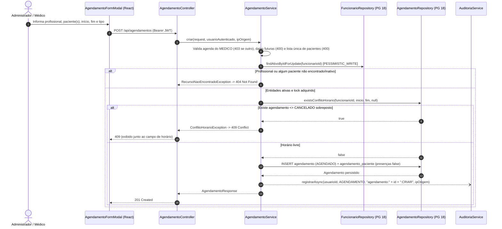

# Plano Técnico de Implementação: Agendamentos e Consultas

> **ID da Spec:** `SPEC-004`  
> **Status:** Planejamento  
> **Referência Funcional:** [spec.md](spec.md)  
> **Delta de Banco de Dados:** [data-model.md](data-model.md)  
> **Foco:** **Como** (Arquitetura, Decisões de Engenharia, Interfaces, Segurança e Testes)

---

## 1. Visão Técnica Geral e Abordagem

A implementação da **`SPEC-004`** entrega o núcleo de agenda clínica do **AMDE Digital** (criação individual e em grupo, prevenção de choque de horários sob concorrência, edição, conclusão, cancelamento sem exclusão física, registro independente de presença e visibilidade segregada por perfil), respeitando integralmente a [constitution.md](../../memory/constitution.md) e as convenções JPA/PostgreSQL 18 de [AGENTS.md](../../../AGENTS.md).

### Decisões Arquiteturais Principais

1. **Criação e Edição de Agendamentos (`UC14`, `UC16`, `RF-05.1`, `RF-05.2`, `RF-05.4`, `RN11`, `RN12`, `RN14`, `RN39`–`RN41`, `RN43`):**
   - Os endpoints `POST /api/agendamentos` e `PUT /api/agendamentos/{id}` são restritos a `ADMINISTRADOR` e `MEDICO` (`403 Forbidden` para `PACIENTE`).
   - **Autorização por agenda (`RN43`):** o `ADMINISTRADOR` seleciona qualquer `funcionarioId` ativo; o `MEDICO` só pode criar e editar agendamentos em que ele próprio é o responsável (`funcionarioId` correspondente ao seu `usuario_id`), recebendo `403 Forbidden` caso informe ou tente operar agendamento de outro profissional. Na edição (`PUT`), o `funcionarioId` é imutável (`400 Bad Request` se enviado diferente do atual — `RN40`).
   - **Validações de entrada e pré-existência:**
     - `dataFim > dataInicio` (`RN12`) e `dataInicio > OffsetDateTime.now()` (`RN41`) — rejeita com `400 Bad Request` caso contrário.
     - Lista `pacientesIds` obrigatória com ao menos 1 paciente e sem IDs duplicados (`400 Bad Request` caso vazia ou repetida — `RN40`).
     - Existência e estado ativo (`excluido_em IS NULL`) do `Funcionario` (com usuário de perfil `MEDICO`) e de todos os `Paciente` informados (`404 Not Found` se algum não existir ou estiver inativo — `RN11`, `RN40`).
   - **Estado inicial e preservação na edição:** na criação, `status` inicia como `AGENDADO`, `possui_presenca_funcionario = false` e cada vínculo `AgendamentoPaciente` (`@EmbeddedId AgendamentoPacienteId`) inicia com `possui_presenca = false` (`RN14`). A edição só é permitida quando `status == AGENDADO` (`409 Conflict` se `CONCLUIDO` ou `CANCELADO` — `RN39`). Ao editar a lista de pacientes, os mantidos preservam sua presença atual, os novos iniciam com `false` e os removidos têm seu vínculo excluído da associativa.

2. **Verificação de Conflito e Controle de Concorrência (`UC18`, `RF-05.3`, `RN13`, `RN41`, `RNF-05.2`):**
   - Na criação (`UC14`) e na edição (`UC16`), antes de checar sobreposição de horários, a transação `@Transactional` adquire **lock pessimista** (`@Lock(LockModeType.PESSIMISTIC_WRITE)`) sobre a linha do `Funcionario` responsável (`SELECT f FROM Funcionario f WHERE f.id = :funcionarioId AND f.excluidoEm IS NULL`). Isso serializa transações simultâneas para o mesmo profissional e assegura que duas requisições concorrentes em horários sobrepostos resultem em exatamente 1 agendamento criado e 1 `409 Conflict` (`RNF-05.2`, `Cenário 15`).
   - A consulta de sobreposição utiliza o índice parcial `ix_agendamento_funcionario_periodo` (`WHERE status <> 'CANCELADO'`) com semântica de intervalo semiaberto `[data_inicio, data_fim)`:
     - `a.funcionario.id = :funcionarioId AND a.status <> 'CANCELADO' AND (:idIgnorado IS NULL OR a.id <> :idIgnorado) AND a.dataInicio < :novoFim AND a.dataFim > :novoInicio`.
     - Sessões adjacentes (`existente.dataFim.equals(novoInicio)`) **não** conflitam (`RN41`, `Cenário 6`), e agendamentos `CANCELADO` são ignorados.

3. **Cancelamento, Conclusão e Registro de Presença (`UC16`, `UC17`, `RF-05.5`, `RF-05.6`, `RN39`, `RN42`):**
   - **Cancelamento (`DELETE /api/agendamentos/{id}`, `UC17`):** exige `status == AGENDADO` (`409 Conflict` se `CONCLUIDO` ou `CANCELADO` — `RN39`). Atualiza `status` para `CANCELADO` (sem nunca executar `DELETE` físico), preservando o histórico e liberando automaticamente o horário no índice parcial.
   - **Conclusão (`PATCH /api/agendamentos/{id}/concluir`, `UC16`):** exige `status == AGENDADO` **e** `OffsetDateTime.now() >= dataInicio` (`409 Conflict` se antes do horário de início ou se em situação final — `RN39`, `RN42`). Não exige presenças previamente marcadas.
   - **Registro e Correção de Presença (`PATCH /api/agendamentos/{id}/presenca`, `UC16`):** permitido quando `status` é `AGENDADO` ou `CONCLUIDO` **e** `OffsetDateTime.now() >= dataInicio` (`409 Conflict` se `status == CANCELADO` ou se antes de `dataInicio` — `RN42`). Atualiza de forma independente `possui_presenca_funcionario` e/ou `possui_presenca` de cada paciente participante informado.

4. **Listagem, Consulta Detalhada e Minimização LGPD em Grupo (`UC15`, `UC19`, `RF-05.7`, `RF-05.8`, `RN15`, `RN43`, `RNF-05.3`):**
   - `GET /api/agendamentos` (`UC19`) aceita `termo` (busca por nome do paciente ou profissional até 100 chars), `dataInicio` e `dataFim` (rejeitando intervalo invertido com `400`), `status`, `tipoAgendamento`, `funcionarioId` (aplicado apenas ao `ADMINISTRADOR`), paginação (`page=0`, `size=10`, máximo `50`) e ordenação (`ASC`/`DESC`, padrão `dataInicio ASC`).
   - `GET /api/agendamentos` e `GET /api/agendamentos/{id}` (`UC15`) aplicam filtro automático por perfil:
     - `ADMINISTRADOR`: visualiza todos os agendamentos e todos os participantes.
     - `MEDICO`: visualiza apenas os agendamentos sob sua responsabilidade (`403 Forbidden` em `{id}` de outro profissional).
     - `PACIENTE`: visualiza apenas agendamentos em que participa em `agendamento_paciente` (`403 Forbidden` em `{id}` de que não participa; `404 Not Found` se `{id}` não existe). **Minimização LGPD (`RN43`, `RNF-05.3`):** ao mapear o DTO de resposta para um usuário `PACIENTE`, o `AgendamentoMapper` filtra a lista `pacientes` mantendo **exclusivamente o registro do próprio paciente autenticado** (ocultando nomes e presenças de outros participantes em sessões em grupo).

5. **Auditoria Assíncrona e Fuso Horário (`UC20`, `RF-05.9`, `RN16`, `RN41`, `RN47`):**
   - Criação (`UC14`), edição, conclusão, presença (`UC16`) e cancelamento (`UC17`) disparam `AuditoriaService.registrarAsync` com `acao = 'AGENDAMENTO'` e `recurso` técnico sem PII (`"agendamento:{id}:CRIAR"`, `"agendamento:{id}:EDITAR"`, `"agendamento:{id}:CANCELAR"`, `"agendamento:{id}:CONCLUIR"`, `"agendamento:{id}:PRESENCA"`). Falhas de gravação seguem a `RN44` sem bloquear a operação.
   - Datas e horas trafegam em ISO-8601 com fuso (`OffsetDateTime` / `timestamptz`) e são formatadas no front-end em `America/Sao_Paulo`.

---

## 2. Metas Técnicas Derivadas dos RNFs

| ID RNF (Origem Spec) | Meta Técnica Quantificável | Decisão de Arquitetura / Solução Técnica |
|---|---|---|
| **RNF-05.1** | p95 < 500 ms na listagem e na checagem de conflito com 10.000 agendamentos | Índice parcial composto `ix_agendamento_funcionario_periodo (funcionario_id, data_inicio, data_fim) WHERE status <> 'CANCELADO'`, índices em `agendamento_paciente (paciente_id)` e consultas paginadas. |
| **RNF-05.2** | 2 requisições simultâneas conflitantes geram exatamente 1 criação e 1 `409 Conflict` | Lock pessimista `PESSIMISTIC_WRITE` sobre a linha de `funcionario` durante criação e edição (`SELECT ... FOR UPDATE`), serializando a verificação temporal na mesma transação. |
| **RNF-05.3** | 0 vazamentos de dados de outros pacientes ao perfil `PACIENTE` em sessões em grupo | Filtro obrigatório da coleção `pacientes` no `AgendamentoMapper` baseado no `pacienteId` autenticado, tanto em `GET /api/agendamentos` quanto em `GET /api/agendamentos/{id}`. |
| **RNF-05.4** | Feedback sem reload, 4 estados de tela, fuso `America/Sao_Paulo` e conflito no campo de horário | Conversão consistente para `America/Sao_Paulo` na UI, exibição de erro `409` vinculado ao campo de data/horário do formulário e componentes `Skeleton`, `EmptyState`, `ErrorState` e `Table`. |
| **RNF-05.5** | Operação integral por teclado (`Tab`, `Enter`, `Esc`), foco visível e contraste ≥ 4,5:1 | Componentes Shadcn/ui (Radix UI), modal de confirmação de cancelamento com backdrop e tokens exclusivos de [`design/tokens.json`](../../../design/tokens.json). |

---

## 3. Componentes e Camadas Impactadas

| Camada / Módulo | Componentes Impactados | Responsabilidade Técnica |
|---|---|---|
| **Front-end Web (`frontend/`)** | `AgendamentosPage`, `AgendamentoFormModal`, `AgendamentoDetalheModal`, `PresencaModal`, `ConfirmarCancelamentoDialog`, `agendamentoService.ts` | Listagem paginada (`/agendamentos`), filtros (período, situação, tipo, busca), formulário com seleção múltipla de pacientes e alerta de conflito no horário, controle de presença, conclusão e cancelamento com backdrop. |
| **API Controller (`backend/`)** | `AgendamentoController` | Exposição das 7 rotas `/api/agendamentos/**`, `@PreAuthorize` para escrita restrita a Admin/Médico, `@Valid` e extração do usuário autenticado. |
| **Serviço / Caso de Uso (`backend/`)** | `AgendamentoService` | Regras `RN11`–`RN16` e `RN39`–`RN43`, lock pessimista no `Funcionario`, máquina de estados, controle temporal de conclusão/presença e auditoria `AGENDAMENTO`. |
| **Mappers (`backend/`)** | `AgendamentoMapper` (MapStruct / customizador por perfil) | Conversão de `Agendamento` + `AgendamentoPaciente` para `AgendamentoResponse` aplicando minimização LGPD para `PACIENTE`. |
| **Repositório / Persistência (`backend/`)** | `Agendamento`, `AgendamentoPaciente`, `AgendamentoPacienteId`, `TipoAgendamento`, `StatusAgendamento`, `AgendamentoRepository`, `FuncionarioRepository` (`findAtivoByIdWithLock`) | Mapeamento JPA/Hibernate 6 em `amde_digital`: `@EmbeddedId` + `@MapsId` na associativa `agendamento_paciente`, `OffsetDateTime` e `@Enumerated(EnumType.STRING)` com `columnDefinition = "text"`. |
| **Banco de Dados (`PostgreSQL 18`)** | [`001_esquema_inicial.sql`](../../../backend/src/main/resources/db/changelog/migrations/001_esquema_inicial.sql) | Tabelas `agendamento` e `agendamento_paciente`, PK composta, `ck_agendamento_periodo`, índice parcial `ix_agendamento_funcionario_periodo` e triggers `tg_*_atualizado_em`. |
| **Auditoria e Logs (`backend/`)** | `AuditoriaService` (`SPEC-005`) | Registro assíncrono do evento `AGENDAMENTO` indicando identificador e operação realizada (`RN47`). |

---

## 4. Diagramas de Sequência da Solução

### 4.1. Criação de Agendamento com Lock Pessimista e Checagem de Conflito (`UC14`, `UC18`, `UC20`)



### 4.2. Presença, Conclusão, Cancelamento e Minimização LGPD (`UC15`, `UC16`, `UC17`)

```mermaid
sequenceDiagram
    autonumber
    actor A as Admin / Médico / Paciente
    participant C as AgendamentoController
    participant S as AgendamentoService
    participant AR as AgendamentoRepository (PG 18)
    participant AUD as AuditoriaService

    rect rgb(240, 253, 244)
        Note over A,AUD: Registrar Presença / Concluir (Admin ou Médico responsável)
        A->>C: PATCH /api/agendamentos/{id}/presenca (ou /concluir)
        C->>S: registrarPresenca / concluir(id, usuarioAutenticado, ipOrigem)
        S->>AR: findById(id) [404 se ausente; 403 se MEDICO de outra agenda]
        alt Status == CANCELADO ou Agora < dataInicio
            S-->>C: ConflitoEstadoException -> 409 Conflict
        else Válido (Agora >= dataInicio)
            S->>AR: Atualiza presenças ou status = CONCLUIDO
            S--)AUD: registrarAsync(usuarioId, AGENDAMENTO, "agendamento:" + id + ":PRESENCA|CONCLUIR", ipOrigem)
            S-->>C: AgendamentoResponse
            C-->>A: 200 OK
        end
    end

    rect rgb(240, 248, 255)
        Note over A,AUD: Consultar Detalhe por Paciente em Sessão em Grupo (UC15)
        A->>C: GET /api/agendamentos/{id} (JWT PACIENTE)
        C->>S: buscarPorId(id, usuarioAutenticado)
        S->>AR: findByIdComParticipantes(id) [404 se ausente; 403 se não participa]
        S->>S: Filtra lista pacientes mantendo apenas o próprio paciente autenticado (RNF-05.3)
        S-->>C: AgendamentoResponse (sem dados dos demais pacientes)
        C-->>A: 200 OK
    end
```

---

## 5. Plano de Interface e Componentes (UI Plan)

- **Rota da Aplicação:** `/agendamentos` (tela inicial pós-login para `MEDICO` e `PACIENTE`; acessível pelo menu lateral para `ADMINISTRADOR`).
- **Componentes Base (Shadcn/ui + Tailwind CSS via [`design/tokens.json`](../../../design/tokens.json)):**
  - Barra de filtros: busca textual, intervalo de datas (rejeitando período invertido), seletor de `status` (`AGENDADO`, `CONCLUIDO`, `CANCELADO`), seletor de `tipoAgendamento` (`CONSULTA`, `EXAME`, `RETORNO`, `AVALIACAO`, `TERAPIA`) e filtro por profissional (visível apenas para `ADMINISTRADOR`).
  - `Table` com cabeçalhos ordenáveis (`ASC`/`DESC`), paginação na base (`10`, `20`, `50`), horários exibidos explicitamente no fuso `America/Sao_Paulo` e `Badge` semântico de status (`Agendado` `status.info`, `Concluído` `status.success`, `Cancelado` `status.danger`) e tipo (`Retorno`/`Avaliação` `status.warning`).
  - `AgendamentoFormModal` (criação e edição — habilitado para Admin e Médico): seleção de profissional (bloqueado para o próprio Médico logado e bloqueado na edição), seleção múltipla de pacientes ativos para sessões individuais ou em grupo, seleção de início/fim e tipo, exibindo mensagem de conflito `409` diretamente junto ao campo de horário (`RNF-05.4`).
  - `AgendamentoDetalheModal`: para `PACIENTE`, exibe exclusivamente data/horário, tipo, situação, profissional e a própria presença (sem nomes nem presenças dos demais pacientes em sessões em grupo).
  - `PresencaModal` e ação **"Concluir"**: habilitados para Admin e Médico responsável quando a sessão já iniciou (`Agora >= dataInicio`) e não está `CANCELADO`.
  - `ConfirmarCancelamentoDialog` (`AlertDialog` com *backdrop* escurecido e suporte a `Esc`): confirma a mudança de situação para `CANCELADO` preservando o histórico (`UC17`).
- **Comportamento por Estado Obrigatório (`RNF-05.4`, `RNF-05.5`):**
  - *Carregando* (`Skeleton`), *Vazio* (ícone + orientação), *Erro* (alerta com ação **"Recarregar"**) e *Sucesso*, com operação integral por teclado (`Tab`, `Enter`, `Esc`).

---

## 6. Endpoints e Contratos de API

- **Arquivo de Contrato:** [`contracts/api-contract.yaml`](contracts/api-contract.yaml)
- **Rotas Envolvidas:**
  - `POST /api/agendamentos` — Criar agendamento individual ou em grupo com checagem de conflito (`UC14`, `UC18`).
  - `GET /api/agendamentos` — Listar agendamentos com filtros, ordenação, paginação e visibilidade por perfil (`UC19`).
  - `GET /api/agendamentos/{id}` — Consultar detalhe do agendamento com minimização LGPD (`UC15`).
  - `PUT /api/agendamentos/{id}` — Editar horário, tipo e lista de pacientes de agendamento `AGENDADO` (`UC16`, `UC18`).
  - `PATCH /api/agendamentos/{id}/presenca` — Registrar ou corrigir presença do profissional e de cada paciente (`UC16`).
  - `PATCH /api/agendamentos/{id}/concluir` — Concluir agendamento `AGENDADO` após o horário de início (`UC16`).
  - `DELETE /api/agendamentos/{id}` — Cancelar agendamento `AGENDADO` sem exclusão física (`UC17`).

---

## 7. Estratégia de Testes

1. **Testes Unitários (JUnit 5 + Mockito):**
   - `AgendamentoServiceTest`: validações de datas (`dataFim <= dataInicio`, `dataInicio <= now`), bloqueio de edição sem trocar `funcionarioId`, pacientes duplicados (`400`), limites exatos de conflito (fim de uma = início da outra permitido; `CANCELADO` ignorado; `CONCLUIDO` bloqueia), bloqueio de conclusão/presença antes de `dataInicio` ou em `CANCELADO` (`409`), autorização por agenda do Médico (`403`) e minimização LGPD para `PACIENTE` (`RNF-05.3`).
2. **Testes de Integração e Concorrência (Spring Boot Test + Testcontainers PostgreSQL 18):**
   - Teste concorrente com 2 threads disparando `POST /api/agendamentos` simultaneamente para o mesmo profissional em intervalos sobrepostos, validando exatamente 1 `201 Created` e 1 `409 Conflict` (`RNF-05.2`, `Cenário 15`).
   - Persistência real da chave composta `@EmbeddedId AgendamentoPacienteId`, triggers `atualizado_em`, visibilidade na sessão em grupo (`RNF-05.3`) e disparo de eventos `AGENDAMENTO` (`RN16`).
3. **Testes de Front-end e Aceitação BDD (Vitest + Testing Library + E2E/Axe):**
   - Cobertura completa dos **15 cenários BDD** de [`spec.md`](spec.md).
   - Verificação de acessibilidade WCAG 2.1 AA com Axe DevTools (`RNF-05.5`), fuso `America/Sao_Paulo` e desempenho p95 < 500 ms com massa de 10.000 agendamentos (`RNF-05.1`).

---

## 8. Definição de Pronto (Definition of Done - DoD)

- [ ] Contrato [`contracts/api-contract.yaml`](contracts/api-contract.yaml) validado e sincronizado entre front-end e back-end.
- [ ] Validação SQL com `sqlfluff lint --dialect postgres` e [`data/verificacao.sql`](../../../data/verificacao.sql) (zero linhas nas 9 consultas) concluída.
- [ ] Checklist de Banco de Dados ([`AGENTS.md`](../../../AGENTS.md)) e `ddl-auto=validate` aprovados com `amde_digital_app` (incluindo `@EmbeddedId AgendamentoPacienteId`).
- [ ] Regras `RN11`–`RN16` e `RN39`–`RN43` implementadas com lock pessimista contra conflitos simultâneos (`RNF-05.2`) e minimização LGPD em sessões em grupo (`RNF-05.3`).
- [ ] Todos os 15 cenários BDD da [`spec.md`](spec.md) executados e aprovados.
- [ ] Interface `/agendamentos` acessível (WCAG 2.1 AA), com modal de cancelamento com backdrop, exibição de horários em `America/Sao_Paulo` e 4 estados de tela.
