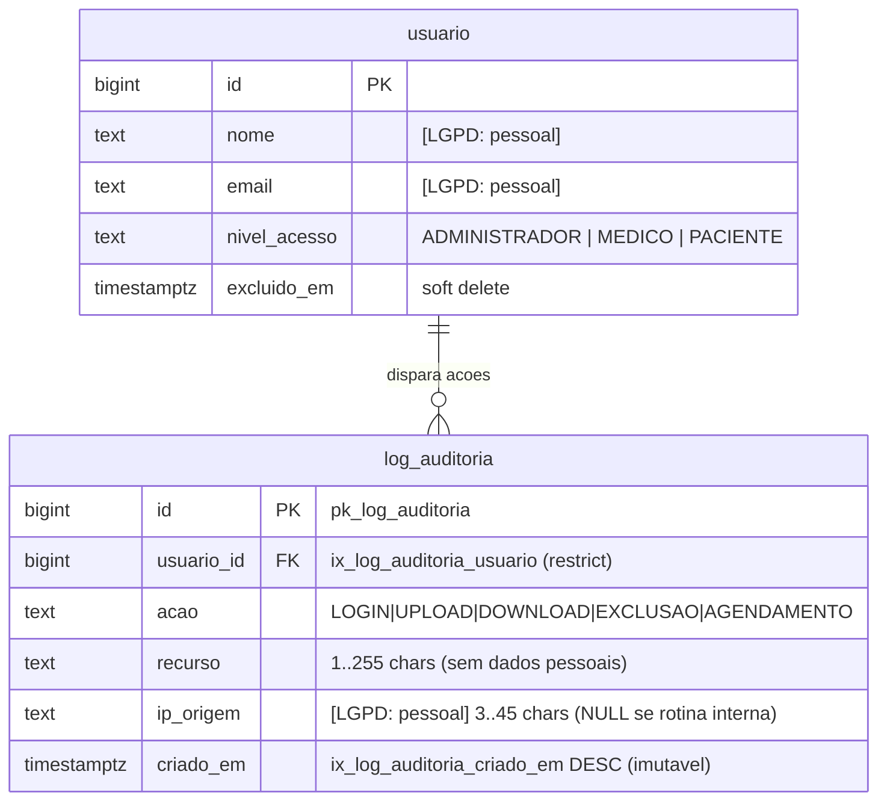

# Delta do Modelo de Dados: Auditoria e Segurança

> **ID da Spec:** `SPEC-005`  
> **Status:** Aplicado via Migration Inicial (`001_esquema_inicial.sql`)  
> **Referência Funcional:** [spec.md](spec.md)  
> **Modelo Conceitual Global:** [domain-model.md](../../memory/domain-model.md)  
> **Foco:** **Mapeamento Conceitual ➔ Lógico no Schema `amde_digital` (PostgreSQL 18) e Alinhamento JPA/Hibernate 6**

---

## 1. Mapeamento Conceitual ➔ Materialização Lógica

> Esta seção evidencia a derivação do Modelo Conceitual (`domain-model.md`) e dos requisitos da `SPEC-005` para o Modelo Lógico PostgreSQL 18 já materializado em [`001_esquema_inicial.sql`](../../../backend/src/main/resources/db/changelog/migrations/001_esquema_inicial.sql).

| Elemento Conceitual (DER / Spec) | Materialização Lógica (Tabela / Coluna / Constraint) | Alocação da Regra (Banco vs. Aplicação) | Justificativa / Rastreabilidade |
|---|---|---|---|
| `LOG_AUDITORIA` (trilha imutável *append-only*, `RN45`) | Tabela `amde_digital.log_auditoria`, PK `id bigint generated always as identity` (`pk_log_auditoria`); **sem** `atualizado_em`, **sem** `excluido_em` e **sem** trigger de update | Banco de Dados + Aplicação | Garante modelo estritamente *append-only*; aplicação reforça imutabilidade com `@Immutable` e ausência de rotas/métodos de alteração ou remoção (`RNF-06.3`) |
| Vínculo obrigatório com `USUARIO` responsável (`RN45`, `RN48`) | Coluna `usuario_id bigint not null`, FK `fk_log_auditoria_usuario` (`references usuario (id) on delete restrict`), índice `ix_log_auditoria_usuario` | Banco de Dados | Preserva eventos mesmo após soft delete do usuário (`RN48`) e impede remoção física do usuário referenciado |
| Catálogo fechado de ações (`RN46`) | Coluna `acao text not null`, constraint `ck_log_auditoria_acao` (`in ('LOGIN', 'UPLOAD', 'DOWNLOAD', 'EXCLUSAO', 'AGENDAMENTO')`) | Banco de Dados + Aplicação | Banco veta ações fora do catálogo; aplicação dispara eventos exclusivamente para operações bem-sucedidas |
| Identificador técnico minimizado do recurso (`RN47`) | Coluna `recurso text not null`, constraint `ck_log_auditoria_recurso` (`char_length(trim(recurso)) between 1 and 255`) | Banco de Dados + Aplicação | Sem FKs diretas para `registro_prontuario` ou `agendamento` (permite preservar o histórico mesmo se o recurso for arquivado/cancelado); aplicação formata apenas tipo, ID e operação sem PII (`RNF-06.4`) |
| IP de origem rastreável (`RN45`, `UC20`) | Coluna `ip_origem text null`, constraint `ck_log_auditoria_ip_origem` (`ip_origem is null or char_length(trim(ip_origem)) between 3 and 45`) | Banco de Dados + Aplicação | Suporta IPv4 e IPv6; **obrigatório** em requisições HTTP web na aplicação e **anulável** apenas em rotinas internas ou testes sem requisição web (`UC20`) |
| Instante exato da operação (`RNF-06.5`) | Coluna `criado_em timestamptz not null default now()`, índice `ix_log_auditoria_criado_em` (`criado_em desc`) | Banco de Dados + Aplicação | Aplicação captura `OffsetDateTime.now()` na thread da operação e o persiste explicitamente (`insertable = true`) para não sofrer atraso da fila assíncrona |
| Assincronia e exceção na exclusão de documento (`RN44`) | Fila `@Async` pós-commit vs. transação síncrona `REQUIRES_NEW` antes da remoção do PDF | Aplicação (`AuditoriaService`) | Concilia desempenho (`<= 50 ms` p95) com a exigência da `RN10` na exclusão de prontuários |

---

## 2. Origem das Decisões do Modelo

- **Definido explicitamente na Spec (`SPEC-005`):**
  - Catálogo fechado de 5 ações (`LOGIN`, `UPLOAD`, `DOWNLOAD`, `EXCLUSAO`, `AGENDAMENTO`) disparadas apenas em sucesso (`RN46`).
  - Minimização rigorosa do campo `recurso` (`1..255` caracteres) com proibição de dados pessoais/clínicos (`RN47`).
  - Obrigatoriedade de `ip_origem` em requisições HTTP web e permissão de `NULL` apenas para rotinas internas ou testes sem requisição web (`RN45`, `UC20`).
  - Preservação permanente e imutável dos registros sem rotina de expurgo ou consulta pela aplicação nesta versão (`RN48`).
- **Derivado das convenções da Constituição e do Banco (`constitution.md` / `AGENTS.md` / `001_esquema_inicial.sql`):**
  - Tabela append-only isenta de `atualizado_em`, `excluido_em` e triggers (exceção formal prevista na Constituição §3.1 e na consulta nº 9 de `data/verificacao.sql`).
  - Uso de `@org.hibernate.annotations.Immutable` no Hibernate 6 (`AGENTS.md` §6), `columnDefinition = "text"`, `OffsetDateTime` para `timestamptz` e tag `[LGPD: pessoal]` em `ip_origem`.
- **Suposições da IA com Justificativa:**
  - Mapeamento de `criado_em` com `insertable = true, updatable = false` (diferente das tabelas mutáveis com `insertable = false`) para garantir a precisão temporal exigida pela `RNF-06.5` quando a gravação ocorre em thread assíncrona.

---

## 3. Resumo e Diagrama do Delta

### 3.1. Resumo das Alterações
| Tipo de Operação | Objeto / Tabela | Modificação Detalhada |
|---|---|---|
| `Nenhuma alteração DDL` | `amde_digital.log_auditoria`, `amde_digital.usuario` | A tabela `log_auditoria`, suas constraints `pk_`, `fk_`, `ck_` e os índices `ix_log_auditoria_usuario` e `ix_log_auditoria_criado_em` **já estão criados** em [`001_esquema_inicial.sql`](../../../backend/src/main/resources/db/changelog/migrations/001_esquema_inicial.sql). |

### 3.2. Diagrama das Entidades Envolvidas (Mermaid)



---

## 4. Dicionário de Dados e Mapeamento JPA (`AGENTS.md`)

### Tabela: `amde_digital.log_auditoria`

> **Política de Ciclo de Vida:** Tabela estritamente imutável (*append-only*). Não possui `atualizado_em`, `excluido_em` nem trigger de atualização. Entidade JPA anotada com `@Table(name = "log_auditoria", schema = "amde_digital")` e `@org.hibernate.annotations.Immutable`.

| Coluna | Tipo SQL (PG 18) | Nulo? | Mapeamento JPA / Java | Restrições / Chaves | Descrição / Classificação LGPD e Justificativa |
|---|---|---|---|---|---|
| `id` | `bigint generated always as identity` | Não | `@Id @GeneratedValue(strategy = GenerationType.IDENTITY) Long id` | `pk_log_auditoria` | Identificador único do evento. |
| `usuario_id` | `bigint` | Não | `@ManyToOne(fetch = FetchType.LAZY, optional = false) @JoinColumn(name = "usuario_id", nullable = false, updatable = false) Usuario usuario` | `fk_log_auditoria_usuario`, `ix_log_auditoria_usuario` | Usuário ativo responsável no momento da operação. |
| `acao` | `text` | Não | `@Enumerated(EnumType.STRING) @Column(name = "acao", nullable = false, updatable = false, columnDefinition = "text") AcaoAuditoria acao` | `ck_log_auditoria_acao` | Tipo de evento (`LOGIN`, `UPLOAD`, `DOWNLOAD`, `EXCLUSAO`, `AGENDAMENTO`). |
| `recurso` | `text` | Não | `@Column(name = "recurso", nullable = false, updatable = false, columnDefinition = "text") String recurso` | `ck_log_auditoria_recurso` (`1..255`) | Identificador técnico minimizado do objeto afetado (sem PII ou conteúdo clínico). |
| `ip_origem` | `text` | Sim | `@Column(name = "ip_origem", updatable = false, columnDefinition = "text") String ipOrigem` | `ck_log_auditoria_ip_origem` (`3..45` ou `NULL`) | `[LGPD: pessoal]` Endereço IPv4/IPv6 de origem em requisições HTTP web. **Anulável** apenas quando o evento for disparado por rotina interna ou teste sem requisição HTTP web (`UC20`). |
| `criado_em` | `timestamptz` | Não | `@Column(name = "criado_em", nullable = false, updatable = false) OffsetDateTime criadoEm` | Default `now()`, `ix_log_auditoria_criado_em` | Instante exato da operação capturado na thread chamadora (`RNF-06.5`). |

---

## 5. Validação Automática do Esquema e Consulta de Apuração

1. Executar `sqlfluff lint --dialect postgres backend/src/main/resources/db/changelog/migrations/ data/verificacao.sql`.
2. Executar `psql -h localhost -U postgres -d amde_digital -f data/verificacao.sql` confirmando **zero linhas** nas 9 verificações estruturais e conferindo `[LGPD: pessoal]` em `log_auditoria.ip_origem`.

---

## 6. Dados Sintéticos para Testes e Validação (Seeds)

> **Atenção:** Seeds ficam em arquivos separados das migrations estruturais (`data/seeds/005_auditoria_seed_sintetico.sql`) e utilizam **exclusivamente massas sintéticas**, sem IPs ou registros reais da AMDE.

```sql
-- Arquivo sugerido: data/seeds/005_auditoria_seed_sintetico.sql
-- Seed sintético contemplando as 5 ações auditáveis e um evento interno (ip_origem NULL)
set search_path = amde_digital, public;

with usr as (
    select id
    from usuario
    where excluido_em is null
    order by id
    limit 1
)
insert into log_auditoria (usuario_id, acao, recurso, ip_origem, criado_em)
select usr.id, v.acao, v.recurso, v.ip_origem, v.criado_em
from usr
cross join (
    values
        ('LOGIN', 'usuario:1:LOGIN', '192.0.2.10', now() - interval '3 hours'),
        ('UPLOAD', 'documento:101:UPLOAD', '192.0.2.10', now() - interval '2 hours'),
        ('DOWNLOAD', 'documento:101:DOWNLOAD', '198.51.100.25', now() - interval '1 hour'),
        ('AGENDAMENTO', 'agendamento:42:CRIAR', '192.0.2.10', now() - interval '30 minutes'),
        ('EXCLUSAO', 'documento:102:EXCLUSAO', null, now() - interval '5 minutes')
) as v(acao, recurso, ip_origem, criado_em);
```
