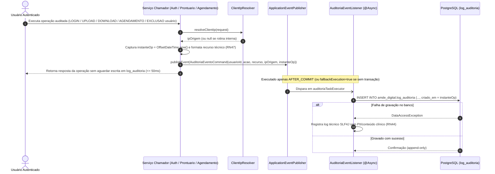
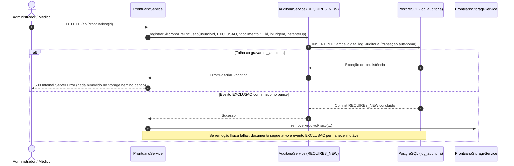

# Plano Técnico de Implementação: Auditoria e Segurança

> **ID da Spec:** `SPEC-005`  
> **Status:** Planejamento  
> **Referência Funcional:** [spec.md](spec.md)  
> **Delta de Banco de Dados:** [data-model.md](data-model.md)  
> **Foco:** **Como** (Arquitetura, Decisões de Engenharia, Garantias Transacionais e Testes)

---

## 1. Visão Técnica Geral e Abordagem

A implementação da **`SPEC-005`** provê o componente transversal de rastreabilidade imutável (`AuditoriaService`) consumido pelas `SPEC-001` (`LOGIN`, `EXCLUSAO` de usuário), `SPEC-003` (`UPLOAD`, `DOWNLOAD`, `EXCLUSAO` de documento) e `SPEC-004` (`AGENDAMENTO`), garantindo conformidade com a LGPD, a Resolução CFM nº 1.821/2007 e a [constitution.md](../../memory/constitution.md).

### Decisões Arquiteturais Principais

1. **Dois Modos de Gravação no `AuditoriaService` (`UC20`, `RF-06.1`–`RF-06.4`, `RN44`, `RN46`):**
   - **Modo 1 — Gravação Assíncrona Pós-Commit (`registrarAsync` via `ApplicationEventPublisher` + `@TransactionalEventListener(phase = TransactionPhase.AFTER_COMMIT, fallbackExecution = true)` + `@Async("auditoriaTaskExecutor")`):**
     - Utilizada em `LOGIN` (`SPEC-001`), `EXCLUSAO` de usuário (`SPEC-001`), `UPLOAD` (`SPEC-003`), `DOWNLOAD` (`SPEC-003`, disparado somente após validar existência e abertura do stream) e `AGENDAMENTO` (`SPEC-004`).
     - A fase `AFTER_COMMIT` assegura que operações que falharem, forem negadas (`401`/`403`) ou sofrerem rollback nunca gerem evento de auditoria (`RF-06.7`, `RN46`), enquanto `fallbackExecution = true` garante disparo imediato quando o fluxo chamador não abrir transação de escrita (como `LOGIN` e `DOWNLOAD`).
     - O pool `auditoriaTaskExecutor` (`ThreadPoolTaskExecutor`) utiliza fila dimensionada e `setWaitForTasksToCompleteOnShutdown(true)` com `setAwaitTerminationSeconds(10)` para drenar eventos pendentes em desligamentos graciosos (`Seção 8`).
     - **Resiliência (`RN44`, `Cenário 7`):** falhas na persistência do worker assíncrono são capturadas em `try/catch`, registradas no log técnico SLF4J apenas com código de erro e `acao` (sem PII, títulos ou conteúdo clínico — `RNF-06.4`) e nunca afetam o fluxo do usuário.
   - **Modo 2 — Gravação Síncrona Prévia (`registrarSincronoPreExclusao` com `@Transactional(propagation = Propagation.REQUIRES_NEW)`):**
     - Utilizada exclusivamente antes da remoção do PDF na exclusão de documento de prontuário (`SPEC-003`, `UC12`, `RN10`, `RN37`, `RN44`).
     - Executa e comita o registro `EXCLUSAO` em transação própria antes de remover o arquivo físico. Se falhar, a exceção interrompe a operação com `500 Internal Server Error` sem remover o arquivo físico nem inativar o registro (`Cenário 8`).

2. **Captura Síncrona do Instante da Operação e do IP do Cliente (`RF-06.2`, `RN45`, `RNF-06.5`, `Seção 8`):**
   - O instante exato (`OffsetDateTime.now()`) e o endereço IP de origem são capturados **na thread da operação** no momento em que o evento é montado (e **não** apenas no momento em que o worker assíncrono escreve no banco). Na entidade `LogAuditoria`, `criado_em` é mapeado com `insertable = true, updatable = false` para gravar exatamente o instante capturado (`RNF-06.5`).
   - O utilitário `ClientIpResolver` extrai o IP (`3..45` caracteres para IPv4/IPv6) usando `server.forward-headers-strategy=NATIVE` com lista explícita de `trusted-proxies` da infraestrutura (AWS CloudFront/ALB/Nginx), impedindo falsificação de `X-Forwarded-For` por clientes externos (`Seção 8`).
   - Quando a operação for invocada por rotina interna ou teste automatizado sem `HttpServletRequest` ativo, `ipOrigem` assume `null` (`UC20` Fluxo Alternativo Passo 1, `ck_log_auditoria_ip_origem`).

3. **Minimização LGPD e Padronização Canônica de `recurso` (`RF-06.6`, `RN47`, `RNF-06.4`):**
   - `RecursoAuditoriaFormatter` gera identificadores técnicos fechados com comprimento garantido entre `1` e `255` caracteres, proibindo a passagem de nomes, e-mails, títulos de laudos ou dados clínicos:
     - `LOGIN`: `"usuario:{usuarioId}:LOGIN"`
     - `EXCLUSAO` (usuário): `"usuario:{usuarioId}:EXCLUSAO"`
     - `UPLOAD` (envio / substituição): `"documento:{documentoId}:UPLOAD"` / `"documento:{documentoId}:SUBSTITUICAO"`
     - `DOWNLOAD`: `"documento:{documentoId}:DOWNLOAD"`
     - `EXCLUSAO` (documento): `"documento:{documentoId}:EXCLUSAO"`
     - `AGENDAMENTO`: `"agendamento:{agendamentoId}:{CRIAR|EDITAR|CANCELAR|CONCLUIR|PRESENCA}"`

4. **Imutabilidade Estrita e Apuração Técnica Fora da Aplicação (`RF-06.5`, `RN45`, `RN48`, `RNF-06.3`):**
   - `LogAuditoria` é anotada com `@org.hibernate.annotations.Immutable` ([`AGENTS.md`](../../../AGENTS.md)) e todas as colunas possuem `updatable = false`.
   - `LogAuditoriaRepository` estende `org.springframework.data.repository.Repository<LogAuditoria, Long>` (em vez de `JpaRepository`), expondo apenas `save` e consultas de leitura usadas por testes de integração, sem expor `delete*` ou `update`.
   - Em banco, a role `amde_digital_app` realiza apenas `INSERT` nesta tabela pela aplicação; nenhum controller REST ou tela exibe a trilha nesta versão (`RN17`, `RN48`). Consultas de apuração forense ocorrem por procedimento técnico controlado fora da aplicação com fuso `America/Sao_Paulo`.

---

## 2. Metas Técnicas Derivadas dos RNFs

| ID RNF (Origem Spec) | Meta Técnica Quantificável | Decisão de Arquitetura / Solução Técnica |
|---|---|---|
| **RNF-06.1** | Acréscimo <= 50 ms no p95 das operações auditadas | Publicação de evento em memória na thread HTTP + gravação fora da thread da requisição via `auditoriaTaskExecutor` (`@Async`) após commit. |
| **RNF-06.2** | 100% dos eventos válidos gravados em até 5 segundos | Pool assíncrono dedicado com múltiplas threads e fila dimensionada + dreno no shutdown (`awaitTerminationSeconds = 10`). |
| **RNF-06.3** | 0 funcionalidades ou perfis capazes de alterar/excluir eventos | Entidade `@Immutable`, ausência de triggers/colunas de update/soft-delete, `LogAuditoriaRepository` sem métodos de delete e ausência de endpoints mutáveis. |
| **RNF-06.4** | 0 vazamentos de senhas, títulos, nomes ou dados clínicos em logs/eventos | `RecursoAuditoriaFormatter` restrito a tipo, ID numérico e operação; logs técnicos de erro de auditoria exibem apenas `acao` e exceção resumida. |
| **RNF-06.5** | 100% dos eventos com instante igual ao da operação | Captura de `OffsetDateTime.now()` na thread da operação e persistência explícita desse valor em `log_auditoria.criado_em`. |

---

## 3. Componentes e Camadas Impactadas

| Camada / Módulo | Componentes Impactados | Responsabilidade Técnica |
|---|---|---|
| **Front-end Web (`frontend/`)** | *Nenhum componente visual* | Conforme `RN17` e `RN48`, nenhum perfil consulta a trilha pela interface nesta versão. |
| **API Controller (`backend/`)** | *Nenhum endpoint exclusivo* | Não há endpoints `/api/auditoria`; `GlobalExceptionHandler` garante retorno `500` genérico caso `registrarSincronoPreExclusao` falhe na `SPEC-003`. |
| **Configuração Spring (`backend/`)** | `AuditoriaAsyncConfig`, `ClientIpResolver`, `application.yml` (`forward-headers-strategy`) | Pool assíncrono `auditoriaTaskExecutor` com shutdown gracioso e resolução segura de IP de proxies confiáveis da infraestrutura. |
| **Serviço / Caso de Uso (`backend/`)** | `AuditoriaService`, `AuditoriaEventListener`, `RecursoAuditoriaFormatter`, `AuditoriaEventoCommand` | Orquestração assíncrona pós-commit (`registrarAsync`), persistência síncrona prévia (`REQUIRES_NEW`), tratamento seguro de falhas e formatação canônica de `recurso`. |
| **Repositório / Persistência (`backend/`)** | `LogAuditoria`, `AcaoAuditoria`, `LogAuditoriaRepository` | Entidade `@Immutable` mapeada no schema `amde_digital`, `columnDefinition = "text"`, `@Enumerated(EnumType.STRING)` e persistência estritamente *append-only*. |
| **Banco de Dados (`PostgreSQL 18`)** | [`001_esquema_inicial.sql`](../../../backend/src/main/resources/db/changelog/migrations/001_esquema_inicial.sql) | Tabela `log_auditoria` sem `atualizado_em`, sem `excluido_em` e sem trigger de atualização, com índices `ix_log_auditoria_usuario` e `ix_log_auditoria_criado_em`. |

---

## 4. Diagramas de Sequência da Solução

### 4.1. Gravação Assíncrona Pós-Commit e Resiliência a Falhas (`RN44`, `RNF-06.1`, `RNF-06.5`)



### 4.2. Gravação Síncrona Prévia na Exclusão de Documento (`SPEC-003`, `RN10`, `RN37`, `RN44`)



---

## 5. Plano de Operação e Consulta Técnica (Fora da Aplicação)

- **Interface na Aplicação:** Não há rotas, menus ou telas para consulta da trilha de auditoria nesta versão (`RN17`, `RN48`).
- **Procedimento Técnico Controlado de Apuração (`Seção 2`):**
  - Quando a instituição precisar apurar um acesso ou operação, o responsável técnico autorizado executa consulta somente leitura diretamente no banco com o fuso horário configurado para `America/Sao_Paulo`:
    ```sql
    set time zone 'America/Sao_Paulo';
    select
        l.id,
        l.criado_em as instante_operacao,
        l.acao,
        l.recurso,
        l.usuario_id,
        u.email as usuario_email,
        l.ip_origem
    from amde_digital.log_auditoria l
    inner join amde_digital.usuario u on u.id = l.usuario_id
    where l.criado_em between :inicio and :fim
    order by l.criado_em desc;
    ```

---

## 6. Contratos e Garantias Transversais

- **Arquivo de Contrato:** [`contracts/api-contract.yaml`](contracts/api-contract.yaml)
- Como módulo transversal sem endpoints próprios, o contrato formaliza o catálogo canônico de ações (`LOGIN`, `UPLOAD`, `DOWNLOAD`, `EXCLUSAO`, `AGENDAMENTO`), o formato técnico de `recurso`, os cabeçalhos confiáveis de IP de origem e os contratos de erro (`500` na falha de auditoria prévia).

---

## 7. Estratégia de Testes

1. **Testes Unitários (JUnit 5 + Mockito):**
   - `RecursoAuditoriaFormatterTest`: garante que todas as ações produzem strings entre 1 e 255 caracteres contendo apenas tipo, ID e operação (nunca títulos, nomes ou conteúdo clínico).
   - `ClientIpResolverTest`: valida extração de IPv4/IPv6, rejeição de cabeçalhos `X-Forwarded-For` forjados fora de proxies confiáveis e retorno `null` quando sem requisição HTTP (`UC20`).
   - `AuditoriaServiceTest`: garante captura do timestamp original da operação (`RNF-06.5`), captura segura de exceções em `registrarAsync` sem propagar para o usuário (`RN44`) e propagação de exceção em `registrarSincronoPreExclusao`.
2. **Testes de Integração e Imutabilidade (Spring Boot Test + Testcontainers PostgreSQL 18):**
   - Verifica gravação em até 5s (`RNF-06.2`) de `LOGIN`, `UPLOAD`, `DOWNLOAD`, `EXCLUSAO` e `AGENDAMENTO`, ausência de eventos para login inválido (`401`), acesso negado (`403`) e validações (`400`/`413`/`415`) (`Cenário 6`).
   - Verifica preservação dos eventos após exclusão lógica do usuário responsável (`RN48`, `Cenário 10`) e verifica que tentativas de `UPDATE` via Hibernate sobre `LogAuditoria` (`@Immutable`) são bloqueadas (`RNF-06.3`).
   - Verifica interrupção da exclusão de documento com `500` quando a escrita em `log_auditoria` falha (`Cenário 8`).
3. **Testes de Desempenho e Segurança (`RNF-06.1`, `RNF-06.4`):**
   - Benchmark comparativo sob carga garantindo overhead `<= 50 ms` no p95 nas operações auditadas assincronamente (`Cenário 9`) e varredura automatizada de logs confirmando ausência de senhas, títulos, nomes de pacientes ou descrições clínicas (`RNF-06.4`).

---

## 8. Definição de Pronto (Definition of Done - DoD)

- [ ] Contrato transversal [`contracts/api-contract.yaml`](contracts/api-contract.yaml) revisado com os padrões de evento e `recurso`.
- [ ] Validação SQL com `sqlfluff lint --dialect postgres` e [`data/verificacao.sql`](../../../data/verificacao.sql) (confirmando que `log_auditoria` é aceita como tabela imutável na consulta nº 9 e sem falhas nas demais) concluída.
- [ ] Entidade `LogAuditoria` anotada com `@Immutable` conforme [`AGENTS.md`](../../../AGENTS.md) e validada com `ddl-auto=validate` pela role `amde_digital_app`.
- [ ] `AuditoriaService` integrado em `SPEC-001`, `SPEC-003` e `SPEC-004` com gravação assíncrona pós-commit e gravação síncrona prévia `REQUIRES_NEW` na exclusão de documento.
- [ ] Todos os 11 cenários BDD da [`spec.md`](spec.md), verificação de overhead `<= 50 ms` p95 (`RNF-06.1`) e varredura de logs seguros (`RNF-06.4`) aprovados.
