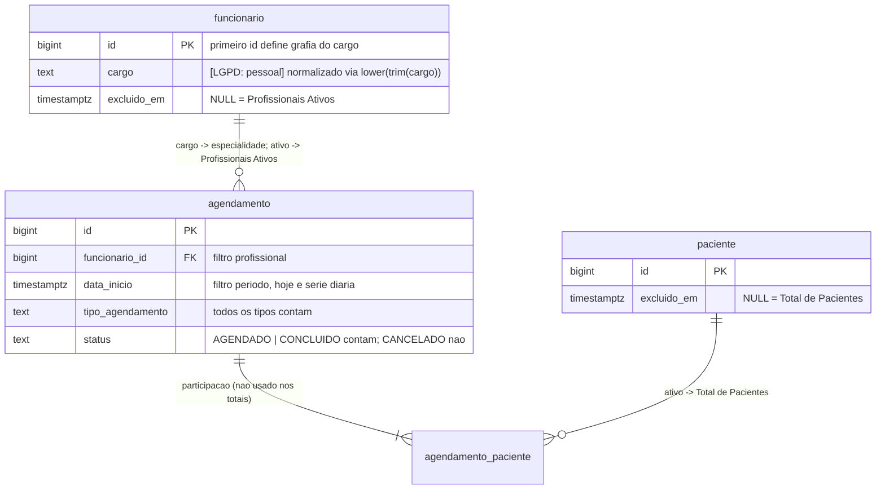

# Delta do Modelo de Dados: Dashboard Gerencial

> **ID da Spec:** `SPEC-006`  
> **Status:** Aplicado via Migration Inicial (`001_esquema_inicial.sql`) — Somente Leitura e Agregação  
> **Referência Funcional:** [spec.md](spec.md)  
> **Modelo Conceitual Global:** [domain-model.md](../../memory/domain-model.md)  
> **Foco:** **Mapeamento Conceitual ➔ Lógico no Schema `amde_digital` (PostgreSQL 18) e Consultas Analíticas**

---

## 1. Mapeamento Conceitual ➔ Materialização Lógica

> Esta seção evidencia como os indicadores e gráficos da `SPEC-006` (`UC21`) são derivados em tempo de leitura sobre as tabelas já criadas em [`001_esquema_inicial.sql`](../../../backend/src/main/resources/db/changelog/migrations/001_esquema_inicial.sql), sem criar novas tabelas nem persistir métricas (`RN52`).

| Elemento Conceitual (DER / Spec) | Materialização Lógica (Tabela / Coluna / Índice) | Alocação da Regra (Banco vs. Aplicação) | Justificativa / Rastreabilidade |
|---|---|---|---|
| `Total de Consultas` e `Consultas Hoje` (`RN50`) | Agregação `COUNT(*)` sobre `amde_digital.agendamento` (`status <> 'CANCELADO'`), aproveitando o índice parcial `ix_agendamento_funcionario_periodo` | Banco de Dados + Aplicação | Banco filtra por intervalo `timestamptz` e `funcionario_id`; aplicação converte limites de período e "hoje" para `America/Sao_Paulo` (`RF-07.1`, `RF-07.4`) |
| `Total de Pacientes` / `Pacientes Ativos` (`RN50`) | Agregação `COUNT(*)` sobre `amde_digital.paciente` (`excluido_em IS NULL` com `usuario.excluido_em IS NULL`), usando índice parcial `ix_paciente_grau_suporte` | Banco de Dados | Reflete pacientes ativos no momento do acesso (`RF-07.1`) |
| `Profissionais Ativos` (`RN50`) | Agregação `COUNT(*)` sobre `amde_digital.funcionario` (`excluido_em IS NULL` com `usuario.excluido_em IS NULL`), usando índice parcial `ix_funcionario_cargo` | Banco de Dados | Reflete equipe ativa no momento do acesso (`RF-07.1`, `UC21`) |
| Gráfico `Consultas ao Longo do Tempo` (`RN51`) | Agrupamento por `(data_inicio AT TIME ZONE 'America/Sao_Paulo')::date` sobre `agendamento` (`status <> 'CANCELADO'`) ordenado por `data ASC` | Banco de Dados + Aplicação | Garante evolução diária precisa no fuso oficial do banco (`RF-07.2`, `UC21`) |
| Gráfico `Consultas por Especialidade` (`RN51`) | `INNER JOIN` `agendamento` ➔ `funcionario` (incluindo inativados para histórico), agrupando por `lower(trim(cargo))`, rótulo do primeiro registro (`ORDER BY f.id ASC`) e ordenação `quantidade DESC, lower(especialidade) ASC` | Banco de Dados + Aplicação | Une cargos equivalentes (`"Psicologia"` e `" psicologia "`), preserva histórico de inativados e calcula percentual (`RF-07.2`, `Cenários 3, 4 e 5`) |
| Exclusividade de acesso e ausência de PII (`RN49`, `RNF-07.4`) | Autorização `@PreAuthorize("hasRole('ADMINISTRADOR')")` e projeção apenas de números, datas e rótulos de especialidade | Aplicação (Controller / Service) | Impede exposição de indicadores a `MEDICO`/`PACIENTE` e evita tráfego de PII (`RF-07.3`) |
| Coerência entre contadores e gráficos (`RN52`, `RNF-07.5`) | Execução de todas as queries em única transação `@Transactional(readOnly = true)` com o mesmo recorte de filtro | Aplicação + Banco de Dados | Garante soma das séries igual a `Total de Consultas` sem cache desatualizado |

---

## 2. Origem das Decisões do Modelo

- **Definido explicitamente na Spec (`SPEC-006`):**
  - 4 contadores (*Total de Consultas*, *Consultas Hoje*, *Total de Pacientes* e *Profissionais Ativos*), 2 gráficos (*Consultas ao Longo do Tempo* e *Consultas por Especialidade*) e filtros opcionais de Período e Profissional (`UC21`).
  - Contagem de agendamentos `AGENDADO` e `CONCLUIDO` (de qualquer `tipo_agendamento`), excluindo `CANCELADO` (`RN50`).
  - Manutenção de consultas históricas de profissionais inativados nos totais e séries, excluindo-os apenas do contador *Profissionais Ativos* (`RN50`, `RN51`).
  - Cálculo sob demanda sem tabelas materializadas ou armazenamento intermediário (`RN52`).
- **Derivado das convenções da Constituição e do Banco (`constitution.md` / `AGENTS.md` / `001_esquema_inicial.sql`):**
  - Fuso horário oficial `America/Sao_Paulo` (`00_bootstrap.sql` e Constituição §3.5), timestamps em `timestamptz` e soft delete padronizado por `excluido_em IS NULL`.
- **Suposições da IA com Justificativa:**
  - Utilização de `ORDER BY f.id ASC` como critério determinístico de "primeiro profissional cadastrado com aquele cargo" para escolher a grafia canônica da especialidade na `RN51`, garantindo resultado estável mesmo se múltiplos profissionais tiverem variações de caixa ou espaços.

---

## 3. Resumo e Diagrama do Delta

### 3.1. Resumo das Alterações
| Tipo de Operação | Objeto / Tabela | Modificação Detalhada |
|---|---|---|
| `Nenhuma alteração DDL` | `amde_digital.agendamento`, `amde_digital.funcionario`, `amde_digital.paciente` | A `SPEC-006` realiza exclusivamente leitura agregada sobre as tabelas e índices já existentes em [`001_esquema_inicial.sql`](../../../backend/src/main/resources/db/changelog/migrations/001_esquema_inicial.sql). |

### 3.2. Diagrama das Entidades Consultadas (Mermaid)



---

## 4. Consultas Analíticas de Referência (PostgreSQL 18 / Role `amde_digital_app`)

> Todas as consultas abaixo operam exclusivamente com `SELECT` pela role `amde_digital_app` dentro de uma transação `@Transactional(readOnly = true)`:

1. **Contagem de `Total de Consultas` e `Consultas Hoje`:**
   ```sql
   select
       count(*) as total_consultas,
       count(*) filter (
           where a.data_inicio >= :inicio_hoje_sp
             and a.data_inicio < :fim_hoje_sp
       ) as consultas_hoje
   from amde_digital.agendamento a
   where a.status <> 'CANCELADO'
     and (:funcionario_id is null or a.funcionario_id = :funcionario_id)
     and (:inicio_periodo is null or a.data_inicio >= :inicio_periodo)
     and (:fim_periodo is null or a.data_inicio < :fim_periodo);
   ```

2. **Contagem de `Total de Pacientes` e `Profissionais Ativos`:**
   ```sql
   select
       (
           select count(*)
           from amde_digital.paciente p
           inner join amde_digital.usuario u on u.id = p.usuario_id
           where p.excluido_em is null and u.excluido_em is null
       ) as total_pacientes,
       (
           select count(*)
           from amde_digital.funcionario f
           inner join amde_digital.usuario u on u.id = f.usuario_id
           where f.excluido_em is null and u.excluido_em is null
       ) as profissionais_ativos;
   ```

3. **Série `Consultas ao Longo do Tempo`:**
   ```sql
   select
       (a.data_inicio at time zone 'America/Sao_Paulo')::date as data,
       count(*) as quantidade
   from amde_digital.agendamento a
   where a.status <> 'CANCELADO'
     and (:funcionario_id is null or a.funcionario_id = :funcionario_id)
     and (:inicio_periodo is null or a.data_inicio >= :inicio_periodo)
     and (:fim_periodo is null or a.data_inicio < :fim_periodo)
   group by (a.data_inicio at time zone 'America/Sao_Paulo')::date
   order by data asc;
   ```

4. **Série `Consultas por Especialidade`:**
   ```sql
   with rotulos as (
       select distinct on (lower(trim(f.cargo)))
           lower(trim(f.cargo)) as chave_cargo,
           trim(f.cargo) as rotulo_oficial
       from amde_digital.funcionario f
       order by lower(trim(f.cargo)), f.id asc
   )
   select
       r.rotulo_oficial as especialidade,
       count(*) as quantidade
   from amde_digital.agendamento a
   inner join amde_digital.funcionario f on f.id = a.funcionario_id
   inner join rotulos r on r.chave_cargo = lower(trim(f.cargo))
   where a.status <> 'CANCELADO'
     and (:funcionario_id is null or a.funcionario_id = :funcionario_id)
     and (:inicio_periodo is null or a.data_inicio >= :inicio_periodo)
     and (:fim_periodo is null or a.data_inicio < :fim_periodo)
   group by r.rotulo_oficial
   order by quantidade desc, lower(r.rotulo_oficial) asc;
   ```

---

## 5. Validação Automática do Esquema

1. Executar `sqlfluff lint --dialect postgres backend/src/main/resources/db/changelog/migrations/ data/verificacao.sql`.
2. Executar `psql -h localhost -U postgres -d amde_digital -f data/verificacao.sql` confirmando **zero linhas** nas 9 verificações estruturais.

---

## 6. Dados Sintéticos para Testes e Validação (Seeds)

> **Atenção:** Seeds ficam em arquivos separados das migrations estruturais (`data/seeds/006_dashboard_seed_sintetico.sql`) e utilizam **exclusivamente massas sintéticas**, sem dados reais da AMDE.

```sql
-- Arquivo sugerido: data/seeds/006_dashboard_seed_sintetico.sql
-- Massa sintética para validar agregação de cargos equivalentes, fuso America/Sao_Paulo e profissional inativado
set search_path = amde_digital, public;

with prof_psi_espacos as (
    insert into usuario (nome, email, senha, nivel_acesso)
    values (
        'Psicologa Espacos Sintetica',
        'psi.espacos@amde.example.org',
        '$2a$10$N9qo8uLOickgx2ZMRZoMyeIjZAgcfl7p92ldGxad68LJZdL17lhWy',
        'MEDICO'
    )
    on conflict do nothing
    returning id
),
func_psi_inativo as (
    insert into funcionario (usuario_id, cargo, excluido_em)
    select id, ' psicologia ', now() - interval '1 day'
    from prof_psi_espacos
    returning id
),
prof_fono as (
    insert into usuario (nome, email, senha, nivel_acesso)
    values (
        'Fono Sintetica',
        'fono.teste@amde.example.org',
        '$2a$10$N9qo8uLOickgx2ZMRZoMyeIjZAgcfl7p92ldGxad68LJZdL17lhWy',
        'MEDICO'
    )
    on conflict do nothing
    returning id
),
func_fono as (
    insert into funcionario (usuario_id, cargo)
    select id, 'Fonoaudiologia'
    from prof_fono
    returning id
)
insert into agendamento (funcionario_id, data_inicio, data_fim, tipo_agendamento, status)
select
    func_psi_inativo.id,
    date_trunc('day', now() at time zone 'America/Sao_Paulo') at time zone 'America/Sao_Paulo' + interval '23 hours 30 minutes',
    date_trunc('day', now() at time zone 'America/Sao_Paulo') at time zone 'America/Sao_Paulo' + interval '23 hours 55 minutes',
    'CONSULTA',
    'AGENDADO'
from func_psi_inativo
union all
select
    func_fono.id,
    now() - interval '3 days',
    now() - interval '3 days' + interval '45 minutes',
    'TERAPIA',
    'CONCLUIDO'
from func_fono;
```
