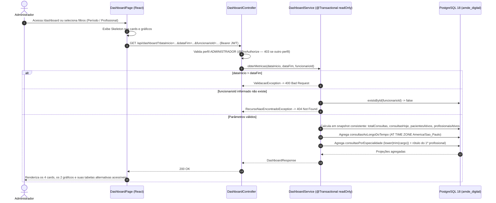

# Plano Técnico de Implementação: Dashboard Gerencial

> **ID da Spec:** `SPEC-006`  
> **Status:** Implementado  
> **Referência Funcional:** [spec.md](spec.md)  
> **Delta de Banco de Dados:** [data-model.md](data-model.md)  
> **Foco:** **Como** (Arquitetura, Decisões de Engenharia, Interfaces, Segurança e Testes)

---

## 1. Visão Técnica Geral e Abordagem

A implementação da **`SPEC-006`** entrega o painel gerencial exclusivo do `ADMINISTRADOR` (`UC21`), calculado sob demanda no momento do acesso e composto pelos **4 contadores principais** e pelos **2 gráficos analíticos**, com filtros opcionais de **Período** e **Profissional**, em estrita conformidade com a [constitution.md](../../memory/constitution.md) e [AGENTS.md](../../../AGENTS.md).

### Decisões Arquiteturais Principais

1. **Controle de Acesso Exclusivo e Privacidade (`UC21`, `RF-07.3`, `RN49`, `RNF-07.4`):**
   - O endpoint `GET /api/dashboard` é protegido com `@PreAuthorize("hasRole('ADMINISTRADOR')")`. Requisições de `MEDICO` ou `PACIENTE` recebem `403 Forbidden`, e o item `"Visão Geral / Dashboard"` é ocultado da barra lateral para esses perfis.
   - O payload de `GET /api/dashboard` retorna **exclusivamente números agregados, datas e rótulos de especialidade**, sem incluir nomes de pacientes, e-mails, identificadores de pessoas ou dados clínicos (`RNF-07.4`). A lista de seleção do filtro de profissional na interface administrativa reutiliza os dados já autorizados exclusivamente ao Administrador (`SPEC-001`, `GET /api/usuarios?nivelAcesso=MEDICO`).
   - O acesso ao Dashboard não gera evento em `log_auditoria`, pois o catálogo de ações é fechado (`SPEC-005`).

2. **Validação de Filtros e Conversão no Fuso `America/Sao_Paulo` (`RF-07.4`, `RN50`–`RN52`, `Seção 8`):**
   - `GET /api/dashboard` aceita parâmetros opcionais: `dataInicio` (`LocalDate`), `dataFim` (`LocalDate`) e `funcionarioId` (`Long`).
   - Se `dataInicio` e `dataFim` forem ambos informados e `dataInicio.isAfter(dataFim)`, a aplicação rejeita com `400 Bad Request` (`Seção 8`).
   - As datas civis do filtro são convertidas em limites `OffsetDateTime` usando `ZoneId.of("America/Sao_Paulo")`: início inclusivo `dataInicio.atStartOfDay(SP_ZONE).toOffsetDateTime()` e fim exclusivo `dataFim.plusDays(1).atStartOfDay(SP_ZONE).toOffsetDateTime()`.
   - Se `funcionarioId` for informado e não existir nenhum registro correspondente na tabela `funcionario` (nem ativo nem inativado), retorna `404 Not Found` (`Seção 8`). Profissional existente porém inativado permanece consultável para preservar o histórico (`RN51`).

3. **Cálculo Transacional Coerente dos 4 Contadores e 2 Gráficos (`RF-07.1`, `RF-07.2`, `RN50`–`RN52`, `RNF-07.5`):**
   - O `DashboardService.obterMetricas(...)` executa todas as agregações dentro de uma única transação `@Transactional(readOnly = true)`, garantindo consistência entre os contadores e as séries dos gráficos em 100% das chamadas (`RNF-07.5`) sem persistir ou cachear resultados (`RN52`):
     1. **`totalConsultas`:** quantidade de registros em `amde_digital.agendamento` com `status <> 'CANCELADO'` (`AGENDADO` ou `CONCLUIDO`), de qualquer `tipo_agendamento`, respeitando os filtros de `dataInicio`, `dataFim` e `funcionarioId`.
     2. **`consultasHoje`:** quantidade de registros em `amde_digital.agendamento` com `status <> 'CANCELADO'` cujo `data_inicio` cai no dia corrente em `America/Sao_Paulo` (`[hoje 00:00:00, amanhã 00:00:00)`), respeitando o filtro de `funcionarioId` quando aplicado.
     3. **`totalPacientes` (`pacientesAtivos`):** quantidade de pacientes ativos (`paciente.excluido_em IS NULL AND usuario.excluido_em IS NULL`).
     4. **`profissionaisAtivos`:** quantidade de funcionários ativos (`funcionario.excluido_em IS NULL AND usuario.excluido_em IS NULL`).
     5. **Gráfico 1 — `consultasAoLongoDoTempo`:** agrupa exatamente o mesmo conjunto de consultas válidas de `totalConsultas` pela data civil de `data_inicio` convertida para `America/Sao_Paulo` (`(a.data_inicio AT TIME ZONE 'America/Sao_Paulo')::date`), ordenado cronologicamente (`data ASC`) com `{ data, quantidade }`.
     6. **Gráfico 2 — `consultasPorEspecialidade`:** agrupa exatamente o mesmo conjunto de consultas válidas com `INNER JOIN amde_digital.funcionario f ON f.id = a.funcionario_id` (sem filtrar `f.excluido_em IS NULL`, mantendo consultas históricas de profissionais inativados — `RN51`, `Cenário 3`), normalizando a chave de agrupamento por `lower(trim(f.cargo))` (`Cenário 5`). O rótulo exibido usa a grafia do primeiro profissional cadastrado com aquele cargo (`FIRST_VALUE(trim(f.cargo)) OVER (PARTITION BY lower(trim(f.cargo)) ORDER BY f.id ASC)`), calcula `quantidade` e `percentual` (`round(quantidade * 100.0 / totalConsultas, 2)`) e ordena por `quantidade DESC, lower(especialidade) ASC` (`RN51`).

4. **Desempenho sob Carga (`RNF-07.1`):**
   - As consultas aproveitam o índice parcial `ix_agendamento_funcionario_periodo` (`WHERE status <> 'CANCELADO'`), `ix_funcionario_cargo` e `ix_paciente_grau_suporte`, retornando em `< 500 ms` no percentil 95 com 10.000 agendamentos e 1.000 pacientes.

---

## 2. Metas Técnicas Derivadas dos RNFs

| ID RNF (Origem Spec) | Meta Técnica Quantificável | Decisão de Arquitetura / Solução Técnica |
|---|---|---|
| **RNF-07.1** | p95 < 500 ms para os 4 contadores e 2 gráficos com 10.000 agendamentos e 1.000 pacientes | Queries agregadas executadas diretamente no PostgreSQL 18 (sem carregar entidades em memória) utilizando índices parciais existentes e transação `readOnly`. |
| **RNF-07.2** | Alternativa em tabela para ambos os gráficos, independência de cor, foco e contraste ≥ 4,5:1 | Cada gráfico possui toggle/seção de tabela HTML semântica acessível (`<table>` com `<thead>`/`<tbody>`) com os mesmos valores, rótulos/padrões visuais além da cor e tokens de [`design/tokens.json`](../../../design/tokens.json). |
| **RNF-07.3** | Skeleton, estado vazio orientativo, erro com recarregar e responsividade Tailwind | Componentes `Skeleton`, `EmptyState`, `ErrorState` (botão `"Recarregar"`) e grid responsivo (`grid-cols-1 md:grid-cols-2 lg:grid-cols-4`). |
| **RNF-07.4** | 0 dados pessoais de pacientes, e-mails ou dados clínicos expostos no Dashboard | DTO `DashboardResponse` contém exclusivamente totais inteiros, percentuais, datas e rótulos de `cargo` agregados. |
| **RNF-07.5** | 100% de igualdade entre a soma de cada gráfico e `totalConsultas` | Cálculo em uma única transação `readOnly` (snapshot consistente) utilizando exatamente os mesmos predicados de filtro para `totalConsultas`, série diária e especialidades. |

---

## 3. Componentes e Camadas Impactadas

| Camada / Módulo | Componentes Impactados | Responsabilidade Técnica |
|---|---|---|
| **Front-end Web (`frontend/`)** | `DashboardPage`, `DashboardFilters`, `MetricCardsGrid`, `ConsultasTempoChart`, `ConsultasEspecialidadeChart`, `TabelaAlternativaGrafico`, `dashboardService.ts` | Tela inicial do Administrador (`/dashboard`), barra de filtros (Período e Profissional), 4 cards de indicadores, 2 gráficos responsivos com tabelas alternativas acessíveis e os 4 estados obrigatórios. |
| **API Controller (`backend/`)** | `DashboardController` | Exposição de `GET /api/dashboard` com `@PreAuthorize("hasRole('ADMINISTRADOR')")` e validação dos query params `dataInicio`, `dataFim` e `funcionarioId`. |
| **Serviço / Caso de Uso (`backend/`)** | `DashboardService` | Orquestração em transação `readOnly`, validação de intervalo invertido (`400`) e existência de profissional (`404`), cálculo dos 4 contadores, série diária e especialidades (`RN49`–`RN52`). |
| **Repositório / Persistência (`backend/`)** | `DashboardRepository` (ou consultas agregadas em `AgendamentoRepository`, `PacienteRepository`, `FuncionarioRepository`) | Consultas SQL nativas / projeções no schema `amde_digital` (role `amde_digital_app`) com `AT TIME ZONE 'America/Sao_Paulo'` e normalização `lower(trim(cargo))`. |
| **Banco de Dados (`PostgreSQL 18`)** | [`001_esquema_inicial.sql`](../../../backend/src/main/resources/db/changelog/migrations/001_esquema_inicial.sql) | Leitura sobre `agendamento`, `funcionario` e `paciente` utilizando os índices parciais já criados (nenhuma tabela ou coluna nova necessária). |

---

## 4. Diagrama de Sequência da Solução

---

## 5. Plano de Interface e Componentes (UI Plan)

- **Rota da Aplicação:** `/dashboard` (tela inicial pós-login exclusiva do `ADMINISTRADOR`; oculta do `Sidebar` para `MEDICO` e `PACIENTE`).
- **Componentes Base (Shadcn/ui + Tailwind CSS via [`design/tokens.json`](../../../design/tokens.json)):**
  - Barra superior de filtros com seleção de **Período** (atalho padrão ex. últimos 30 dias / todo o histórico e datas inicial/final) e **Profissional** (Todos ou um funcionário específico), com validação impedindo data inicial após data final.
  - Grade responsiva com **4 Cards** de indicadores (`Total de Consultas`, `Consultas Hoje`, `Total de Pacientes`, `Profissionais Ativos`).
  - **Gráfico 1 — Consultas ao Longo do Tempo:** gráfico de linha/barras diárias com tooltip acessível e alternância/expansão para tabela alternativa (`Data` | `Quantidade`).
  - **Gráfico 2 — Consultas por Especialidade:** gráfico de barras horizontais ou pizza/rosca com rótulos diretos (não dependente apenas de cor), exibição de quantidade e percentual e tabela alternativa acessível (`Especialidade` | `Quantidade` | `Percentual (%)`).
- **Comportamento por Estado Obrigatório (`RF-07.5`, `RNF-07.2`, `RNF-07.3`):**
  - *Carregando:* `Skeleton` dos 4 cards e das áreas dos 2 gráficos.
  - *Vazio:* quando não houver consultas válidas no recorte, contadores de consultas exibem `0` e os gráficos exibem o estado vazio orientativo (*"Nenhuma consulta encontrada para os filtros selecionados"*), sem erros de renderização.
  - *Erro:* alerta amigável sem detalhes técnicos com botão **"Recarregar"** sem exibir dados parciais inconsistentes.
  - *Sucesso:* 4 cards e 2 gráficos renderizados com navegação completa por teclado e contraste ≥ 4,5:1 (`WCAG 2.1 AA`).

---

## 6. Endpoints e Contratos de API

- **Arquivo de Contrato:** [`contracts/api-contract.yaml`](contracts/api-contract.yaml)
- **Rota Envolvida:**
  - `GET /api/dashboard` — Retorna os 4 contadores (`totalConsultas`, `consultasHoje`, `totalPacientes`, `profissionaisAtivos`) e as 2 séries (`consultasAoLongoDoTempo`, `consultasPorEspecialidade`), aceitando filtros opcionais `dataInicio`, `dataFim` e `funcionarioId` (`UC21`).

---

## 7. Estratégia de Testes

1. **Testes Unitários (JUnit 5 + Mockito):**
   - `DashboardServiceTest`: validação de período invertido (`400`), `funcionarioId` inexistente (`404`), conversão de borda à meia-noite em `America/Sao_Paulo` (`23h30` de hoje conta em `consultasHoje` — `Cenário 2`), exclusão de `CANCELADO`, normalização de cargos com espaços/maiúsculas (`"Psicologia"` + `" psicologia "` — `Cenário 5`) e preservação de consultas históricas de profissional inativado (`Cenário 3`).
2. **Testes de Integração (Spring Boot Test + Testcontainers PostgreSQL 18):**
   - Validação real das queries nativas/JPQL em `amde_digital` garantindo igualdade exata `sum(consultasAoLongoDoTempo) == sum(consultasPorEspecialidade) == totalConsultas` (`RNF-07.5`) em cenários com e sem filtros (`Cenários 1, 4, 9, 10`).
   - Validação de `403 Forbidden` para `MEDICO` e `PACIENTE` (`RN49`, `Cenário 7`) e retorno zerado quando sem dados (`Cenário 6`).
3. **Testes de Front-end, Acessibilidade e Desempenho (Vitest + Testing Library + E2E/Axe):**
   - Cobertura completa dos **10 cenários BDD** da [`spec.md`](spec.md).
   - Validação de tabelas alternativas, operação por teclado e contraste WCAG 2.1 AA com Axe DevTools e Lighthouse (`RNF-07.2`).
   - Teste de carga com massa sintética de 10.000 agendamentos e 1.000 pacientes garantindo p95 < 500 ms (`RNF-07.1`).

---

## 8. Definição de Pronto (Definition of Done - DoD)

- [x] Contrato [`contracts/api-contract.yaml`](contracts/api-contract.yaml) validado e sincronizado entre front-end e back-end.
- [x] Validação SQL com `sqlfluff lint --dialect postgres` e [`data/verificacao.sql`](../../../data/verificacao.sql) concluída.
- [x] Checklist de Banco ([`AGENTS.md`](../../../AGENTS.md)) e `ddl-auto=validate` aprovados com `amde_digital_app`.
- [x] Regras `RN49`–`RN52` implementadas com os 4 contadores, os 2 gráficos, filtros de Período e Profissional e fuso `America/Sao_Paulo`.
- [x] Todos os 10 cenários BDD da [`spec.md`](spec.md), precisão de somas (`RNF-07.5`) e carga p95 < 500 ms (`RNF-07.1`) aprovados.
- [x] Interface `/dashboard` responsiva, acessível (WCAG 2.1 AA com tabelas alternativas para ambos os gráficos) e com os 4 estados de tela implementados. *(Auditoria externa em extensão Axe DevTools/Lighthouse pendente conforme T05.5 de [`tasks.md`](tasks.md).)*
