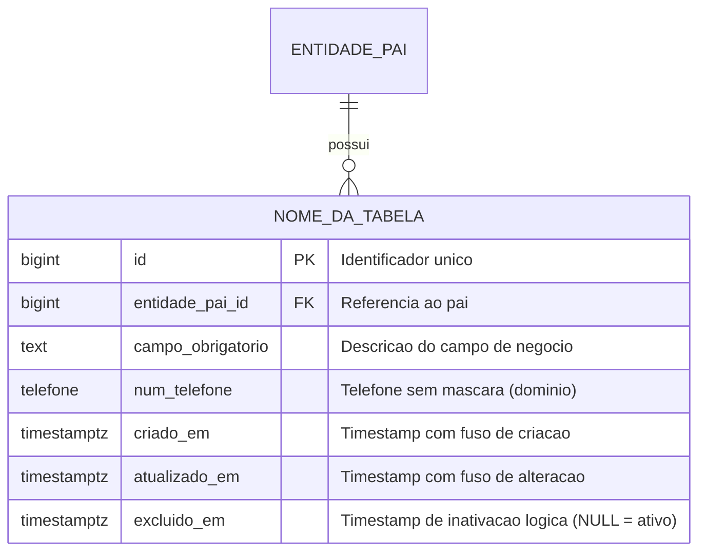

# Delta do Modelo de Dados: [Nome da Funcionalidade]

> **ID da Spec:** `SPEC-XXX`  
> **Status:** [Planejado | Aprovado | Aplicado via Migration]  
> **Referência Funcional:** [spec.md](spec.md)  
> **Modelo Conceitual Global:** [domain-model.md](../../memory/domain-model.md)  
> **Foco:** **O que esta funcionalidade cria ou altera no banco de dados (Delta no Schema `amde_digital`)**

---

## 1. Mapeamento Conceitual ➔ Materialização Lógica

> Esta seção evidencia a derivação obrigatória do Modelo Conceitual (`domain-model.md`) para o Modelo Lógico PostgreSQL 18, garantindo rastreabilidade e prevenindo divergências silenciosas.

| Elemento Conceitual (DER) | Materialização Lógica (Tabela / Coluna / Constraint) | Alocação da Regra (Banco vs. Aplicação) | Justificativa / Rastreabilidade |
|---|---|---|---|
| `[Ex: ENTIDADE_A]` | Tabela `amde_digital.entidade_a` (PK `id bigint generated always as identity`, `pk_entidade_a`) | Banco de Dados | Derivada de `domain-model.md` para atender ao RF-01 |
| `[Ex: Relacionamento A ➔ B]` | Coluna `entidade_a_id bigint not null`, FK `fk_entidade_b_entidade_a` + índice `ix_entidade_b_entidade_a` | Banco de Dados | Chave estrangeira explícita com índice criado imediatamente após |
| `[Ex: Unicidade entre ativos]` | Índice único parcial `uq_entidade_a_campo_ativo` (`WHERE excluido_em IS NULL`) | Banco de Dados | Garante unicidade apenas para registros ativos |
| `[Ex: Restrição de Conflito]` | Consulta temporal com bloqueio transacional | Aplicação (Service / Repository) | Regra RN-XX validada via código antes do `INSERT` |

---

## 2. Origem das Decisões do Modelo

- **Definido explicitamente na Spec:** [Liste os atributos e regras extraídos diretamente do `spec.md`, incluindo classificação LGPD e quais campos são opcionais]
- **Derivado das convenções da Constituição:** [Ex.: Schema `amde_digital`, PK `id bigint generated always as identity`, colunas `criado_em`/`atualizado_em` com trigger `tg_<tabela>_atualizado_em`, `text` + `CHECK` ou domínios (`telefone`, `cpf`, `cep`), soft delete via `excluido_em timestamptz`]
- **Suposições da IA com Justificativa:** [Liste qualquer limite de `CHECK` ou índice sugerido pela IA para validação humana]

---

## 3. Resumo e Diagrama do Delta

### 3.1. Resumo das Alterações
| Tipo de Operação | Objeto / Tabela | Modificação Detalhada |
|---|---|---|
| `CREATE TABLE` / `ALTER TABLE` | `amde_digital.nome_da_tabela` | [Novas colunas, constraints `pk_`/`fk_`/`uq_`/`ck_`, índices `ix_`, triggers `tg_` e `COMMENT ON`] |

### 3.2. Diagrama do Delta em Mermaid


---

## 4. Dicionário de Dados do Delta

### Tabela: `amde_digital.nome_da_tabela`

> **Política de Ciclo de Vida:** [Documentar se utiliza soft delete via `excluido_em` ou se é tabela de domínio/imutável]

| Coluna | Tipo SQL (PG 18) | Nulo? | Padrão | Restrições / Chaves | Descrição / Classificação LGPD e Justificativa de Nulabilidade |
|---|---|---|---|---|---|
| `id` | `bigint generated always as identity` | Não | Identity | `pk_nome_da_tabela` | Identificador único |
| `entidade_pai_id` | `bigint` | Não | — | `fk_nome_da_tabela_entidade_pai`, `ix_nome_da_tabela_entidade_pai` | Vínculo com `entidade_pai` |
| `campo_obrigatorio` | `text` | Não | — | `ck_nome_da_tabela_campo`, `uq_nome_da_tabela_campo_ativo` | `[LGPD: pessoal]` Dado de negócio com justificativa de uso |
| `num_telefone` | `telefone` | Sim | — | Domínio `telefone` | `[LGPD: pessoal]` Telefone sem máscara. **Anulável** porque [...] |
| `criado_em` | `timestamptz` | Não | `now()` | — | Auditoria temporal de criação |
| `atualizado_em` | `timestamptz` | Não | `now()` | Trigger `tg_nome_da_tabela_atualizado_em` | Auditoria temporal de alteração |
| `excluido_em` | `timestamptz` | Sim | `NULL` | — | Data/hora de inativação lógica. **Anulável** pois `NULL` indica registro ativo |

---

## 5. Scripts de Migração Incremental (Liquibase / SQL Formatado)

### 5.1. Migração UP (Aplicação do Esquema pela role `amde_digital_owner`)
```sql
--liquibase formatted sql
--changeset equipe:SPEC-XXX-01-criar-nome-da-tabela splitStatements:false

set search_path = amde_digital, public;

-- 1. Domínios (quando novos forem necessários) -------------------------
-- create domain exemplo_dominio as text check (value ~ '^[0-9]+$');

-- 2. Tabelas ----------------------------------------------------------
create table nome_da_tabela (
    id bigint generated always as identity,
    entidade_pai_id bigint not null,
    campo_obrigatorio text not null,
    num_telefone telefone,
    criado_em timestamptz not null default now(),
    atualizado_em timestamptz not null default now(),
    excluido_em timestamptz,
    constraint pk_nome_da_tabela primary key (id),
    constraint ck_nome_da_tabela_campo
        check (char_length(trim(campo_obrigatorio)) between 2 and 150)
);

-- 3. FKs e seus índices -----------------------------------------------
alter table nome_da_tabela
    add constraint fk_nome_da_tabela_entidade_pai
    foreign key (entidade_pai_id) references entidade_pai (id);
create index ix_nome_da_tabela_entidade_pai
    on nome_da_tabela (entidade_pai_id);

-- 4. Demais índices ---------------------------------------------------
create unique index uq_nome_da_tabela_campo_ativo
    on nome_da_tabela (lower(campo_obrigatorio))
    where excluido_em is null;

-- 5. Auditoria --------------------------------------------------------
create trigger tg_nome_da_tabela_atualizado_em
    before update on nome_da_tabela
    for each row execute function definir_atualizado_em();

-- 6. Comentários ------------------------------------------------------
comment on table nome_da_tabela is
    'Descricao da tabela. Adota soft delete via excluido_em (NULL = ativo; NOT NULL = inativado logicamente).';
comment on column nome_da_tabela.campo_obrigatorio is
    '[LGPD: pessoal] Justificativa de uso do dado no fluxo da AMDE.';
comment on column nome_da_tabela.num_telefone is
    '[LGPD: pessoal] Telefone com DDD, apenas digitos. Anulavel porque [...]';
comment on column nome_da_tabela.excluido_em is
    'Data e hora da inativacao logica. Anulavel pois permanece NULL enquanto ativo.';

--rollback drop table if exists amde_digital.nome_da_tabela cascade;
```

### 5.2. Validação Automática Obrigatória
Antes de aprovar a migration:
1. Executar `sqlfluff lint --dialect postgres <arquivo-migration>.sql` (sem erros de formatação ou estilo).
2. Executar `data/verificacao.sql` no banco local garantindo **zero linhas retornadas** nas 7 verificações estruturais.
3. Conferir a consulta de inventário `[LGPD: ...]` em `data/verificacao.sql`.

---

## 6. Dados Sintéticos para Testes e Validação (Seeds)

> **Atenção:** Seeds ficam em arquivos separados das migrations estruturais e utilizam exclusivamente massas sintéticas (nunca dados reais da AMDE).

```sql
-- Massa de dados fictícia respeitando estritamente a LGPD
set search_path = amde_digital, public;

insert into nome_da_tabela (entidade_pai_id, campo_obrigatorio, num_telefone)
values (1, 'amostra.sintetica@amde.org.br', '15999990001');
```
