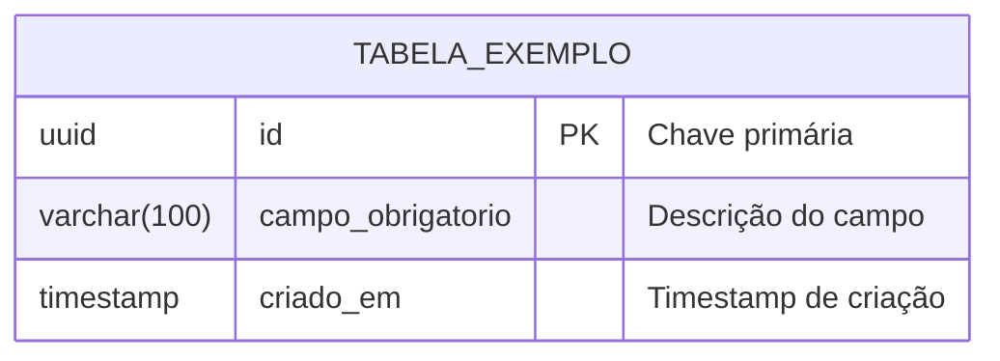

# Delta do Modelo de Dados: [Nome da Funcionalidade]

> **ID da Spec:** `SPEC-XXX`  
> **Status:** [Rascunho | Aprovado | Aplicado]  
> **Foco:** **O que esta funcionalidade cria ou altera (Delta)**  
> **Modelo Global:** Relacionado com [domain-model.md](../../memory/domain-model.md)

---

## 1. Resumo do Delta

Descreva sucintamente quais objetos de banco de dados são impactados por esta especificação.

| Tipo de Alteração | Objeto / Tabela | Descrição da Modificação |
|---|---|---|
| **Criação / Alteração / Exclusão** | `nome_da_tabela` | [Resumo da mudança, novos campos ou constraints] |

---

## 2. Diagrama do Delta



---

## 3. Dicionário de Dados do Delta

### Tabela: `nome_da_tabela`

| Coluna | Tipo | Nulo? | Padrão | Restrições / Chaves | Descrição |
|---|---|---|---|---|---|
| `id` | `UUID` | Não | `gen_random_uuid()` | PK | Identificador único |
| `exemplo_coluna` | `VARCHAR(100)` | Não | - | `UNIQUE` | Explicação da regra e conteúdo |
| `criado_em` | `TIMESTAMP` | Não | `CURRENT_TIMESTAMP` | - | Data de registro |

---

## 4. Scripts de Migração (SQL DDL)

### 4.1. Migração UP (Aplicação)
```sql
-- Script de migração para criar/alterar tabelas
CREATE TABLE IF NOT EXISTS tabela_exemplo (
    id VARCHAR(36) PRIMARY KEY,
    exemplo_coluna VARCHAR(100) NOT NULL,
    criado_em TIMESTAMP NOT NULL DEFAULT CURRENT_TIMESTAMP
);
```

### 4.2. Migração DOWN (Rollback)
```sql
-- Script para reverter as alterações com segurança
DROP TABLE IF EXISTS tabela_exemplo;
```

---

## 5. Massa de Dados Sintética para Testes (Seeds)

```sql
-- Inserções com dados fictícios para validação em ambiente local
INSERT INTO tabela_exemplo (id, exemplo_coluna)
VALUES ('b0000000-0000-0000-0000-000000000001', 'Exemplo sintético de teste');
```
