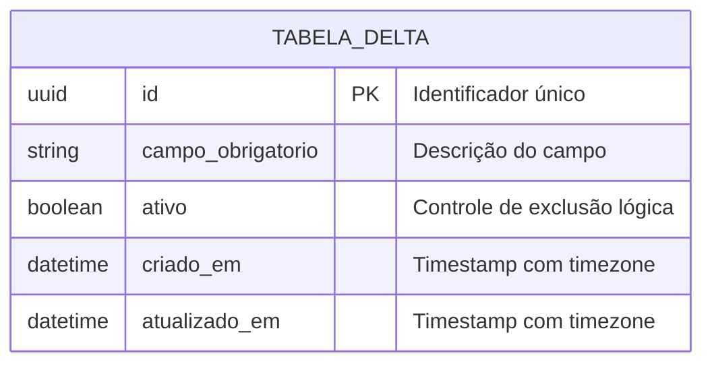

# Delta do Modelo de Dados: [Nome da Funcionalidade]

> **ID da Spec:** `SPEC-XXX`  
> **Status:** [Planejado | Aprovado | Aplicado via Migration]  
> **Referência Funcional:** [spec.md](spec.md)  
> **Modelo Conceitual Global:** [domain-model.md](../../memory/domain-model.md)  
> **Foco:** **O que esta funcionalidade cria ou altera no banco de dados (Delta)**

---

## 1. Mapeamento Conceitual ➔ Materialização Lógica

> Esta seção evidencia a derivação obrigatória do Modelo Conceitual (`domain-model.md`) para o Modelo Lógico, garantindo rastreabilidade e prevenindo divergências silenciosas.

| Elemento Conceitual (DER) | Materialização Lógica (Tabela / Coluna / Constraint) | Alocação da Regra (Banco vs. Aplicação) | Justificativa / Rastreabilidade |
|---|---|---|---|
| `[Ex: ENTIDADE_A]` | Tabela `entidade_a` (PK `id UUID`) | Banco de Dados | Derivada de `domain-model.md` para atender ao RF-01 |
| `[Ex: Relacionamento A ➔ B]` | Coluna `entidade_a_id UUID FK` | Banco de Dados | Chave estrangeira com índice de busca |
| `[Ex: Restrição de Conflito]` | Consulta temporal com bloqueio transacional | Aplicação (Service / Repository) | Regra RN-XX validada via código antes do `INSERT` |

---

## 2. Origem das Decisões do Modelo

- **Definido explicitamente na Spec:** [Liste os atributos e regras extraídos diretamente do `spec.md`]
- **Derivado das convenções da Constituição:** [Ex.: Chaves primárias, colunas `criado_em`/`atualizado_em`, convenção `snake_case`, soft delete]
- **Suposições da IA com Justificativa:** [Liste qualquer tipo de dado ou tamanho sugerido pela IA para validação humana]

---

## 3. Resumo e Diagrama do Delta

### 3.1. Resumo das Alterações
| Tipo de Operação | Objeto / Tabela | Modificação Detalhada |
|---|---|---|
| `CREATE TABLE` / `ALTER TABLE` | `nome_da_tabela` | [Novas colunas, constraints `UNIQUE`, índices ou foreign keys] |

### 3.2. Diagrama do Delta em Mermaid


---

## 4. Dicionário de Dados do Delta

### Tabela: `nome_da_tabela`

| Coluna | Tipo SQL | Nulo? | Padrão | Restrições / Chaves | Descrição / Sensibilidade LGPD |
|---|---|---|---|---|---|
| `id` | `INTEGER` / `UUID` | Não | Auto / Random | `PK` | Identificador único |
| `exemplo_campo` | `VARCHAR(150)` | Não | - | `UNIQUE` | E-mail ou dado de negócio |
| `ativo` | `BOOLEAN` | Não | `TRUE` | - | Flag para soft delete |
| `criado_em` | `TIMESTAMPTZ` | Não | `CURRENT_TIMESTAMP` | - | Auditoria temporal de criação |
| `atualizado_em` | `TIMESTAMPTZ` | Não | `CURRENT_TIMESTAMP` | - | Auditoria temporal de alteração |

---

## 5. Scripts de Migração Incremental (Liquibase / SQL)

### 5.1. Migração UP (Aplicação do Esquema)
```sql
-- Liquibase formatted SQL
-- changeset equipe:SPEC-XXX-01-criar-tabela-delta
CREATE TABLE IF NOT EXISTS nome_da_tabela (
    id SERIAL PRIMARY KEY,
    exemplo_campo VARCHAR(150) NOT NULL,
    ativo BOOLEAN NOT NULL DEFAULT TRUE,
    criado_em TIMESTAMP WITH TIME ZONE NOT NULL DEFAULT CURRENT_TIMESTAMP,
    atualizado_em TIMESTAMP WITH TIME ZONE NOT NULL DEFAULT CURRENT_TIMESTAMP,
    CONSTRAINT uk_exemplo_campo UNIQUE (exemplo_campo)
);

CREATE INDEX IF NOT EXISTS idx_nome_tabela_busca ON nome_da_tabela(exemplo_campo);
```

### 5.2. Migração DOWN (Reversão / Rollback Seguro)
```sql
-- rollback DROP TABLE IF EXISTS nome_da_tabela CASCADE;
```

---

## 6. Dados Sintéticos para Testes e Validação (Seeds)

```sql
-- Massa de dados fictícia respeitando estritamente a LGPD
INSERT INTO nome_da_tabela (id, exemplo_campo, ativo)
VALUES (1, 'amostra.sintetica@amde.org.br', TRUE);
```
