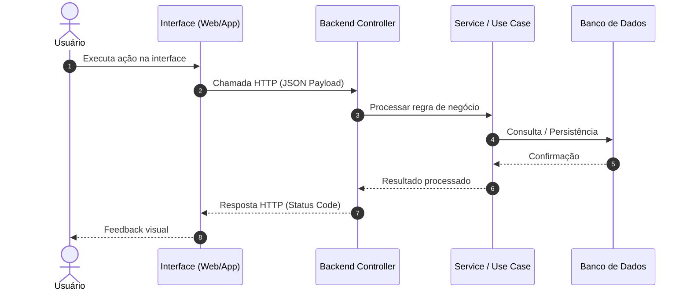

# Plano Técnico de Implementação: [Nome da Funcionalidade]

> **ID da Spec:** `SPEC-XXX`  
> **Status:** [Planejamento | Aprovado | Em Implementação | Concluído]  
> **Referência Funcional:** [spec.md](spec.md)  
> **Foco:** **Como** (Arquitetura, Decisões de Engenharia, Fluxos e Testes)

---

## 1. Visão Técnica Geral

[Resumo da abordagem técnica escolhida para implementar esta funcionalidade respeitando as diretrizes de `.specify/memory/constitution.md`.]

---

## 2. Componentes e Camadas Impactadas

| Camada / Componente | Responsabilidade Técnica |
|---|---|
| **Frontend / Web** | [Componentes de interface, estados, validações cliente] |
| **Mobile** | [Telas, fluxos e consumo de API] |
| **Backend — Controller / Rotas** | [Endpoints expostos, validações de requisição] |
| **Backend — Serviços / Use Cases**| [Lógica de negócio e orquestração] |
| **Backend — Repositório** | [Queries, persistência e transações] |
| **Banco de Dados** | [Migrações e índices definidos no data-model.md] |

---

## 3. Diagrama de Fluxo / Sequência

---

## 4. Endpoints e Contratos

- **Arquivo de Contrato:** [`contracts/api-contract.yaml`](contracts/api-contract.yaml)
- **Rotas envolvidas:**
  - `MÉTODO /api/v1/recurso`: [Descrição]

---

## 5. Estratégia de Validação e Segurança

- [Validações de entrada de dados, sanitização contra XSS e SQL Injection]
- [Autenticação, autorização (RBAC) e tratamento de dados sensíveis (LGPD)]

---

## 6. Estratégia de Testes

1. **Testes Unitários:** [Quais regras e classes serão isoladas para teste]
2. **Testes de Integração:** [Quais endpoints ou fluxos com banco de dados serão verificados]
3. **Testes E2E / Validação dos Critérios de Aceite:** [Cenários do spec.md que serão validados]

---

## 7. Definição de Pronto (Definition of Done - DoD)

- [ ] Contratos de API documentados e validados.
- [ ] Migrações de dados executadas sem erros.
- [ ] Código implementado conforme padrões da Constituição.
- [ ] Testes unitários e de integração passando com cobertura adequada.
- [ ] Critérios de aceite validados.
- [ ] Documentação e checklist de tarefas atualizados.
