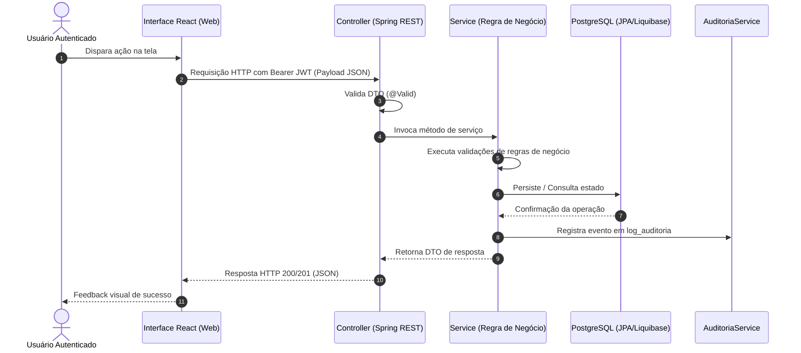

# Plano Técnico de Implementação: [Nome da Funcionalidade]

> **ID da Spec:** `SPEC-XXX`  
> **Status:** [Planejamento | Aprovado | Em Implementação | Concluído]  
> **Referência Funcional:** [spec.md](spec.md)  
> **Delta de Banco de Dados:** [data-model.md](data-model.md)  
> **Foco:** **Como** (Arquitetura, Decisões de Engenharia, Interfaces, Segurança e Testes)

---

## 1. Visão Técnica Geral e Abordagem

[Resumo da abordagem técnica escolhida para implementar esta funcionalidade respeitando as diretrizes de [constitution.md](../../memory/constitution.md) e a arquitetura Java/Spring Boot + React.]

---

## 2. Metas Técnicas Derivadas dos RNFs

| ID RNF (Origem Spec) | Meta Técnica Quantificável | Decisão de Arquitetura / Solução Técnica |
|---|---|---|
| **RNF-01** | Tempo de resposta p95 < 500ms em consultas padrão | Índice no PostgreSQL + Projeção DTO otimizada via Spring Data JPA |
| **RNF-02** | Rastreabilidade e conformidade LGPD | Interceptor/Aspect chamando `AuditoriaService.registrarLog` de forma assíncrona |
| **RNF-03** | Limite rígido de upload (10MB / PDF) | Validação multipart no Controller e conferência de Magic Bytes (`%PDF`) |

---

## 3. Componentes e Camadas Impactadas

| Camada / Módulo | Componentes Impactados | Responsabilidade Técnica |
|---|---|---|
| **Front-end Web (React/Vite)** | Telas e componentes em `frontend/` | Formulários, validações React Hook Form, estados e chamadas Axios |
| **API Controller** | `@RestController` em Spring Boot | Endpoints REST, tratamento de DTOs de entrada e HTTP status codes |
| **Serviço / Caso de Uso** | `@Service` de negócio | Orquestração das regras de domínio (RN01 a RN16) e transações `@Transactional` |
| **Repositório / Persistência** | `@Repository` Spring Data JPA | Consultas, buscas indexadas e integridade referencial |
| **Banco de Dados (PostgreSQL)** | Scripts de schema Liquibase | Tabelas, colunas, chaves primárias e estrangeiras definidas no `data-model.md` |
| **Auditoria e Logs** | `AuditoriaService` | Persistência do evento em `log_auditoria` sem expor dados sensíveis |

---

## 4. Diagrama de Sequência da Solução

---

## 5. Plano de Interface e Componentes (UI Plan)

- **Rota da Aplicação:** `/exemplo/caminho`
- **Componentes Base (Shadcn/ui + Tailwind):** `Button`, `Table`, `Dialog`, `Input`, `Badge` (consumindo [`design/tokens.json`](../../../design/tokens.json)).
- **Comportamento por Estado:**
  - *Carregando:* Esqueleto de tabela (`Skeleton`) ocupando o container principal.
  - *Vazio:* Ilustração com mensagem orientativa e botão para criar o primeiro registro.
  - *Erro:* Banner de aviso com código amigável e botão "Tentar novamente".
  - *Sucesso:* Tabela populada com ações de visualização/edição/exclusão.
- **Proteção Visual de Dados Pessoais:** Aplicação de máscara em campos confidenciais conforme diretriz da LGPD.

---

## 6. Endpoints e Contratos de API

- **Arquivo de Contrato:** [`contracts/api-contract.yaml`](contracts/api-contract.yaml)
- **Rotas Envolvidas:**
  - `POST /api/...`: [Descrição da operação]
  - `GET /api/...`: [Descrição da busca]

---

## 7. Estratégia de Testes

1. **Testes Unitários (JUnit 5 + Mockito):** Isolamento da camada de serviço para checagem exaustiva das regras de negócio e validações de exceção.
2. **Testes de Integração (Spring Boot Test + Testcontainers):** Validação dos endpoints REST e persistência real no PostgreSQL.
3. **Testes de Aceitação BDD:** Execução automatizada validando todos os cenários estipulados no `spec.md`.

---

## 8. Definição de Pronto (Definition of Done - DoD)

- [ ] Contrato OpenAPI documentado e alinhado entre frontend e backend.
- [ ] Changelogs Liquibase testados com sucesso (UP e rollback).
- [ ] Implementação de regras de negócio aderente às diretrizes da Constituição.
- [ ] Log de auditoria disparado em operações sensíveis.
- [ ] Cobertura de testes unitários e de integração satisfatória.
- [ ] Cenários BDD do `spec.md` validados e aprovados.
- [ ] Telas acessíveis (WCAG 2.1 AA) e com estados obrigatórios implementados.
