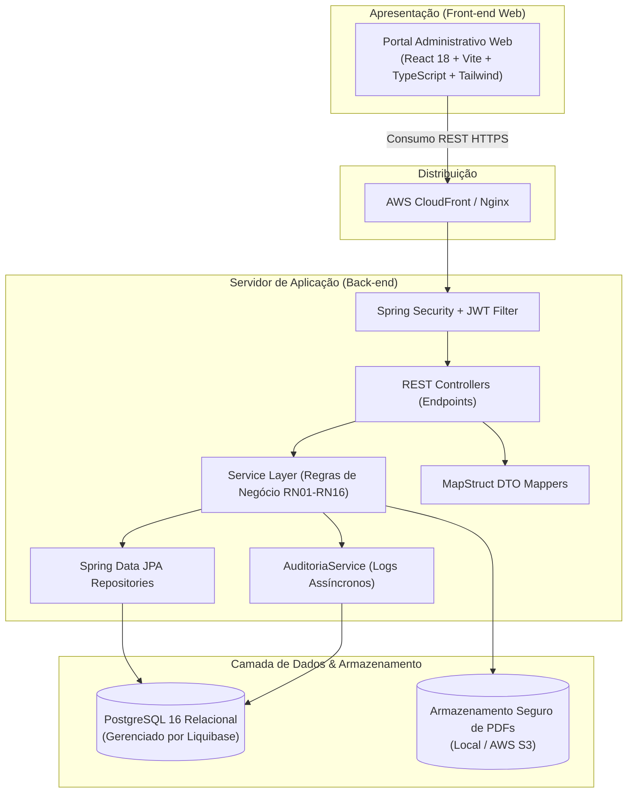

# Visão Arquitetural — AMDE Digital

> **Referência Acadêmica:** Capítulo 4.1 e 4.2 da Monografia  
> **Padrão:** Monólito Modular em Camadas com Front-end Desacoplado (SPA)  
> **Controle de Engenharia:** Spec-Driven Development ([`.specify/`](../../.specify/README.md))

---

## 1. Visão Geral da Arquitetura do Sistema

O **AMDE Digital** é estruturado segundo uma arquitetura monolítica modular no back-end (Spring Boot 3) e uma aplicação SPA (Single Page Application) em React/TypeScript no front-end, conteinerizada via Docker e preparada para nuvem (AWS).

<b>Fonte:</b> Autores (Monografia AMDE Digital / Fatec Sorocaba).

---

## 2. Componentes e Responsabilidades

| Camada / Componente | Tecnologias | Responsabilidade Técnica |
|---|---|---|
| **Portal Web (Front-end)** | React, TypeScript, Vite, Tailwind CSS, Shadcn/ui, Axios | Interface responsiva, controle de rotas protegidas, validações de formulário e consumo das APIs REST. |
| **Segurança & Filtro JWT** | Spring Security 6, JWT (io.jsonwebtoken) | Autenticação stateless, interceptação de requisições, validação de tokens e autorização baseada em roles (`ADMINISTRADOR`, `MEDICO`, `PACIENTE`). |
| **Controllers REST** | Spring Web MVC | Exposição dos endpoints REST, validação de schemas de entrada (`@Valid`) e retorno de códigos HTTP adequados. |
| **Camada de Serviço** | Spring Boot Service (`@Service`) | Implementação das regras de negócio (RN01 a RN16), cálculos, orquestração e gerenciamento transacional (`@Transactional`). |
| **Camada de Acesso a Dados** | Spring Data JPA / Hibernate | Mapeamento objeto-relacional (ORM), consultas otimizadas e persistência no PostgreSQL. |
| **Controle de Esquema** | Liquibase | Versionamento estrito e rastreável do banco de dados através de changelogs incrementais. |
| **Armazenamento de Arquivos** | File Storage Service / AWS S3 | Upload com nomenclatura UUID segura em `uploads/prontuarios/paciente-{id}/{uuid}.pdf`. |
| **Auditoria e Logs** | Aspectos / AuditoriaService | Gravação de histórico de acessos a dados sensíveis clínicos em conformidade com LGPD e CFM nº 1.821/2007. |

---

## 3. Ambientes e Infraestrutura

- **Desenvolvimento Local:** Orquestração completa de banco e backend através de `docker-compose.yml`.
- **Integração e Entrega Contínua (CI/CD):** Pipeline no GitHub Actions executando build, testes automatizados e geração de imagens Docker.
- **Nuvem (AWS):** Banco relacional gerenciado e armazenamento seguro de prontuários via S3 com distribuição do front-end por CDN CloudFront.

