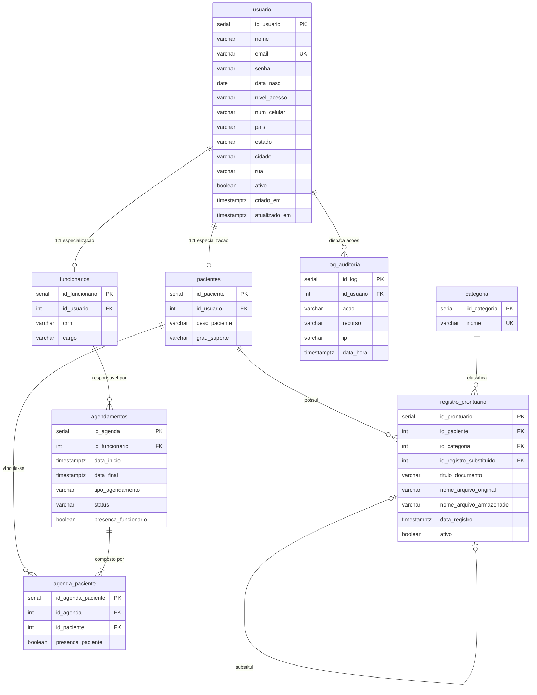

# Diagrama de Entidade-Relacionamento (DER) — AMDE Digital

> **Referência Acadêmica:** Capítulo 4.3 da Monografia  
> **Modelo Conceitual Global SDD:** [`.specify/memory/domain-model.md`](../../.specify/memory/domain-model.md)  
> **SGBD:** PostgreSQL 16 (Relacional ACID)

---

### Figura – Modelo de Entidade-Relacionamento do AMDE Digital

<b>Fonte:</b> Autores (Monografia AMDE Digital / Fatec Sorocaba).

---

### Descrição dos Relacionamentos

1. **`usuario` ➔ `funcionarios` / `pacientes` ($1:0..1$):** Especialização de perfil. Cada conta de usuário pode ser associada a no máximo um registro de funcionário ou de paciente.
2. **`pacientes` ➔ `registro_prontuario` ($1:N$):** Um paciente assistido possui zero ou múltiplos documentos clínicos arquivados no PEP.
3. **`categoria` ➔ `registro_prontuario` ($1:N$):** Toda ficha pertence a uma categoria pré-definida (Exames, Laudos, Receituário, Arquivado).
4. **`registro_prontuario` ➔ `registro_prontuario` ($0..1:0..1$):** Auto-relacionamento que permite versionar a substituição de documentos obsoletos.
5. **`funcionarios` ➔ `agendamentos` ($1:N$):** Cada compromisso na agenda clínica é conduzido por um profissional responsável.
6. **`agendamentos` ➔ `agenda_paciente` ➔ `pacientes` ($N:N$):** Tabela associativa que viabiliza o vínculo de pacientes às consultas e registra o comparecimento individual.

